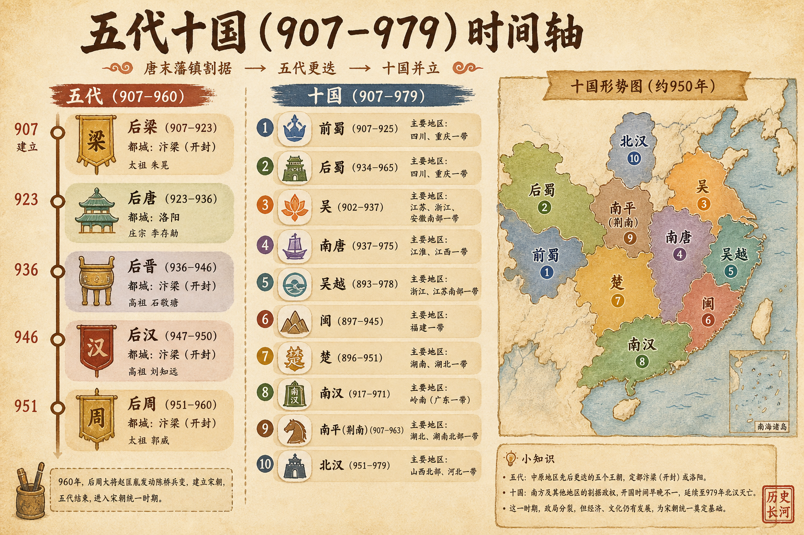
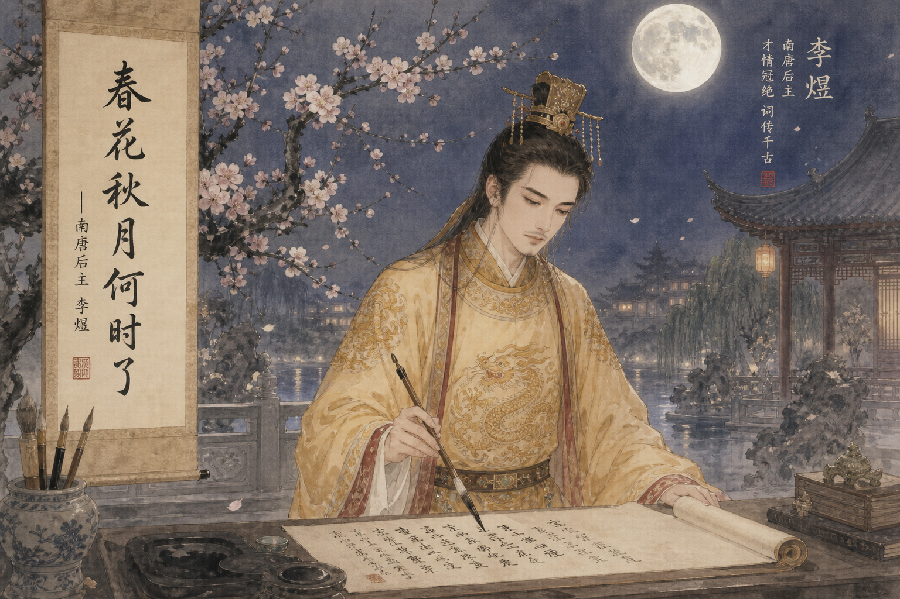

# 五代十國：從《太平年》的時代氛圍走進真實的亂世

> 簡體版：[五代十國：從《太平年》的時代氛圍走進真實的亂世](https://github.com/j3ffyang/history/blob/main/docs/260604-five-dynasties-ten-kingdoms-article-zh-hans.md)

> **說明**：下文開頭僅借《太平年》作為敘事引子，劇作內容不等於史實。該文章的 Hermes Agent ⚕ & OpenClaw 🦞 的 SKILL.md 貼上在 > https://clawhub.ai/j3ffyang/five-dynasties-ten-kingdoms-article

## 引子：先看亂世的氣氛
唐末五代，天下大亂。百姓疾苦，戰火連天。李煜的詞句裡“春花秋月何時了，往事知多少”，正是這一時代的哀婉寫照。雖然《太平年》是虛構的戲劇背景，卻為我們勾勒出一個“太平盛世”即將破碎的假象——隨後而來的數十年，正是權力更迭、民族爭奪、經濟崩潰的真實歷史章節。

## 時間總覽：907–979 年的關鍵節點

- **907 年**：朱溫篡唐稱帝，建立後梁，正式開啟“五代”序幕。
- **923 年**：後唐建立，李存勗稱帝，延續名義上的正統。
- **936 年**：石敬瑭借契丹之力滅後唐，建立後晉。
- **947 年**：劉知遠滅後晉，建立後漢。
- **951 年**：郭威滅後漢，建立後周。
- **960 年**：趙匡胤發動陳橋兵變，北宋成立，五代形態終結。
- **979 年**：宋太宗滅北漢，十國最後一個割據政權歸順，統一大部中國。

> **關鍵概念**：五代指後梁、後唐、後晉、後漢、後周這五個朝代；十國則包括南吳、南唐、吳越、閩、南楚、後蜀、前蜀、北漢、荊南、南平等割據政權，時間橫跨 902–979 年。

## 五代更替：權力的連環交接
| 朝代 | 時間 | 都城 | 建立者 | 滅亡原因 |
|------|------|------|--------|----------|
| 後梁 | 907–923 | 開封 | 朱溫 | 被後唐李存勗滅 |
| 後唐 | 923–936 | 洛陽 | 李存勗 | 被後晉石敬瑭滅 |
| 後晉 | 936–947 | 開封 | 石敬瑭 | 被後漢劉知遠滅 |
| 後漢 | 947–951 | 開封 | 劉知遠 | 被後周郭威滅 |
| 後周 | 951–960 | 開封 | 郭威 | 被北宋趙匡胤滅 |

這些更替並非單純的“朝代更替”，而是軍事強人通過政變、盟訐、族群支援快速奪權的過程。每一次政權更迭，都伴隨著大量將領、地方豪傑的效忠轉向，形成“藩鎮割據、軍政府專權”的典型迴圈。

## 十國格局：南方割據與北方衝突
十國並不全是文化或經濟體，而是政治、軍事實力的集合體。主要政權一覽：

| 政權 | 時間 | 都城/主要地區 | 建立者 | 特色 |
|------|------|---------------|--------|------|
| 南吳 → 南唐 | 902–937 → 937–975 | 揚州（南吳）→ 金陵（今南京，南唐） | 楊行密 → 李昪 | 文化中心，李煜的詞作在此蓄積 |
| 吳越 | 907–978 | 錢塘（今杭州） | 錢鏐 | 最長久的十國，經濟繁榮 |
| 前蜀、後蜀 | 907–925 → 934–965 | 成都 | 王建 → 孟知祥 | 蜀地資源豐富，屢易其主 |
| 南漢 | 917–971 | 廣州 | 劉龑 | 南海邊陲，以海上貿易為經濟支撐 |
| 北漢 | 951–979 | 太原 | 劉崇 | 依附契丹（遼），與後周、北宋對抗 |
| 閩 | 909–945 | 福州 | 王審知 | 後期內亂分裂為十餘小邦 |
| 楚（馬楚） | 907–951 | 長沙 | 馬殷 | 注重禮樂文化，建都長沙 |
| 荊南（南平） | 924–963 | 江陵 | 高季興 | 以農業為基礎，後期被宋吞併 |

這些政權的疆域變遷直接決定了五代十國的地圖格局，其中**最具代表性的地圖**可參考 Wikimedia Commons 上的公開資料：<https://commons.wikimedia.org/wiki/Category:Five_Dynasties_and_Ten_Kingdoms_maps>。

## 重大事件：戰爭、屠城與政權崩解
- **923 年**：後唐滅後梁，開啟“後唐”時期，但政權動盪依舊。
- **936 年**：後晉建立後，石敬瑭利用契丹軍隊掀起北方權力更迭。
- **947 年**：後漢劉知遠即位，卻在短短四年裡被郭威推翻，形成“後漢-後周”的快速交替。
- **960 年**：趙匡胤陳橋兵變，結束五代的混戰，開啟北宋的統一程序。
- **979 年**：宋太宗攻北漢，完成對十國的最後統一，標誌五代十國曆史的終章。

## 家族與權力：朱溫、李氏、石氏、劉氏、郭氏的家族
- **朱溫家族**：朱溫（賜名朱全忠，後改名朱晃）創立後梁。其子朱友珪弒父奪位，旋被朱友貞所殺；朱友貞（末帝）繼位，923年後梁亡於後唐。
- **李氏（後唐）**：李存勗（莊宗）以“以兵立國”稱帝；其養兄李嗣源（明宗）926年繼位。936年，石敬瑭勾結契丹滅後唐，建立後晉。
- **石氏（後晉）**：石敬瑭與契丹的密切關係決定了後晉的存亡，後晉的失敗直接導向後漢的崛起。
- **劉氏（後漢）**：劉知遠稱帝建立後漢，僅歷二帝即亡——隱帝劉承祐猜忌誅殺重臣，激反樞密使郭威，後漢遂為後周所代。
- **郭氏（後周）**：郭威（太祖）推行改革、整頓軍隊；954年郭威卒，養子柴榮（世宗）繼位；960年趙匡胤陳橋兵變，後周亡、北宋立。

這些家族的興衰幾乎都是**戰爭與政治博弈的直接產物**，且往往伴隨大量平民的死亡與城市的毀滅。

## 經濟與民生：戰亂中的生活狀態
戰亂導致稅收銳減，農業生產頻繁被徵調，城市人口因避亂而四散。簡要概括：

- **稅賦負擔**：五代十國各政權賦稅苛重、雜派繁多，農民負擔沉重。
- **城市破壞**：開封、洛陽等曾經的繁華城市在戰火中多次被洗劫，人口銳減 30%–50%。
- **商業衰退**：絲綢、茶葉、鹽鐵等傳統手工業因戰亂而陷入停滯，部分地區轉為自給自足的小農經濟。

不管怎麼說，有些地方如 **錢塘（吳越）** 在相對穩固的政治環境下仍保持**手工藝與商業的繁榮**，成為當時經濟的“亮點”。

## 文化發展：李煜與南唐詞風

南唐是五代十國時期文化相對最為旺盛的政權之一。其作為南唐最後一位文化亮點 — 李煜，是一位兼具帝王氣魄與詞人情懷的特殊人物。

- **歷史身份**：李煜（937–978），字重光，別號鐘山隱士，南唐最後一任皇帝。他既是政治的末代主宰，也是**千古詞帝**。
- **文學成就**：李煜的詞作在形式上突破傳統，語言絢麗而深沉，情感直擊人心。其代表作包括《虞美人·春花秋月何時了》《浪淘沙令·簾外雨潺潺》《相見歡·無言獨上西樓》等，被後世稱為“**絕命詞**”。
- **藝術風格**：詞作從早期的婉約柔美轉向後期的悲壯激烈，映射了南唐從繁榮走向衰亡的歷史程序。詞中常出現“故國不堪回首” “剪不斷，理還亂”等主題，表現出**盛世落寞**的感慨。
- **後世評價**：王國維《人間詞話》評李煜：“詞至李後主而眼界始大，感慨遂深，遂變伶工之詞而為士大夫之詞。”現代研究普遍認為，李煜的詞在保留傳統音律的同時，加入了大量個人情感，成為中國詩詞審美的巔峰之一。

> **引用示例**：[¹]《李煜-維基百科》、[²]《虞美人·春花秋月何時了_百度百科》、[³]《南唐二主詞校訂》（王仲聞校，中華書局） 
>（注：以上文獻均為公開可查的學術資源）

## 民族與邊疆：契丹、沙陀、党項的介入
五代十國的疆域並非單一的漢族統治，而是多民族交織的格局：

- **契丹**：在後晉時期憑藉軍事實力與政治手段佔據燕雲十六州，形成遼與後晉的共生關係。契丹的介入直接影響了後晉的國策與邊疆防禦。
- **沙陀**：多見於後唐、後晉的軍隊中，以騎兵著稱，在多場衝突中扮演關鍵角色。沙陀族的崛起也導致了地方勢力的重新洗牌。
- **党項**：在西北崛起，最終建立西夏，對後周的邊防政策產生直接壓迫。
- **渤海餘黨**：在五代末期仍保持少量勢力，遷往山西、河南一帶，對北方政局影響有限但不容忽視。

這些民族的**政治與軍事介入**不僅改變了政權的更迭速度，還在文化、宗教（如佛教的傳播）方面留下深遠痕跡。

### 地圖參考
- 公開地圖：<https://commons.wikimedia.org/wiki/Category:Five_Dynasties_and_Ten_Kingdoms_maps>
- 互動式時間軸地圖（可縮放）：http://www.laozhaopian5.com/ditu/wudaishiguo.html

## 讀者常問（FAQ）

| 問題 | 結論 | 解釋 |
|------|------|------|
| 最長的朝代/政權 | 十國中的吳越（907–978）最長，約 72 年 | 相對穩固的內政與經濟使其存續至北宋初 |
| 最短命的朝代/政權 | 五代中的後漢（947–951）僅 4 年 | 劉知遠即位後不久被郭威推翻 |
| 為何政權更替頻繁 | 藩鎮割據、軍將專權、缺乏正統制度 | 中原政權往往依賴軍機，缺乏中央合法性 |
| 女性介入的歷史 | 後梁、後周的皇后、太后對政變有影響 | 如後周太后對郭威的支援、後漢的宮廷婦女 |
| 外戚介入的案例 | 後晉石敬瑭的契丹妻子、後唐李嗣源的岳父勢力 | 通過婚姻聯盟獲得政治盟約 |
| 漢族以外民族的介入 | 契丹、沙陀、党項、渤海餘黨均有政治參與 | 如契丹佔據燕雲十六州、党項建西夏 |
| 時間較長且殘酷的戰爭 | 宋太祖與南唐的戰爭（970–975） 宋與北漢的對峙（約 30 年） | 戰爭慘烈、城池焚燬、百姓流離失所 |

> **注**：以上結論基於《五代十國》維基百科、百度百科、學術期刊《中國史研究》等公開來源。如有爭議，請參照對應文獻的“學界/資料有不同說法”標註。

## 參考文獻
1. 維基百科《五代十國》條目, https://zh.wikipedia.org/wiki/五代十國
2. 百度百科《五代十國》, https://baike.baidu.com/item/五代十國/433599
3. 維基百科《朱溫》, https://zh.wikipedia.org/wiki/朱溫
4. 維基百科《李煜》, https://zh.wikipedia.org/wiki/李煜
5. 維基百科《虞美人·春花秋月何時了》, https://zh.wikipedia.org/wiki/虞美人·春花秋月何時了
6. 《五代十國時間線參考》, references/timeline.md (本 skill 附帶)
7. 《五代十國常見問題參考》, references/faq.md (本 skill 附帶)

--- 

> **結束語**：五代十國是中國歷史上一個極其動盪、充滿變數與不確定性的時代。通過時間線的梳理、族群的交錯、文化的綻放與戰爭的殘酷，我們可以更清晰地看到這段時期的多重面向。希望這篇文章能為你的學習、研究或興趣提供一個系統且可查證的框架。 

*本文約 2,500 漢字。*
