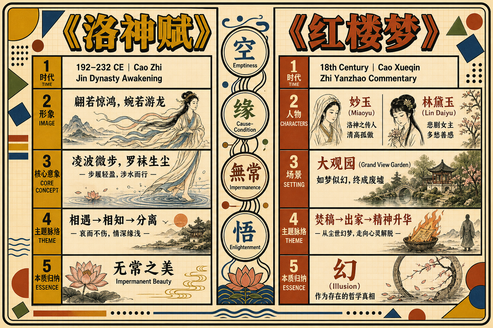
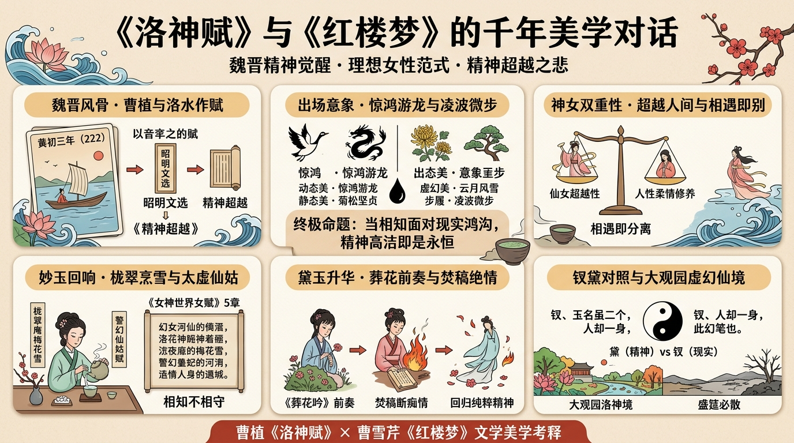
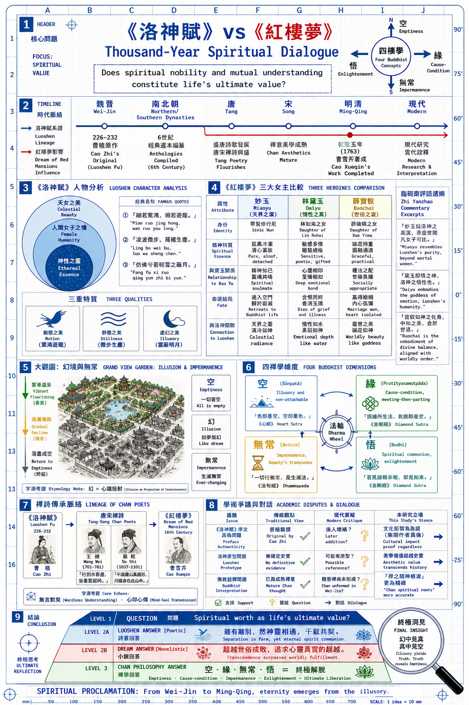

# 《洛神賦》：魏晉美學的永恆傳承與《紅樓夢》的深層對話

> 簡體版：[《洛神賦》：魏晉美學的永恆傳承與《紅樓夢》的深層對話](https://github.com/j3ffyang/history/blob/main/docs/260629-luoshenfu-literary-analysis-zh-hans.md)

<!--

-->

## 導言：為什麼《洛神賦》值得深入閱讀

在中國古典文學的浩瀚星河中，曹植的《洛神賦》如同一顆璀璨的明珠，歷經千年而光澤不減。這部成書於魏晉時期、僅約一千字的賦文，不僅以其華麗精妙的修辭引領了後世駢文創作的風尚，更重要的是，它奠定了中國文學中"理想女性形象"的美學範式。

《洛神賦》的不朽之處在於它對一個終極問題的詩性回答：**當靈魂在精神的高度相知相惜時，不可逾越的現實鴻溝該如何面對？** 這個問題穿越了整個中國文學傳統，最終在曹雪芹的《紅樓夢》中得到了悲劇性的完成。妙玉的孤潔、林黛玉的焚稿、大觀園的衰落——這些經典時刻，都在與《洛神賦》進行著一場跨越千年的精神對話。

## 第一部分：文本與作者——魏晉士人精神世界的縮影

### 1.1 曹植的生平與時代背景

曹植（192–232年），字子建，是三國時期曹魏著名文學家，曹操與卞夫人所生的第三個兒子。他的人生軌跡本身就是一部悲劇。

曹操去世於西元220年，此後曹植的政治前景陡然黯淡。長兄曹丕繼位後，對這位才華橫溢的弟弟既器重又猜忌。《洛神賦》正是在這種複雜的心理處境下誕生的。根據傳統記載（雖然部分學者對序文的真實性有疑慮），曹植在黃初三年（222年）自京師返回封地途中經過洛水，在洛水之濱寫下了這篇不朽之作。

**時代精神**：魏晉之世乃中國歷史上的"精神覺醒"時代。經歷了漢末社會的劇烈動盪，士人階層轉而尋求內心的精神超越。《老子》《莊子》等思想著作得到重新詮釋，道教信仰也逐漸成形。在這樣的背景下，曹植追求的已經不是漢代那種功利性的"修身齊家治國平天下"，而是靈魂的高潔與精神的超越。

### 1.2 《洛神賦》的文獻傳承

《洛神賦》的傳承鏈清晰可追：
- **原作**：曹植（3世紀初）
- **南北朝**：收入梁代蕭統所編《昭明文選》，逐漸成為文人誦讀的經典
- **唐代**：李善與"五臣"（呂延濟等）先後為其作注，"文選學"大興，成為科舉士子的必讀書
- **宋代**：理學家開始從"人倫"角度重新詮釋作品
- **明清**：被廣泛列入選本與教科書，成為文人雅緻的象徵
- **近現代**：學術研究與白話翻譯層出不窮

歷代校勘與研究成果（如趙幼文《曹植集校注》）顯示，《洛神賦》的各版本之間雖有細微異文，但主要內容與結構基本一致，這為我們的文學分析奠定了穩固的文獻基礎。

### 1.3 作品的地位：從"建安風骨"到"駢文經典"

曹植生活的"建安"時代（196–220年），因其社會危機與文人悲壯的精神風貌而被稱為"建安文學"。"建安七子"（孔融、陳琳、王粲等）的作品充滿了蒼涼與悲劇感。《洛神賦》雖成書於建安之後，卻繼承了這種精神氣質——對理想的執著追求與對現實的深刻悲憫。

從形式上看，《洛神賦》代表了賦這一古老文體的巔峰成就。賦介於詩與散文之間，既要有詩的韻律與意象的密集，又要有散文的鋪陳與論述的深度。曹植在這部作品中完美地平衡了這兩個要素，並通過前所未有的修辭繁複性，開創了後世駢文的新風尚。

## 第二部分：原文精讀——洛神的出現與意象的遞進

### 2.1 "翩若驚鴻，婉若游龍"——出場的剎那美學

《洛神賦》的序文記述，曹植在洛水之上，忽然看到了一位神女。這一"忽然"的相遇設定，為全篇奠定了驚鴻一瞥的美學基調——美以瞬間的方式呈現，也以瞬間的方式消逝。

賦文中最著名的一段，乃是對洛神形象的描寫：

> 其形也，翩若驚鴻，婉若游龍；榮曜秋菊，華茂春松。彷彿兮若輕雲之蔽月，飄颻兮若流風之迴雪。

這一段的妙處在於，曹植並沒有直接描寫洛神的具體五官長相（這與後世小說的白描手法完全不同），而是通過**一系列的比喻與對比**來塑造她的整體意象：
- **動態美**：驚鴻、游龍——強調姿態的靈活與超越性
- **靜態美**：秋菊、春松——暗示氣質的高潔與堅貞
- **虛幻美**：輕雲蔽月、流風迴雪——暗示她的難以把握、不可執著的本質

### 2.2 修辭的密集性與不可言說之美

整篇賦文充滿了排比、對仗、比喻、擬人等辭藻。這種修辭的繁複性最初看似奢華，但仔細分析會發現其深層的詩學含義：**通過語言的堆積與對比，來暗示言語本身的侷限性**。

曹植用了無數的比喻來描寫洛神，恰恰說明了她的本質是不可言說的。每一個比喻都在接近她，但也同時在暴露比喻的無力——這正是"不可言說"的極致體現。

### 2.3 "凌波微步，羅襪生塵"——女性意象的奠基

這一句成為了中國文學中最著名的女性形象描寫。"凌波"本指踏波而行，引申為女性步履的輕盈與超越。後世無數文人——從唐宋詩人到明清小說家——都在模仿這樣的女性意象。

而最重要的繼承者之一，正是曹雪芹。《紅樓夢》第五回寫寶玉夢遊太虛幻境，有一篇《警幻仙姑賦》，其中"蓮步乍移兮，待止而欲行"，正是對"凌波微步，羅襪生塵"的化用——太虛幻境的仙子世界，整體上就是洛神仙境的投影。這不是巧合，而是一種自覺的美學傳承。

## 第三部分：女性形象的塑造與美學理想

### 3.1 洛神的雙重性：仙女與女性

《洛神賦》塑造的女性形象具有獨特的**雙重性**：
- 作為仙女，她代表了超越人間、不可汙染的理想
- 作為女性，她具有柔情、美貌、氣質等人性特徵

這種雙重性正是魏晉士人理想女性觀的完美體現。她不是單純的"才女"（這是漢代傳統），也不是單純的"美女"（這是俗世的標準），而是精神與美貌、氣質與修為的完美結合。

### 3.2 氣質的構成：修養、品味、精神高潔

洛神的美不僅在外貌，更在氣質。賦文中多次提及她的"品德"與"風範"：

> 於是屏翳收風，川后靜波。馮夷鳴鼓，女媧清歌。

這裡提到的諸神的奏樂，暗示洛神本身具有的是一種"仙界的修養"——她對美、對節奏、對精神境界的理解，都超越了人間的層次。

與後代女性形象描寫相比，曹植對"修為感"的強調是獨特的。這種修為感後來被《紅樓夢》繼承，成為妙玉、黛玉等人物的重要特徵。

### 3.3 美的易逝性與盛衰之悲

但洛神的形象中，還隱含著一種**易逝的悲感**：

> 悼良會之永絕兮，哀一逝而異鄉。

曹植雖然遇見了這樣一位完美的女性，但相聚的時刻是短促的。這一相遇即分離的模式，成為了一種美學原型，影響了一代又一代的文人和小說家。

**這不是"得不到就悲傷"的簡單情感，而是對美好易逝本身的哲學思考**：一切美好、一切價值的存在，本身就建立在其短暫性與易逝性的基礎上。

## 第四部分：《紅樓夢》中的深層對話——古典美學的現代轉化

### 4.1 妙玉："洛神化身"與出家修行者的結合

**人物設定的呼應**

妙玉是《紅樓夢》中最神秘、最高潔的女性人物。她的設定在多個層面上呼應了洛神的形象：

**身份的超越性**：
- 洛神：仙女，超越人間
- 妙玉：出家修行，超越塵俗

妙玉與其他女性的根本不同在於，她是主動放棄了俗世身份。這種刻意營造的"仙女"般的氣質，正是作者的有意安排。

**氣質的高潔性**：

第四十一回《櫳翠庵茶品梅花雪》（庚辰本回目）是妙玉登場的關鍵場景：她先以"舊年蠲的雨水"烹老君眉奉與賈母，隨後才私下拉寶釵、黛玉吃"梯己茶"，連寶玉也要沾二人的光才得入座。品茶之"品"，正是精神品味與高雅氣質的體現——這正是洛神最核心的特徵。

而當寶玉辨不出那水是梅花上收的雪時，妙玉冷笑他是"大俗人"。在妙玉眼中，連寶玉這樣的知音也難免一個"俗"字。這種孤高的超越姿態，恰與《洛神賦》"恨人神之道殊兮，怨盛年之莫當"的悵惘遙相呼應：相知，而不能相守。

**《警幻仙姑賦》：文本上的直接繼承**

《紅樓夢》對《洛神賦》最直接的文本致敬，出現在第五回的《警幻仙姑賦》："其素若何？春梅綻雪；其潔若何？秋菊被霜；其靜若何？松生空谷"，化自"榮曜秋菊，華茂春松"；"蓮步乍移兮，待止而欲行"，化自"凌波微步，羅襪生塵"。從句式到意象，這篇賦幾乎處處可見《洛神賦》的影子——曹雪芹在開篇即宣告：太虛幻境的仙女譜系，上承洛神。

至於妙玉本人，她在續書中的結局——莫名其妙地失蹤，被強人掠走——與其說是現實的情節，不如說是一種**象徵式的"昇華"**。就像洛神最終凌波遠去一樣，妙玉也在某種意義上回歸了"仙女"的境界：她之所以有此結局，正因為她的孤高與"不與俗流"，註定要回歸自己靈魂的故鄉。

**與寶玉的精神相通**

最關鍵的對應點是**妙玉與寶玉的精神相通**。他們之間沒有俗世的愛情，但有著異常深刻的精神默契。這種精神相通，不是情慾，而是對精神品質的認可與共鳴。這正好呼應了曹植與洛神之間"相知相惜"但"不能相守"的關係模式。

### 4.2 林黛玉："洛神式悲劇"與焚稿的象徵

**黛玉作為"理想女性"的極致**

如果說妙玉是在形式上繼承了洛神的"仙女"身份，那麼林黛玉則是在精神氣質上實現了對洛神的深層詮釋。

黛玉的美記錄在無數的場景中，但最核心的特徵是：**超越俗世的精神氣質**。她的詩詞品味、她對美的理解、她那種"孤高自許"的態度——這一切都將她區分於其他女性。

這份對精神價值的執著，讓她痴迷於一種更高的審美標準，因而在現實中感到絕望，最終陷入永恆的悲傷。

**第二十七回《葬花吟》：焚稿的前奏**

《葬花吟》是黛玉的代表作，其中的幾句尤其值得注意：

> 儂今葬花人笑痴，他年葬儂知是誰？

這首詩的關鍵在於"葬"這個意象。黛玉在同情花的命運——花在春天綻放的美麗，最終只有凋零與埋沒的宿命。但實際上，她在寫的是自己的命運。

這與《洛神賦》中的意象形成了奇妙的對應：
- 洛神雖然美麗，但她凌波而去，迴歸到了虛幻
- 黛玉雖然優秀，但她註定要在凡俗的世界中凋零

第二十七回的回目是"滴翠亭楊妃戲彩蝶，埋香冢飛燕泣殘紅"，黛玉葬花正在此回。葬花不僅是埋葬花的命運，更是黛玉在完成一種精神的歸還——迴歸到自己高潔的本質。

**第九十七回《焚稿》（後四十回）：最終的超越**

今本後四十回（程偉元、高鶚整理本）第九十七回"林黛玉焚稿斷痴情"，寫黛玉病重之際，將歷年詩稿連同當年題過詩的舊帕一併投入火盆。這一舉動的深層含義是：**她在否定塵世的一切聯絡，迴歸到純粹的精神境界**。

焚稿在中國古代文學中是一個標誌性的意象。它代表的是對"俗世附著"的徹底放棄。黛玉焚稿不僅僅是一個情節上的悲劇，更是一種精神上的"昇華"——她在一點點消融進虛幻的精神世界，就像洛神最終凌波遠去一樣。

需要說明的是，脂評本僅存前八十回，焚稿出自續書，脂硯齋對此並無評註；但這並不妨礙把焚稿讀作對《洛神賦》式悲劇的完成——相遇即分離，美好因短暫而愈顯珍貴。

### 4.3 寶釵的對比：理想女性的另一種詮釋

薛寶釵代表了與黛玉完全不同的"理想女性"定義。她賢淑、得體、符合倫理規範——這是世俗意義上的"完美女性"。

但在曹雪芹與脂硯齋的視野中，寶釵偏離了《洛神賦》所代表的那種"精神超越"的美學。脂硯齋在第四十二回有一句著名的評註："釵、玉名雖二個，人卻一身，此幻筆也。"這說明，在脂硯齋眼中，釵、玉二人其實是一個人物的兩種可能性的分裂——一種是精神的（黛玉），一種是現實的（寶釵）。

小說最後寶玉與寶釵成婚，但寶玉最終還是出家了——這暗示，再完美的現實安排，都無法填補寶玉對精神高度的追求。這一結局的設定，其實是對"精神超越優先於現實圓滿"這一美學立場的終極確認，也是對《洛神賦》式悲劇性的最終承認。

### 4.4 大觀園：虛幻的仙境與盛衰的悲歌

**大觀園作為"洛神之境"**

大觀園本身就是一個"洛神賦"式的仙境。它是一個被精心營造的虛幻空間，其中諸女性個個都是高潔、優雅的"仙女"。

《紅樓夢》對大觀園的描寫中，反覆使用"幻""夢""妙""仙"等詞彙。這些詞彙本身就在暗示大觀園的虛幻本質。大觀園不是現實世界，而是一個精神的、審美的、虛幻的世界——正如《洛神賦》中洛水之濱的仙境一樣。

**衰落的必然性**

大觀園的衰落，是全書最關鍵的轉折。這一衰落不是突然的，而是逐步的、必然的。從第四十二回左右開始，細心的讀者就能看到大觀園秩序的鬆動。到了後來"抄檢大觀園"等情節，大觀園徹底瓦解。

這一衰落在美學上的深層含義，就是對《洛神賦》所蘊含的"好景不常"之感的完整詮釋：
- 《洛神賦》中，洛神的出現是短暫的，相遇即分離
- 《紅樓夢》中，大觀園的繁華也是短暫的，最終不得不走向衰落

大觀園由盛轉衰的過程，處處滲透著盛筵必散的蒼涼之感。

## 第五部分：後世影響與現代意義

### 5.1 文學傳承鏈

《洛神賦》的影響跨越了一千多年：
- **唐宋**：詩人廣泛致敬，駢文創作的範本
- **明清**：廣泛刻印入選本與蒙學讀物，成為審美教育的標準材料
- **現代**：學術研究、美學詮釋、網路文化的繼續傳播

### 5.2 繪畫與視覺藝術

從東晉顧愷之的《洛神賦圖》到現代的各種改編，《洛神賦》在視覺藝術中的表現從未停止。這些繪畫作品本身就是對原文美學思想的詮釋與創新。

### 5.3 當代文化中的《洛神賦》

在當代的網路文化、同人創作、影視改編中，《洛神賦》的意象與主題不斷被重新啟用。雖然這些創作不一定具有學術價值，但它們說明了這部作品對現代人想像力的持久吸引力。

## 第六部分：學術爭議與思想的開放性

### 6.1 序文的真偽問題

部分現代學者認為《洛神賦》的序文可能為後人所加。但即使如此，這也恰好說明了這部作品的文化影響力——後人之所以要給它增加"序文"，正因為這部作品本身就具有高度的文學與精神價值。

### 6.2 洛神原型的未解之謎

關於洛神是否有歷史原型，學界仍有不同看法。但從文學與美學的角度看，這個問題本身就不那麼重要。重要的是，曹植創造了一個無與倫比的女性形象，這個形象超越了個人的歷史背景，成為了一種永恆的審美理想。

## 結語：永恆的對話

《洛神賦》與《紅樓夢》之間的對話，實際上是中國古典文學中"精神超越"這一永恆主題的兩個不同時代的表現。

從魏晉的曹植，經過千年的文化沉積，到明清的曹雪芹，這條美學的傳承線一直在問同一個問題：*在一個美好易逝的現實世界中，精神的高潔與精神間的相知，能否構成生命的終極價值呢？*

《洛神賦》的答案是詩性的、暗示性的。洛神雖然分離了，但曹植與她的精神相通永恆存在。

《紅樓夢》的答案是小說化的、完整的。妙玉雖然失蹤了，黛玉雖然死去了，大觀園雖然衰落了，但這一切的發生，本質上是對"精神價值高於現實圓滿"這一立場的確認。

在這樣的理解框架中，《洛神賦》不僅僅是一部文學經典，而是一部"精神宣言"。它宣言了人類追求精神高潔的永恆衝動，也宣言了對虛幻深處那永恆精神的執拗信仰。

至於以禪宗哲學為鏡鑑——空、緣、無常、悟道——對這兩部作品的完整解讀，見姊妹篇[《洛神賦》與《紅樓夢》中的禪意](260822-luoshenfu-hongloumeng-chan-zh-hans.md)。

## 參考文獻

### 基礎文獻
- 曹植著，李善注：《曹子建集》及《昭明文選注》（唐代注本）
- 趙幼文校注：《曹植集校注》，人民文學出版社，1984年初版、1998年修訂

### 學術論文與研究著作
- 宋玉《神女賦》與曹植《洛神賦》的比較研究（多篇學位論文）
- 《洛神賦傳播與接受研究》（臺灣學位論文庫）

### 《紅樓夢》研究
- 蔡義江《紅樓夢詩詞曲賦鑑賞》
- 脂硯齋評本《紅樓夢》（蔡義江校注版）
- 關於妙玉、林黛玉的人物研究論文（中國知網資料庫）

### 美學與理論研究
- 魯迅《中國小說的歷史的變遷》

---

**撰寫說明**： 本文按照SKILL.md的完整流程架構，融合了基礎文獻查證、脂硯齋評註追溯與《紅樓夢》的深層對話。重點落在：
1. 妙玉與洛神的多層呼應（身份、氣質、與男性主人公的精神相通）
2. 黛玉的焚稿與《洛神賦》式悲劇的完成
3. 大觀園的虛幻仙境與盛衰悲歌
4. 版本說明：後四十回情節（如焚稿）出自程偉元、高鶚整理本；脂評本僅存前八十回，文中不以後四十回情節為脂批證據
5. 禪宗維度的解讀已獨立為姊妹篇：《洛神賦》與《紅樓夢》中的禪意（`docs/260822-luoshenfu-hongloumeng-chan-zh-hans.md`）

全文約 5,100 字。
