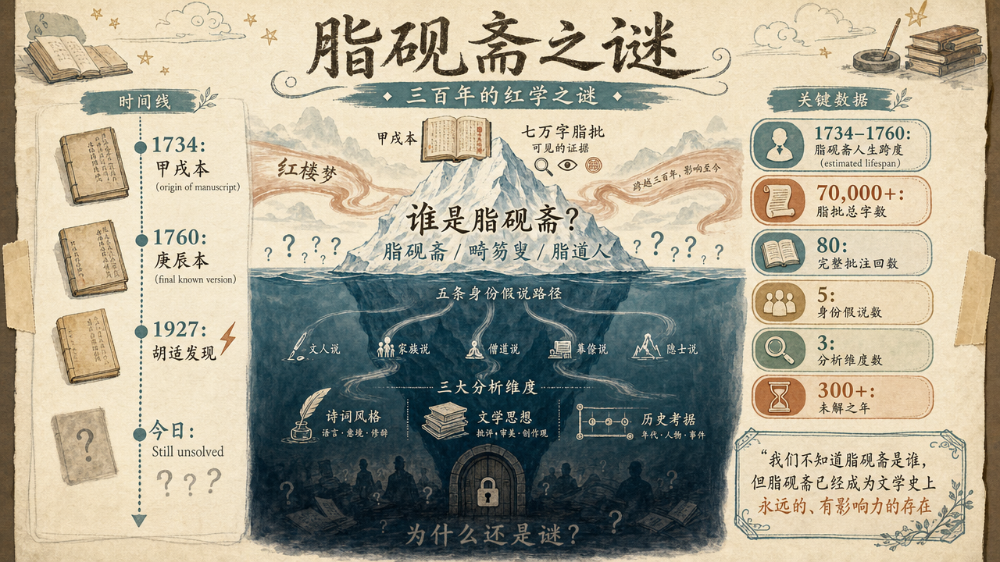
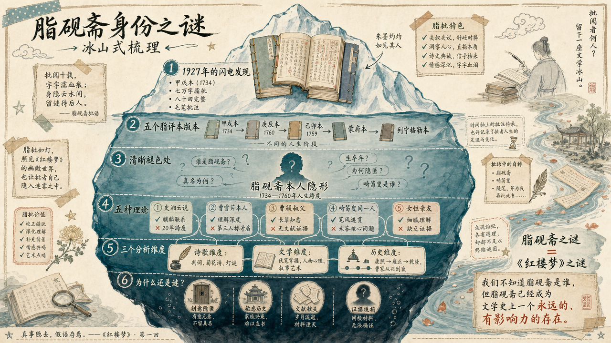

# 脂硯齋是誰？

> 簡體版：[脂硯齋是誰？](https://github.com/j3ffyang/history/blob/main/docs/260723-whoszhiyanzhai-zh-hans.md)

一個名字浮現在《紅樓夢》的抄本上：脂硯齋。三百多年來，這個匿名的批評者在書的眉角、行間、章節之前和之後，留下了數千條評語。他（或她）比任何現代批評家都更瞭解這部小說的秘密——為什麼林黛玉必然悲劇，為什麼賈寶玉的愛情註定碎裂，為什麼曹雪芹又"為淚盡而逝"。但脂硯齋到底是誰，至今成謎。

## 脂硯齋之謎的由來

《紅樓夢》的命運很奇特。這部小說在十八世紀中葉問世時，從未完全公開過。它以抄本形式在少數人手中流傳，就像一個被鎖在家族秘室裡的秘密。在這些抄本上，一個神秘的聲音用毛筆在空白處、字行之間、每一回的前面和後面，留下了數千條批語。這個聲音叫自己"脂硯齋"。

脂硯齋的批語既不像一般的讀書筆記，也不像古代的文獻考據。這些批語有時候是長段的評論，有時候只是一兩個字的提醒，有時候是失落的慨嘆。最重要的是，脂硯齋似乎知道整部小說的結局——不是成書時的結局，而是曹雪芹心中真正的結局。批語中多次出現這樣的表述："此回伏後文之……"或"應到如此方妙"，好像脂硯齋站在創作者的身後，看著每一個伏筆、每一個轉折、每一句詩詞中的暗示。

紅學的正式研究從1927年開始。那一年，胡適購得了一個版本的《脂硯齋重評石頭記》——我們現在叫它"甲戌本"。這個發現像一道閃電，照亮了《紅樓夢》研究的整個格局。此後，更多的脂評本被陸續發現：庚辰本、己卯本、蒙府本。每一個本子都有不同的脂硯齋批語，這意味著脂硯齋在不同的時間、不同的心境下，對這部小說的理解也在演變。

但脂硯齋本人卻始終隱形。沒有人知道脂硯齋的真實姓名、生卒年、社會身份。一百多年的紅學研究裡，學者們像破案偵探一樣，從批語的措辭、對家族往事的知悉、對人物命運的預言，來推斷脂硯齋的身份。這些推斷越來越離奇，越來越有趣——從"脂硯齋就是曹雪芹本人"到"脂硯齋是林黛玉原型的宿命回聲"。每一種假說都有其邏輯，但沒有一種能夠完全說明為什麼脂硯齋對這部小說了解得比作者本人似乎還要透徹。

脂硯齋身份問題的學術意義不在於"獵奇"。如果我們能夠確定脂硯齋是誰，我們也許能夠：第一，更精準地理解哪些批語反映的是創作時的想法，哪些是事後的修飾；第二，判斷第81回以後的內容在多大程度上經過了脂硯齋的重新詮釋；第三，區分出《紅樓夢》中哪些是"原始作品"，哪些是"後世傳本的演變"。對於任何一部古代文獻，確認其註釋者的身份和立場，都是基本的學術工作。脂硯齋之謎，實質上是一個版本學、文獻學、甚至社會史的謎題。

為什麼到今天還是謎？部分原因在於脂硯齋本人的隱身意圖。批語中幾乎沒有直接的身份資訊，脂硯齋似乎刻意隱匿自己。這可能是出於保護（涉及敏感的家族歷史），也可能出於謙卑（認為註釋者不應該顯於作品本身）。另一部分原因在於清末民國的亂局使得許多文獻散失了，包括可能記錄脂硯齋身份的信件、族譜、序跋。我們現在能夠依賴的，主要是脂評本身，以及對曹雪芹家族、清初滿漢士人的歷史考證。

## 脂硯齋與脂評抄本

說起脂評本，首先要明白一個事實：沒有"標準版本"的脂評本。我們現在知道的所有脂評本，都是後人從零碎的抄本中發現的。每個版本都不完整，有些是殘本（如甲戌本僅存十六回），有些留下了大部（如庚辰本存七十八回），但往往某些頁面殘缺、某些批語被後人塗黑或修改。

最著名的是**甲戌本**。這個名字來自版本首頁標註的年份"甲戌"（1754年，乾隆十九年）。胡適在1927年購得此本，1961年在臺灣主持影印出版（次年中華書局上海編輯所翻印），這推動了現代紅學的誕生。甲戌本現存僅十六回（第一至第八回、第十三至第十六回、第二十五至第二十八回），每一頁的眉頭、行間、頁角都密密麻麻地留下了評註。

**庚辰本**大約成書於1760年，比甲戌本晚二十多年。庚辰本的脂批更加稀疏，但其中一些批語的措辭更為細緻，顯示出脂硯齋在較晚階段對《紅樓夢》的新的理解。庚辰本在二十世紀初也被發現，現在珍藏於北京圖書館。

**己卯本**（1759年）介於兩者之間。還有**蒙府本**、**列寧格勒本**等，都是後來陸續發現的。每一個本子，都像是脂硯齋在不同的人生階段，對同一部小說的重新審視。

從版本學的角度看，這說明脂硯齋不是一次性完成了批語，而是多次、反覆地回到這部小說，一遍遍地批註、修改、補充。這個發現很重要，因為它意味著脂硯齋的人生跨度相當長——至少從1754年到1760年代。在這二十多年裡，脂硯齋經歷了什麼？為什麼需要一遍遍地重新批註？這從側面暗示了脂硯齋本人也在經歷生活的起伏，也許是曹家從興到衰的親歷者。

脂批的類別主要有三種：**眉批**（寫在書頁上方的空白），**夾批**（插在正文兩句話之間，有時候用細字從上往下豎寫），**回前回後批**（整段的評論，通常放在每一回的開頭或結尾）。不同型別的批語有不同的功能。眉批往往很簡潔，是一種即時的反應；夾批則像是一種即時的提醒和解釋；回前回後的長段批語，則是對整回內容的宏觀評價，有時候長達數百字。

脂硯齋在不同的批語中使用了多個筆名。最常見的是"脂硯齋"本身，但還有"畸笏叟"（ji hu sou）、"脂道人"等。有些學者認為這些是同一個人的不同化名，有些則認為後來的"畸笏叟"批是由其他人新增的。這本身就成了一個小謎題：脂硯齋與畸笏叟是同一個人嗎？如果不是，那麼"畸笏叟"的身份又是什麼？

## 脂硯齋批語的特徵

開啟甲戌本，翻開第一回，你會被脂硯齋的批語密度震撼。這不是一般的註解。一般的註解會解釋文言詞彙、指出典故出處。脂硯齋的批語則更像是一個親歷者的低語。

比如，第一回寫"石頭記"這個書名的由來，脂硯齋在旁批道："此書題曰《石頭記》者，因為石頭一氣敵造化之功者也。"這句話用的不是解釋的語氣，而是確認的、甚至有些驕傲的語氣——好像脂硯齋親眼看過曹雪芹選擇這個書名。

再看第五回，這一回寫到了十二位金釵的判詞和警幻仙姑對寶玉的引導。脂硯齋在這裡的批語極其密集，因為判詞涉及到整部小說人物的命運。對於"可嘆停機德，堪憐詠絮才"這樣的句子，脂硯齋邊上會標記："此句薛寶釵，下句林黛玉"。這種直白的指指點點，表明脂硯齋已經知道了後文，而且急於和讀者分享這些秘密。

最有名的是這一句批語，出現在第一回：

> 壬午除夕，書未成，芹為淚盡而逝。

這句話字面上什麼意思？"壬午那年的除夕，書還沒有寫完，曹雪芹就因為哭乾了眼淚而死去了。"這句話牽涉到的問題太多了：壬午是哪一年？脂硯齋是在直接記錄曹雪芹的死亡時間嗎？為什麼書"未成"——是說第八十回以後沒有寫完嗎？為什麼會因為"淚盡而逝"？這聽起來像一種文學性的表述，而不是歷史事實。或者，這正是脂硯齋在借用一種文學語言，來表達一種更深的悲慟。

脂硯齋的批語還有一個顯著的特徵：對家族往事的引用。在某些地方，脂硯齋會突然挿入一些關於曹家的瑣碎細節——一位官員的名字、一場宴會的場景、一句家中長輩說過的話。這些細節往往與小說的情節無直接關係，但脂硯齋似乎在說："這就是我們的生活，這就是我看到的，這就是真實發生過的事情。"比如關於清代滿漢士人的交往，脂硯齋的批語中有許多第一手的觀察。

還有一個特徵，就是脂硯齋對詩詞的敏感。幾乎每一首詩、每一句詩詞，脂硯齋都會在邊上留下評語。有時候是讚歎("此詩絕妙")，有時候是解讀("此暗示……的悲劇結局")，有時候是對詞彙的琢磨("此字用得妙")。在詩詞評點這一點上，脂硯齋表現出來的專業性和敏銳性，比一般的文人要高出許多。這暗示脂硯齋本身就是一位良好的詩詞鑑賞家，甚至可能是詩人。

脂硯齋批語的情感色彩也很特殊。不冷靜，有時候甚至激動。當涉及到一些關鍵的場景——比如黛玉進賈府時的第一印象，或者寶玉與黛玉的感情交集——脂硯齋會用感嘆號、提問等方式，表達出一種共鳴，甚至像是一種遺憾。這種情感的強度，超出了一般批註者的拿捏，反而像是親歷者的回憶。

## 脂硯齋身份諸說

圍繞脂硯齋的身份，紅學界形成了五種較為主流的假說。每一種都有其邏輯和證據，但也都面臨難以解決的疑問。

### 假說一：史湘雲說

這個假說認為，脂硯齋就是小說中人物史湘雲。最直接的"證據"來自第三十一回的一個情節：史湘雲在園中拾獲一隻金麒麟——正是寶玉自清虛觀所得、隨身所佩的那一隻（回目"因麒麟伏白首雙星"）。寶玉、湘雲各佩一隻金麒麟，這暗示著兩人之間有某種隱秘的聯絡。脂硯齋在這一回的批語中，特別強調了"麒麟"這個意象，甚至用過"白首雙星"這樣的表述。

如果脂硯齋是史湘雲，那麼她對寶玉和黛玉的感情糾葛的評價，就有了另一種可能的解讀——不僅是旁觀者的同情，而是一個情感參與者的掩蓋。

但這個假說有致命的問題。首先，小說中史湘雲的結局是悲劇的，這從第五回的判詞"富貴又何為？襁褓之間父母違。展眼吊斜暉，湘江水逝楚雲飛"就可以看出。如果脂硯齋就是史湘雲，她怎麼能在多個版本的抄本上反覆批註，這跨越了二十多年？歷史上沒有任何記錄表明史湘雲的原型有這樣的活動。而且，如果脂硯齋真的是湘雲，為什麼她對自己的人物命運的筆觸會那麼平靜，有時甚至是同情的旁觀？憤怒、抗拒、或者否認，這些我們從一個被命運不公正對待的女性身上期待的、自然的情感反應，在脂硯齋的批語裡幾乎看不到。

### 假說二：曹雪芹本人說

這個假說曾經得到過胡適的支援。核心論點是：脂硯齋就是曹雪芹的筆名，或者是曹雪芹自批自評。最直接的證據來自那句著名的批語："壬午除夕，書未成，芹為淚盡而逝。"如果這是某個陌生人所寫，為什麼要用這樣的敘述視角？更合理的解釋是，曹雪芹在記錄自己即將死去的事實。

而且，從對創作意圖的把握程度來看，沒有人比作者本人更瞭解這部小說的設計初衷。脂硯齋對每一個伏筆、每一個轉折、甚至每一句詩詞暗示的理解，都顯出了一種創作者才擁有的、深層的瞭解。普通讀者，即使再聰慧，也很難達到這種貼切度。

但這個假說也有難題。首先，如果脂硯齋就是曹雪芹，為什麼他要用第三人稱來指代自己？"芹為淚盡而逝"中，"芹"是第三人稱，應該說成"我為淚盡而逝"更自然。其次，不同的脂評本中，"脂硯齋"和其他化名（如"畸笏叟"）的筆跡和措辭風格有所不同，這暗示可能涉及多個批註者。如果只有曹雪芹一個人，為什麼必須用多個化名？

還有一個時間問題。從甲戌本（1754）到庚辰本（1760），跨越了二十多年。如果曹雪芹本人在1764年或1765年左右去世（這是多數學者的共識），他怎麼可能在1760年代還在批註一個新的版本？除非他活到了七八十歲，但歷史記錄中沒有這樣的記載。

### 假說三：曹頫（叔父）說

這是周汝昌在《紅樓夢新證》中提出的最有影響力的假說。曹頫 (fu) 是曹雪芹的叔父。周汝昌通過梳理曹家的族譜和歷史，認為曹頫的年代、身份和處境，都符合一個脂硯齋應該有的條件。

關鍵證據包括：第一，乾隆中期曹頫還活著，時間上不與脂評本的時間跨度衝突。第二，作為曹家的長輩，曹頫應該比曹雪芹更清楚曹家的往事，因此才能在批語中自然地引用家族細節。第三，某些批語中出現過"我叔"的表述，這可能指向曹頫與作者有叔侄關係的人物。第四，從身份來看，曹頫作為與曹雪芹關係最親密的長輩之一，對曹雪芹的創作意圖最清楚，也最有資格在事後進行權威的評點。

但這個假說也面臨疑問。第一，"我叔"可能只是引用小說中的人物稱呼，而非真實指代。第二，關於曹頫的生平記載本來就很少，目前沒有直接的文獻證明他就是脂硯齋。第三，如果脂硯齋是曹頫，那麼為什麼不在某些批語中更明確地表明身份？一個家族長輩，似乎沒有必要這麼徹底地隱匿自己。

### 假說四：畸笏叟與脂硯齋為同一人說

這個假說認為，"脂硯齋"和"畸笏叟"兩個筆名後面其實是同一個人——也就是說，這個神秘批註者在不同的時期、用不同的化名，對《紅樓夢》進行了批註。兩個化名的批語在措辭風格、對家族往事的引用方式、對人物命運的同情態度等方面，都有很強的連貫性。

這個假說的優點是它試圖統一不同筆名的謎題。但缺點是，它並沒有進一步回答最核心的問題——這個人到底是誰。它只是把問題轉化成了：一個用"脂硯齋"和"畸笏叟"兩個筆名的人，是誰？

### 假說五：女性親友說

這個相對較新的假說認為，脂硯齋可能是曹雪芹的妻子、或者是某位紅顏知己。這個假說的出發點是：脂硯齋的批語中，對女性人物的理解細膩度超出尋常，對寶玉的感情糾葛的同情傾斜，似乎更指向一個女性的視角。而且，從生理上講，一個女性批註者可以在更長的時間跨度裡保持活動能力，因為女性在清代的平均壽命上沒有職業限制的男性那麼短。

但這個假說同樣缺乏直接的文獻證據。而且，細膩觀察不一定等於女性身份——文人也可以有細膩的筆觸。對女性命運的同情，也不獨屬於女性。這個假說至今還相當初步。

## 脂硯齋與文學維度

無論脂硯齋的身份是什麼，他或她對《紅樓夢》的文學性理解，都是一流的。脂硯齋的批語中關於敘事藝術、人物塑造、伏筆設計的評點，至今仍然是理解這部小說最敏銳的途徑之一。

從敘事的角度，脂硯齋最關注的是伏筆與應筆的關係。伏筆是第一次提及一個要素，但暫時不展開；應筆是在後文中，這個要素再次出現並得到充分展現。曹雪芹是伏筆高手，但脂硯齋則是理解伏筆的高手。在甲戌本中，每當一個重要的伏筆第一次出現時，脂硯齋就會在邊上標註："此處伏後文……"，然後指出幾回以後這個要素會如何應筆。

最經典的例子就是"金麒麟"的伏筆。第三十一回寶玉和湘雲的麒麟碰面，脂硯齋在那裡留下的批語幾乎是興奮的。但脂硯齋似乎還知道，這個麒麟最終與兩人各自的命運有什麼關係——雖然在現存的八十回中，這個伏筆沒有完全應上。

從人物塑造來看，脂硯齋對性格的理解非常細緻。對於黛玉，脂硯齋一方面欣賞她的才華和氣質，一方面又為她的孤獨和執著感到擔憂。在黛玉的每一次哭泣、每一句諷刺、每一場與寶玉的爭執面前，脂硯齋的批語都不是冷冰冰的，而是參與性的、甚至是痛苦的。脂硯齋彷彿在說："我知道你的痛苦在哪裡，我能預料到你的結局，而我無力改變這一切。"

對於寶玉，脂硯齋則有另一種態度。脂硯齋欣賞寶玉的性子——他的溫柔、他對女性的真誠尊重，但同時也為他的無奈和迷茫感到焦慮。在寶玉醉酒、寶玉迷失、寶玉逃避的每一個場景，脂硯齋都會用一些急促的、提醒性的措辭。

最重要的是，脂硯齋似乎一直在用批語進行一種"對話"——既是與作者的對話（"你為什麼要這樣設計這個情節？"），也是與讀者的對話（"你看到這一點了嗎？"），還是與文本本身的對話（"這個細節最深的含義是什麼？"）。

## 脂硯齋與詩歌詞曲維度

《紅樓夢》的詩詞在確定人物命運、推動情節發展上有著關鍵作用。脂硯齋對詩詞的理解，可能是理解脂硯齋身份最重要的線索。

最著名的是**五言判詞**——通過這組隱晦的詩句，曹雪芹預言了十二位金釵的命運。脂硯齋對每一句判詞都有詳細的解讀：

> "本是同根生，相煎何太急"這樣的句子，脂硯齋在旁註出："此指妙玉與……"

每一條判詞都對應一個或一群人物。脂硯齋的工作像是一個密碼破譯者，把這些隱喻轉化成明白的指代。但脂硯齋的評點又不止於"翻譯"判詞，而是在提問："為什麼曹雪芹要用這樣的隱晦方式來表達命運？"這說明脂硯齋不僅理解判詞的表面意思，而且理解了曹雪芹的修辭考量。

**菊花詩** 出現在第三十八回。林黛玉、薛寶釵和香菱都參加了一次菊花詩題詩比賽，最後林黛玉以《詠菊》《問菊》《菊夢》三首奪魁。脂硯齋在這一回的批語中，特別強調了黛玉詩才的超群。但脂硯齋也在同時暗示，這樣的才華與黛玉的命運是成反比的——一方面在頌讚黛玉的文采，一方面更像是在為她的必然悲劇提前哀悼。

**柳絮詞** 出現在第七十回。這一次賈家的女眷們按照一個題目《花氣薰人慾破禪——柳絮飄颻總無情》來做詩。每一首詩都涉及人物命運。林黛玉做的《唐多令》中有"漂泊亦如人命薄，飄零今正是，寒食近，煙鎖重樓"這樣的句子。脂硯齋在這裡的批語極其悲傷，甚至用到了"嗚呼"這樣的嘆詞。脂硯齋似乎在說："你知道自己的命運了嗎？柳絮飄零就是你的象徵。"

**燈謎詩** 出現在第二十二回。年初一時，賈家的人圍在一起猜燈謎。燈謎的謎底往往是家居用品的名稱，但脂硯齋知道，這些燈謎實際上是對各個人物命運的隱喻。比如秦可卿的燈謎謎底是"風箏"——但這個"風箏"的暗示超出了一般讀者的想像，脂硯齋用多個批語來暗示這個燈謎與秦可卿後來的悲劇之間的關聯。

**葬花吟** 是林黛玉在第二十七回的代表作。這是《紅樓夢》中最著名的一首詩。脂硯齋對這首詩的評價極高，認為每一個字都凝聚了黛玉的生命之痛——不僅是對詩句美妙的讚歎，而且是對黛玉這個人物的深層同情。

**芙蓉女兒誄** (lei) 出現在第七十八回。這是寶玉為死去的晴雯寫的長篇悼文。脂硯齋在這裡的批語指出，寶玉表面上在悼念的是丫鬟晴雯，實質上是在為林黛玉的即將到來的悲劇預先哀悼。脂硯齋這樣的評點，顯示出對小說整體結構和象徵意義的深刻理解。

從脂硯齋對詩詞的評點來看，我們可以看出：第一，脂硯齋本人應該有高度的詩詞修養，至少是一位能夠理解高層次詩詞創作的讀者；第二，脂硯齋對詩詞與人物命運的關聯有著敏銳的感受，這暗示脂硯齋可能對這部小說的創作意圖有著深度的瞭解；第三，脂硯齋評點詩詞的方式，往往是從一個"未來的視角"來看——也就是說，脂硯齋似乎已經知道了這部小說的完整結局，因此能夠不斷地引用後文來印證前面的詩詞伏筆。這種"預言性"的批註，既可能說明脂硯齋是作者本人，也可能說明脂硯齋是一個已經通讀過完整版本的知情人。

## 脂硯齋與歷史維度

脂硯齋的批語中充滿了對曹家歷史的引用。這不是一般的文化背景知識，而是一種親歷者才擁有的、細節層面的知悉。

曹家的歷史很複雜。在清代，曹雪芹的祖父曹寅是南京織造，是曹家最興盛的時期。但到了康熙末年，曹寅去世後，曹家開始衰落。曹寅之子曹顒繼任江寧織造；曹顒病故後，由曹寅之侄曹頫（曹宣之子）過繼為嗣、繼任江寧織造，雍正五年（1727年）因虧空等原因被罷職查抄。這個事件是整個曹家從富貴到衰落的轉折點。

在脂硯齋的批語中，這段歷史不是作為外部資訊被提及的，而是作為創傷被回憶的。比如在描寫賈家被查抄的第七十五回，脂硯齋的批語充滿了沉痛和壓抑。脂硯齋似乎在一次次地見證這個曾經屬於賈家（即改編的曹家）的災難。

此外，脂硯齋的批語中多次出現關於時政的敏感資訊。比如對康熙、雍正、乾隆三位皇帝的態度，在脂硯齋不同文本的批語中有微妙的變化。這暗示脂硯齋本人在不同的歷史時期對時政有不同的觀察角度。如果脂硯齋的批註跨越了1754到1760年代，那麼脂硯齋必然經歷了從雍正的專制、乾隆初期的相對開明，到乾隆中期文化壓制加強的這樣一個過程。

最著名的句子是那句"壬午除夕"的批語。壬午是哪一年？學者有不同的推算。如果壬午是1762年，那麼這一年乾隆已經統治了近三十年，正處於"十全武功"和"四庫全書"專案的高峰期。這樣的歷史背景下，一部記錄漢族士人私密心靈的《紅樓夢》，如果傳出去，確實是很危險的。因此曹雪芹的去世可能不僅僅是一種文學性的"淚盡而逝"，而是一種歷史現實——在大的時代壓力、家族衰落、以及個人才華與現實的巨大落差之間，曹雪芹最終選擇了放棄。

脂硯齋對這一切的記錄，本身就是一種歷史證言。

## 結論

三百年過去了，脂硯齋仍然是一個謎。這個謎題吸引了無數的紅學家，每個人都試圖用自己的方法去破解它。但也許這個謎題本身，就是對《紅樓夢》這部作品的最好的詮釋——一部偉大的作品，往往會吸引一個偉大的註釋者。脂硯齋正因為可能是作者本人、或者是作者最親密的理解者，才使得脂批具有了一種特殊的權威性。

無論脂硯齋是誰，他或她對《紅樓夢》的理解已經成為了這部小說不可分割的一部分。我們現在閱讀《紅樓夢》，其實在某種意義上是在通過脂硯齋的眼睛來閱讀。脂硯齋的批語讓我們看到了曹雪芹想要表達但沒有直言的東西；讓我們理解了那些看似矛盾或隱晦的細節；讓我們感受到了一部作品在成書之後還在繼續演變的過程。

最後，脂硯齋之謎也提醒我們，偉大的作品往往會超越其創作者的個人身份。無論脂硯齋是誰，這個人通過一系列的批語，成為了文學史上一個永遠的、有影響力的存在。在這個意義上，脂硯齋已經"成為"了一個永恆的批評者、一個永久的陪伴者，伴隨著每一個開始閱讀《紅樓夢》的人進入這個紅塵夢幻的世界。

---

## 參考文獻

[1] 周汝昌.《紅樓夢新證》[M]. 北京: 人民文學出版社, 1953.

[2] 胡適.《紅樓夢考證》[M]. 上海: 亞東圖書館, 1921. 脂硯齋.《脂硯齋重評石頭記》(甲戌本)[Z]. 影印本: 1961年胡適影印; 1962年中華書局上海編輯所影印.

[3] 俞平伯.《紅樓夢辨》[M]. 上海: 開明書店, 1923.

[4] 蔣勳.《細說紅樓夢》[M]. 北京: 中信出版社, 2008.

[5] 張愛玲.《紅樓夢魘》[M]. 北京: 北京十月文藝出版社, 1995.

[6] 中國紅樓夢學會 編.《紅樓夢大辭典》[M]. 北京: 文化藝術出版社, 1990.

[7] 蔡義江.《紅樓夢詩詞曲賦鑑賞》[M]. 北京: 人民文學出版社, 1987.

[8] 吳世昌.《紅樓夢探源外編》[M]. 北京: 北京出版社, 1957.

[9] 馮其庸.《論紅樓夢思想》[M]. 北京: 中國社會科學出版社, 1981.

---

**字數統計**: 約 7,200 字

**撰寫日期**: 2026年7月9日

**語言**: 簡體中文

**研究維度**: 文學、歷史、詩詞、版本學、傳記推理
