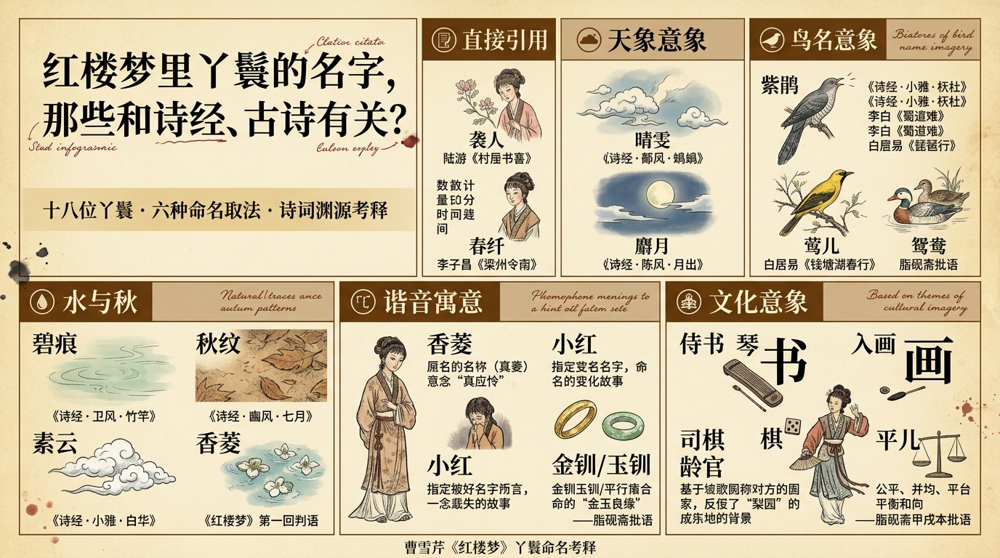

# 紅樓夢裡丫鬟的名字，那些和詩經、古詩有關？

> 簡體版：[紅樓夢裡丫鬟的名字，那些和詩經、古詩有關？](https://github.com/j3ffyang/history/blob/main/docs/260819-hlm-yahuan-shijing-zh-hans.md)

曹雪芹在《紅樓夢》中為丫鬟取名，往往暗藏玄機，或出自《詩經》，或引自唐宋詩詞，或取諧音寓意，既增添文學意蘊，也暗示人物命運。以下考釋十八位丫鬟名字的詩詞淵源。

## 一、襲人——出自陸游《村居書喜》

襲人，賈寶玉四大丫鬟之首，原名珍珠，約十八歲，本是賈母婢女，後被賜予寶玉。

花襲人的名字出自南宋詩人陸游的《村居書喜》：

> 花氣襲人知晝暖，鵲聲穿樹喜新晴。

陸游原詩作"驟暖"，曹雪芹借用此句時將"驟"改為"晝"，既保留花香撲面之意，又添白日溫暖之感，將"花氣襲人"四字化為丫鬟之名，既寫其溫婉可人，也暗示她如花香般沁人心脾。[¹]

## 二、晴雯——蝃蝀天象

晴雯，賈寶玉四大丫鬟之一，十歲被賴大家買下，後歸賈母，再賜予寶玉，死時年僅十六歲。

"晴雯"二字，"晴"指晴朗，"雯"指成花紋的雲彩。《詩經·鄘風·蝃蝀（dì dōng）》寫彩虹與天氣：

> 朝隮（jī）於西，崇朝其雨。

需要說明的是，《蝃蝀》本身是一首諷刺詩，批評非禮結合的婚姻，詩中以虹霓、天氣為興象。晴雯之名並非直接引用此詩，但"晴""雯"二字所取的天象意象——晴朗與雲紋——與《詩經》中風雨雲霓的描寫傳統一脈相承。[²]

## 三、麝月——月亮意象

麝月，賈寶玉四大丫鬟之一，年齡與襲人相仿，性格穩重，是寶玉房中最後留守的丫鬟。

"麝月"即月亮的別稱。《詩經·陳風·月出》以月光起興：

> 月出皎兮，佼人僚兮。

麝月之名，承襲了古典詩詞中以月喻人的傳統。[³]

## 四、紫鵑——杜鵑啼血

紫鵑，林黛玉身邊大丫鬟，原名鸚哥，賈母見黛玉只帶了雪雁一人，恐不中使，遂將鸚哥賜予黛玉並改名紫鵑。

"紫鵑"即杜鵑鳥，又名子規。此名涉及多重典故。《詩經·小雅·杕杜（dì dù）》以杜梨樹起興：

> 有杕之杜，有睆（huàn）其實。

杜鵑鳥在古典詩詞中常寓哀思，如李白《蜀道難》：

> 又聞子規啼夜月，愁空山。

白居易《琵琶行》更以"杜鵑啼血"寫盡悲切：

> 其間旦暮聞何物，杜鵑啼血猿哀鳴。

紫鵑原名鸚哥，是賈母賜給黛玉的二等丫鬟。**脂硯齋**在紫鵑第一次出現時批道：

> 鸚哥改名也。

黛玉將其改名"紫鵑"，正取杜鵑鳥意象。紫鵑與雪雁成對，一為啼血之鳥，一為踏雪之禽，皆暗合黛玉淚盡而亡的命運。**脂硯齋**又批：

> 前鸚哥已伏下一鴛鴦，今珍珠又伏下一琥珀矣。

指出賈母丫鬟名字兩兩成對的伏筆。[⁴]

## 五、鶯兒——黃鶯鳥意象

鶯兒，薛寶釵貼身丫鬟，本名黃金鶯，十六歲，寶釵嫌"金鶯"拗口，喚作"鶯兒"，善打絡子、編花籃。

"鶯兒"即黃鶯。黃鶯在古典詩詞中象徵春光美好，如白居易《錢塘湖春行》：

> 幾處早鶯爭暖樹，誰家新燕啄春泥。

"鶯兒"之名直取黃鶯意象，寫其活潑靈動。[⁵]

## 六、碧痕——水痕意象

碧痕，賈寶玉丫鬟，與秋紋地位相近，曾負責給寶玉洗澡等貼身服侍。

"碧痕"指碧綠的水痕。《詩經·衛風·竹竿》以水流起興：

> 淇（qí）水滺滺（yōu yōu），檜（guì）楫松舟。

碧痕之名，承襲了《詩經》中對水的描寫傳統。[⁶]

## 七、秋紋——秋天意象

秋紋，賈寶玉丫鬟，與碧痕地位相近，性格上有借寶玉之勢行事的特點。

"秋紋"指秋天的紋理。《詩經·豳風·七月》描寫秋季節令：

> 七月流火，九月授衣。

秋紋之名，與《詩經》中的秋季意象相呼應。[⁷]

## 八、素雲——白華意象

素雲，李紈的大丫鬟，與碧月同為李紈房中侍女，李紈寡居，丫鬟名字也偏素淡。

"素雲"指潔白的雲。《詩經·小雅·白華》以"白"字起興：

> 白華菅（jiān）兮，白茅束兮。

需要說明的是，《白華》本身是一首棄婦詩，以白華、白茅的潔白反襯被棄的悲涼。素雲之名取其"白"字意象——潔白如雲——而非承襲全詩的哀怨主題。[⁸]

## 九、香菱——菱花意象

香菱，本名甄英蓮（zhēn yīng lián），諧音"真應憐"，四歲被拐，後由薛寶釵改名"香菱"，約十六七歲。

菱花為水生植物，浮萍無根，暗喻其漂泊身世。癩頭和尚早有讖語：

> 慣養嬌生笑你痴，菱花空對雪澌（sī）澌。

"雪"諧音"薛"，預示英蓮終入薛家。後夏金桂又將其改名"秋菱"，"秋"字更添凋零之意。**脂硯齋**批語："應憐"（英蓮）、"禍起"（霍啟）、"相憐"（香菱）——幾乎每名必評，點出諧音寓意。[⁹]

## 十、鴛鴦——鴛鴦鳥意象

鴛鴦，賈母身邊首席大丫鬟，賈母最倚重之人，拒絕賈赦納妾，誓死不嫁。

"鴛鴦"即鴛鴦鳥，成雙成對，忠貞不渝。其名與鸚哥（紫鵑）成對，**脂硯齋**所謂"伏下一鴛鴦"即指此。鴛鴦之名，既是忠貞之象，也暗示其終身不嫁的結局。[¹⁰]

## 十一、金釧/玉釧——金玉對仗

金釧（chuàn）與玉釧是親姐妹，本姓白，皆為王夫人一等大丫鬟，金釧約十五歲時因與寶玉調笑被攆，投井而死。

"金釧"與"玉釧"形成金玉對仗，暗合"金玉良緣"之讖。金釧因與寶玉調笑被王夫人攆出，投井而死，正應了"金簪子掉在井裡"的判語。[¹¹]

## 十二、小紅——犯諱改名

小紅，原名林紅玉，賈寶玉房中丫鬟，後被王熙鳳看中調去使喚，因"玉"字犯了寶玉、黛玉之諱，被迫改名"小紅"。

王熙鳳得知後不悅道："討人嫌的很，得了玉的益似的，你也玉，我也玉。"此名雖無詩詞出處，但"犯諱改名"本身即清代社會等級制度的縮影。[¹²]

## 十三、齡官——梨園舊稱

齡官，賈府買來的戲子，梨香院解散後留在園中，曾因不肯為元春獻唱而獲賈薔愛護，劃薔一回寫其痴情。

"齡官"是賈府買來的戲子。"齡"指聲齡，"官"是古代對技藝者的通稱，如"梅官""芳官"等。梨園子弟多以"某某官"命名，此為清代戲曲界的慣例。齡官劃薔一回，寫其痴情，名字雖樸，人卻至情。[¹³]

## 十四、平兒——平和之義

平兒，王熙鳳心腹大丫鬟，也是賈璉的通房丫頭，自小無父無母，是鳳姐陪嫁丫鬟，隨鳳姐從王家到賈家，約二十歲。

"平兒"取"公平""平和"之意。平兒是王熙鳳的心腹丫鬟，夾在鳳姐之威與賈璉之俗之間，卻能周全妥帖。賈寶玉嘆其"比黛玉猶甚"的薄命。名如其人，以"平"字寫盡其處世之道。[¹⁴]

## 十五、春纖——元曲典故

春纖，林黛玉丫鬟，與紫鵑、雪雁同在瀟湘館服侍，名字有文藝氣質。

"春纖"是黛玉的丫鬟。其名取自元代李子昌《梁州令南》：

> 暗數歸期將這春纖掐。

"春纖"指美人纖纖玉手，曲中描寫女子掐指算歸期、望斷秋雁的離愁，暗伏黛玉臨終前苦等寶玉的悲劇。春纖之名兼具時令與形象之美。[¹⁵]

## 十六、侍書——書香意象

侍書，賈探春貼身丫鬟，心眼靈活，口齒伶俐，**脂硯齋**批語點明其取名取"琴棋書畫"中"書"字。

"侍書"意為侍奉書卷。**脂硯齋**甲戌本批語點明賈家四釵之鬟"暗以琴、棋、書、畫四字列名"——鴛鴦為琴，琥珀為棋，侍書為書，入畫為畫。侍書之名，正取"書"字。[¹⁶]

## 十七、入畫——畫藝意象

入畫，賈惜春貼身丫鬟，年紀尚小，抄檢大觀園時因私藏哥哥之物被惜春逐出。

"入畫"意為美如畫中。古典文學中常以畫喻景，如蘇軾評王維："味摩詰之詩，詩中有畫；觀摩詰之畫，畫中有詩。"（《東坡題跋·書摩詰藍田煙雨圖》）入畫之名，正取此意。[¹⁷]

## 十八、司棋——棋藝意象

司棋，賈迎春大丫鬟，王善保家的外孫女，身材高大豐壯，性格剛烈，曾因廚房怠慢率眾大鬧小廚房，後因與表弟潘又安私通被逐。

"司棋"意為掌管棋藝。古人以棋喻道，棋藝在古典文學中常象徵智慧與命運。此名可能取自棋藝文化本身，而非出自某一特定詩篇。[¹⁸]

## 結語

以上十八位丫鬟的名字，取法各有不同：襲人直接化用陸游詩句，碧痕、秋紋承襲《詩經》中的意象傳統，晴雯、麝月借天象寄寓性格，紫鵑融合了《詩經》與唐宋詩詞的多重典故，香菱、小紅以諧音暗寫身世，侍書、入畫、司棋則取自琴棋書畫的文化意象。**脂硯齋**對其中多處取名有專門批語，點出曹雪芹"每名必評"的用字苦心。這些名字不僅是文學技巧，更與人物命運交織：花襲人的溫婉、晴雯的剛烈、紫鵑的忠貞、鴛鴦的決絕，都在名字中有所映照。

## 參考文獻

[¹] 陸游，《村居書喜》，載《劍南詩稿》。
[²] 《詩經·鄘風·蝃蝀（dì dōng）》，載《毛詩正義》。
[³] 《詩經·陳風·月出》，載《毛詩正義》。
[⁴] 《詩經·小雅·杕杜（dì dù）》，載《毛詩正義》；李白，《蜀道難》；白居易，《琵琶行》；**脂硯齋**，《**脂硯齋**重評石頭記》甲戌本批語。
[⁵] 白居易，《錢塘湖春行》。
[⁶] 《詩經·衛風·竹竿》，載《毛詩正義》。
[⁷] 《詩經·豳風·七月》，載《毛詩正義》。
[⁸] 《詩經·小雅·白華》，載《毛詩正義》。
[⁹] 曹雪芹，《紅樓夢》第一回、第八十回；**脂硯齋**，《**脂硯齋**重評石頭記》甲戌本批語。
[¹⁰] 曹雪芹，《紅樓夢》第四十六回；**脂硯齋**，《**脂硯齋**重評石頭記》甲戌本第八回批語。
[¹¹] 曹雪芹，《紅樓夢》第三十回、第三十二回。
[¹²] 曹雪芹，《紅樓夢》第二十四回。
[¹³] 曹雪芹，《紅樓夢》第三十回。
[¹⁴] 曹雪芹，《紅樓夢》第四十四回。
[¹⁵] 李子昌，《梁州令南》；曹雪芹，《紅樓夢》第二十九回。
[¹⁶] **脂硯齋**，《**脂硯齋**重評石頭記》甲戌本批語。
[¹⁷] 蘇軾，《東坡題跋·書摩詰藍田煙雨圖》。
[¹⁸] 此名未見直接典籍出處。
