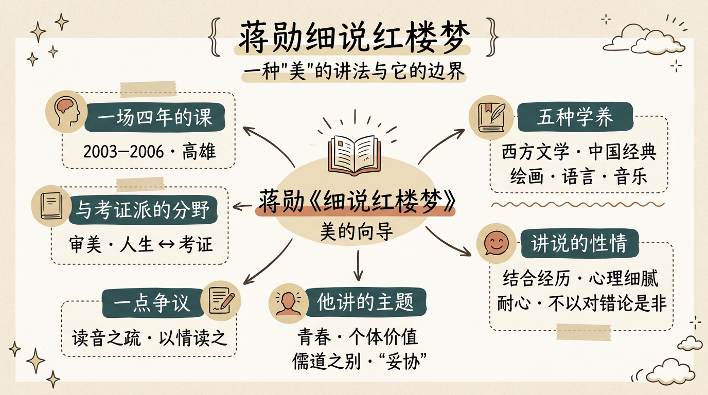

# 《蔣勳細說紅樓夢》：一種"美"的講法與它的邊界

> 簡體版：[《蔣勳細說紅樓夢》：一種"美"的講法與它的邊界](https://github.com/j3ffyang/history/blob/main/docs/260820-jiangxun-zh-hans.md)

蔣勳的《細說紅樓夢》，與其說是一部紅學著作，不如說是一場持續四年的課。據發行方說明，2003 至 2006 年，他受耕心負責人林靜華之邀，在高雄逐回開講；錄音後來整理成有聲書與圖書，流傳極廣。[¹] 許多人對《紅樓夢》的親近，是從蔣勳的聲音開始的——本文作者前後聽了三遍，以下便多是個人的聽講印象。[²]

## 一、他怎樣細讀

蔣勳的講法，最見特色者有幾點。他看《紅樓夢》的角度，多半來自幾種學養——西方文學、中國古典經典、繪畫、音樂與語言；而講說之際，又帶著幾點特別的性情。幾者交疊，才成就了那種別人少有的講法。[²]

- **中西並置。** 他兼有東西方的教育背景，講《紅樓夢》時常使中西兩邊的文學彼此映照：西方這一邊，旁及希臘神話、羅馬典故，把寶黛的故事與《羅密歐與朱麗葉》相參照。在以考證為主流的紅學傳統之外，這是"以文學講文學"的另一條路。[²]
- **詩詞與戲曲。** 中國這一邊，他雅好並熟稔大量傳統詩詞與古典戲曲——《詩經》、唐詩宋詞，下及元曲、明清傳奇與京劇，講《紅樓夢》時信手拈來。他尤其常引戲曲為旁證：如《西廂記》"願普天下有情的都成了眷屬"，如《長生殿》《桃花扇》的興亡之嘆，如京劇《鎖麟囊》由富轉貧、終因一善得報——一情一命一興亡，都與《紅樓夢》遙遙相映。[²]
- **繪畫·美學·審美。** 他本行是繪畫，少年時接受的西式教育又讓他浸潤於藝術、繪畫與文學。這給了他兩層東西：一是"美學"——關於美的學問與原理；二是"審美"——對美的實際感受與判斷。講《紅樓夢》時，他常從繪畫、色彩、空間切入，落花、綢緞、園林、戲臺上的衣飾與唱腔，他都看得出、也說得出其中的美。這份對"美學"的看重，恰是許多紅學家與紅學愛好者少談的一層。[²]
- **語言與跨域。** 他通英文、法文，對語言如何承載不同地域、不同時代的差異格外敏感，讀《紅樓夢》時因此能帶出別處少見的跨文化維度。[²]
- **音樂的經驗。** 他也常從聲音、節奏與旋律去體會《紅樓夢》的文字，講起來自有一種樂感。[²]
- **結合個人經歷。** 他談的常常不只是小說，還有自己的生命體驗——常引用、對照自己年輕時的經歷，因此格外貼近聽眾，不似講課，更像分享。[²]
- **心理的細膩。** 他極擅捕捉人物內心的起伏，一顰一笑、一嗔一怒，都細細分說，把許多被讀者一眼略過的地方講得有血有肉。[²]
- **直讀原文。** 他特別尊崇直接閱讀原文，不願被別人的評論"預先定義"；不過講說之際，他也常引用胡適、張愛玲、林語堂等人讀《紅樓夢》的心得與評論。[²]
- **逐字逐句。** 他常把文字逐字逐句地講——如《芙蓉女兒誄（lěi）》，一句一句地讀，把字裡的意思與情味都講透。本文作者尤其喜歡這一段。[²]
- **漫長的耐心。** 四年逐回細讀，他不急於丟擲結論，而是"陪著讀"。[¹]
- **不以對錯論是非。** 對趙姨娘、賈環這樣常被一筆否定的人物，他也願意站在"他們自己的維度"去理解。[²]

## 二、他講的主題

- **青春。** 蔣勳把大觀園讀作一座青春的園林：它讚美青春、理解青春，容得下年輕人的錯誤與任性——也正因如此，它的凋零才格外令人心痛。[²]
- **個體價值。** 與"青春"相連的，是他對個體價值的看重：他關心的，是一個個具體的人——黛玉、寶釵、晴雯——各自的處境與價值，而不只是家族興衰的宏大敘事。在他看來，人一生中最可貴的，不是服從家族或禮法的群體價值，而是展現、實現自己的個體價值。[²]
- **儒道之別。** 這背後，是儒家與老莊道家的對照：他更親近道家，而非儒家（書中以逼寶玉讀四書五經的賈政代表儒家）；寶玉偏不愛四書五經，獨愛《牡丹亭》《西廂記》（書中多次提到），其詩詞才情多憑天分，近乎無師自通。[²]
- **"妥協"。** 在他眼裡，黛玉與寶釵的對立，越到後來（尤其第七十九回之後）越趨於某種和解與妥協。[²]

## 三、一點爭議，一點體諒

蔣勳的講述，也難免引來一些討論——說來都算不得嚴厲，更多的是一種"既愛又惜"的心情。

1. **讀音之疏。** 據本文作者的聽講印象（也是聽眾間常有的談論），他偶有唸錯的字。例如"親家"（"親"應讀 qìng，非 qīn）、"阿房宮"（"阿"應讀 ē，非 ā）。[²][³] 這或與他成長於臺灣、語音裡帶著閩南方言與讀法的痕跡有關；在那樣長的講稿裡，口誤也其實難免，倒也不必太苛責。
2. **以情讀之。** 他不在版本、作者、文獻上用力，而是以感覺與抒情去貼近文本、貼近人物——這份投入，正是他最動人的地方。

這些與其說是"錯"，不如說是兩種讀法的不同。第一點只是聽者的個人印象；第二點，則源於"審美讀法"與"考證讀法"的分野——一個關心"這部書與我們的人生"，一個關心"這部書從何而來"。各有各的好，不必以一端苛求另一端。[²]

而說到底，與他講述的深入與細緻相比，那幾處小小的口誤，實在小得可以略過。

## 四、與考證派的分野

若把"紅學"分作兩路，蔣勳屬於**審美的、人生的**一路；自胡適以來的"新紅學"，則走**考證**一路——版本、作者、後四十回、曹雪芹家世。[⁴] 兩路並不必然相爭：考證回答"這部書是怎麼來的"，蔣勳回答"這部書於我們的人生意味著什麼"。

## 餘論

聽蔣勳，不妨把他當作一位"說書人"，或一位"美的嚮導"，而不必當作"紅學家"。他會有疏漏，偶爾抒情過度，經不起考證的追問；但他把無數人領回了《紅樓夢》。這或許是他最大的功勞——不是考出一個真本，而是讓人重新愛上這部書。

## 關於解讀層次

本文將內容分作三層：講座的時間、地點、出版等屬事實（據發行方說明及工具書）；蔣勳的觀點與主題，屬他個人的讀法，均標明來源；對蔣勳的聽感與批評（如讀錯字一類），則是本文作者的個人看法，一併標出，不作定論。

補充：據本文作者的聽講印象，蔣勳在講座中自己提到 2006 年，並說這套課前後講了約四年——與發行方所記的 2003–2006 年正相印證。

## 引用來源

- 蔣勳《細說紅樓夢》講座——據授權發行方說明：2003–2006 年受耕心負責人林靜華邀請，在高雄開講，為期四年，後整理為有聲書及圖書，訪問日期：2026-09-26
- 蔣勳《蔣勳細說紅樓夢》——講法（學養：西方文學·中國經典·詩詞戲曲·繪畫·語言·音樂；美學與審美；講說方式：結合個人經歷、心理細膩、直讀原文、逐字逐句、耐心、不以對錯論是非）與主題（青春、個體價值、儒道之別、"妥協"），據本文作者聽講筆記整理，訪問日期：2026-09-26
- 漢典"親"條（"親"讀 qìng，專用於"親家"）、"阿"條（"阿"讀 ē），訪問日期：2026-09-26
- 維基百科"高鶚"條——胡適等"新紅學"以考證為主的路徑（版本、作者、後四十回），訪問日期：2026-09-26
