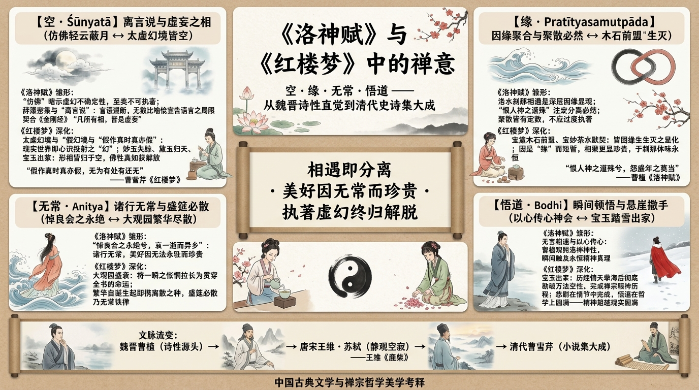

# 《洛神賦》與《紅樓夢》中的禪意——空、緣、無常與悟道

> 簡體版：[《洛神賦》與《紅樓夢》中的禪意——空、緣、無常與悟道](https://github.com/j3ffyang/history/blob/main/docs/260822-luoshenfu-hongloumeng-chan-zh-hans.md)

> 本文是《[洛神賦：魏晉美學的永恆傳承與《紅樓夢》的深層對話](260629-luoshenfu-literary-analysis-zh-hans.md)》的姊妹篇。那篇長文討論兩部作品在女性形象、悲劇結構與美學層面的千年對話；本文則把其中禪宗哲學的維度單獨抽出，集中考察"空、緣、無常、悟道"這四個概念如何在兩部作品中層層深化。

## 導言

當我們將禪宗的哲學鏡鑑照向《洛神賦》，才會悟到：*相遇即分離，美好因無常而顯得更為珍貴；執著於虛幻之物而不得，正是通往精神解脫的必經之路*。

這一視角並非憑空疊加。《洛神賦》中如夢似幻的相遇，《紅樓夢》中由盛轉衰的大觀園，本身就為這種解讀提供了充分的文本基礎。以下依次展開四個層面：**空**（Śūnyatā）、**緣**（Pratītyasamutpāda）、**無常**（Anitya）與**悟道**（Bodhi）——四個概念皆在《洛神賦》中現其雛形，而在《紅樓夢》中獲得情節化、體系化的深化。

## 第一部分：《洛神賦》——禪意的雛形

魏晉之世是中國歷史上的"精神覺醒"時代：漢末動盪之後，士人轉而向內尋求精神的超越——長文已詳述老莊之學與道教信仰如何塑造了這一時代氛圍。這裡要補充的是同一精神氣候的另一面：早期的佛教思想也開始對中國知識精英產生影響，為日後禪宗的誕生埋下種子。曹植正是在這樣的精神氣候中寫作的。

### 剎那相遇："忽然"的美學

《洛神賦》的序文記述，曹植在洛水之上，忽然看到了一位神女。這一"忽然"相遇的設定，本身就暗示了一種"頓悟"式的剎那性——美與真不以漸進的方式呈現，而是在電光石火的一瞬整體湧現。這與後來禪宗"頓悟"的美學有隱秘的內通。

### 辭藻的密集與"離言說"

長文已經指出，賦文以排比、對仗、比喻的密集堆疊構成其修辭特色。這裡關心的是另一層含義：這種堆疊最終指向的不是華美，而是語言本身的失效。

這正是禪宗"離言說"的思想底色。禪宗強調"言語道斷""不立文字"，認為真理無法通過語言完全表述。曹植用無數比喻逼近洛神，每一個比喻卻又在宣告自身的不足——詩人在無意間，提前觸到了後來禪門以機鋒與沉默應對的那個困局。

### 美的易逝性與無常之悲

洛神的形象中，隱含著一種**無常的悲感**：

> 悼良會之永絕兮，哀一逝而異鄉。

曹植遇見了這樣一位完美的女性，相聚的時刻卻短促如一瞬。長文已將這種"相遇即分離"的結構，讀作後世文學反覆迴響的原型；而換上佛家的眼光，同一句詩所呈現的正是"諸行無常"：**美好並非碰巧短暫，它的價值本身就建立在短暫之上**——正因為留不住，這一次相遇才顯得如此珍貴。

### 原文中"空"的意蘊

《洛神賦》的整個敘述框架中，充滿了對虛幻性的暗示：

- 洛神本身是否存在，文中含糊其辭
- 相遇的過程是如夢似幻的
- 分離的後果是對虛幻性的最終確認

曹植從最開始就在暗示觀者：這個女性可能是幻覺、夢想、或者對美的理想化投射。她"彷彿兮若輕雲之蔽月"——這個"彷彿"是關鍵詞，它暗示了一種不確定性、虛幻性。

洛神被描寫得如此具體、如此華麗，但正是這種具體性本身暴露了她的虛幻。每一個比喻都在試圖定義她，但每一個比喻都失敗了，最終只能承認：**她是不可定義的、不可執著的**。這與禪宗經典《金剛經》"凡所有相，皆是虛妄"的旨趣遙相呼應——不是說世界不存在，而是說一切形相都無有自性，無法被絕對固定地界定。

### 相遇的必然性與分離的必然性

曹植與洛神的相遇不是隨機的，而是一種"緣"的顯現。他們在特定的時間、特定的地點相遇，這說明了一種更深層的因緣關係。但同樣地，這種相遇也註定了分離的必然。

禪宗對"緣"的理解是：所有的現象都是因和緣的組合。因緣聚合則相遇，因緣散開則分離。最重要的是，要認識到這種聚與散都有其必然性，而不應過度執著。

### 瞬間悟道：無言的精神相通

曹植與洛神的相遇是一個"瞬間"的相通。在這個瞬間，他們之間沒有言語，但有著深刻的精神默契。這種瞬間的、無言的相通，正是禪宗所說的"頓悟"或"以心傳心"。

《洛神賦》中寫"恨人神之道殊兮，怨盛年之莫當"，曹植通過對洛神的觀照，似乎觸及到了某種永恆的精神真理。這不是一般的感情作用，而是一種精神的"開悟"。

## 第二部分：《紅樓夢》——禪宗思想的深化

如果說《洛神賦》只是無意間觸及了這些主題，那麼《紅樓夢》則是有意識地將其編織進全書的骨架。小說開篇的神話設定——石頭成精、女媧補天、絳珠仙草——本身就是在一個"幻"的框架內展開敘事。

### "空"的具體化

《紅樓夢》中的"空"不僅是哲學觀念，而是被具體化為情節與意象：

- 大觀園雖然存在，但它是"幻"的
- 諸女性雖然鮮活，但她們都在"幻"中
- 寶玉與黛玉之間的愛雖然真摯，但也無法超越虛幻的本質

妙玉最後的失蹤，黛玉最後的"魂歸離恨天"，寶玉最後的出家（以上均見今本後四十回；脂評本僅存前八十回）——這些都是對"空"的終極詮釋。所有的形相都消失了，但精神本身（在禪宗意義上的"佛性"或"真如"）則得到了解放。

### "幻"字的深層含義

《紅樓夢》以"幻"字為中心架構。"太虛幻境""假作真時真亦假"——整部小說的情節都在不斷強化這種虛幻的意蘊。

這個"幻"字的立意，與禪宗的"空""幻"觀相通。在禪宗看來，現實世界本身就是"幻"的，是心識的投射。認識到這一點，反而成為了精神解脫的第一步。

曹雪芹通過將整部小說的現實設定為"幻"，暗示了一個深刻的哲學命題：*所有發生在大觀園中的悲歡離合，所有看似"真實"的人物關係與情感糾葛，本質上都是心靈的映像*。

### 愛情的因緣性

寶玉與黛玉、寶玉與妙玉之間的種種互動，都被設定為"緣"的表現。他們的相知、相惜，以至最後的分離，都遵循了"因緣生滅"的法則。

這種愛情正是因為是"緣"的產物，而不是命定的、絕對的，所以才顯得更加珍貴。當我們明白所有的相聚都源於因緣，所有的分離也源於因緣，我們就不會過度哀傷分離，而是學會了在短暫的相聚中感受永恆的精神價值。

### 大觀園的衰落：無常的法則

大觀園由盛轉衰的過程，長文已從美學層面詳作分析。在佛家的視野裡，它展示的是"無常法則"的完整形態：繁華不是被偶然摧毀的，而是從誕生起就攜帶著離散的種子。《紅樓夢》由此把《洛神賦》在一瞬之間體會到的悵惘，拉長為貫穿全書的命運。

大觀園的女兒們雖然年輕、美麗、智慧，但她們的衰落與離散是必然的。這不是一個悲觀的觀點，而是對"無常法則"的深刻認識：諸女性雖然離散了，但她們在大觀園中的美好時刻卻因為是無常的、短暫的，而顯得更加永恆。

### 出家與"頓悟"的完成

寶玉最終出家，可以理解為他"頓悟"的最後完成。他在經歷了對黛玉的愛、對妙玉的精神相通、對大觀園的繁華與衰落的觀察之後，最終明白了"一切皆空""因緣生滅"的真理，因此選擇了出家。

這一結局雖然在故事層上是悲劇的，但在哲學層面上則是"悟道"的完成。寶玉在《紅樓夢》的世界中經歷了一種"禪宗的精神歷程"：從對現實的執著，到對精神的追求，再到最後對萬法空性的認識與接納。

## 第三部分：兩書的對話——從洛神之逝到寶玉出家

長文的結語已分別給出兩部作品的答案：一首詩的悵惘，一部長篇小說的確認。本文要補充的是第三種聲音——禪宗哲學為這場跨越千年的對話提供的最終解釋：認識到所有的形相都是虛幻的，所有的相遇都因緣生滅，所有的美好都無常易逝，反而成為了精神的最高解脫。

## 第四部分：禪學詮釋的邊界

有學者質疑：魏晉時期禪宗尚未成形，如何能說《洛神賦》包含禪學思想？這是一個有效的問題。但應該理解的是，禪宗的思想基礎——佛教的"空性""無常"等觀念——早已傳入中國；而且，禪宗本身就是中國士人精神與佛教思想融合的產物。

因此，更準確的表述是：《洛神賦》包含的是"禪學的精神源頭"，而非成熟的"禪宗思想"。本文所論的，正是這條思想線索如何從曹植的詩性直覺出發，最終在曹雪芹那裡獲得小說化的完成。

## 第五部分：旁證——王維、蘇軾與《洛神賦》的精神共鳴

後世深受禪學浸潤的詩人與《洛神賦》美學取向之間的共鳴，可以從側面印證這一精神線索的綿延。

王維（701–761），名與字均取自《維摩詰經》，後世尊為"詩佛"。他的詩中反覆出現"空"字——如"空山不見人""空山新雨後"——以靜觀與空寂為審美底色。這種以虛靜觀照永珍的方式，與《洛神賦》以幻筆寫至美的取向遙相呼應。

蘇軾（1037–1101）一生與僧侶交遊密切、熟稔禪理，其詩文常在繁華意象背後透出空幻之嘆。他對"美好難駐、知音難守"一類主題的持續關注，正延續了從《洛神賦》到《紅樓夢》的美學對話。

## 參考文獻

### 佛教與禪宗典籍
- 《壇經》（慧能）
- 《景德傳燈錄》
- 《金剛經》

### 美學與理論研究
- 馮友蘭《中國哲學史》（禪宗部分）
- 王維詩集、蘇軾詩文集（通行整理本）

---

**撰寫說明**：本文由《洛神賦：魏晉美學的永恆傳承與《紅樓夢》的深層對話》（`docs/260629-luoshenfu-literary-analysis-zh-hans.md`）中禪宗維度的內容獨立而成，按"空—緣—無常—悟道"四層重新組織；《洛神賦》《紅樓夢》的文本細節與人物分析請參見該長文。

全文約 3,000 字。
