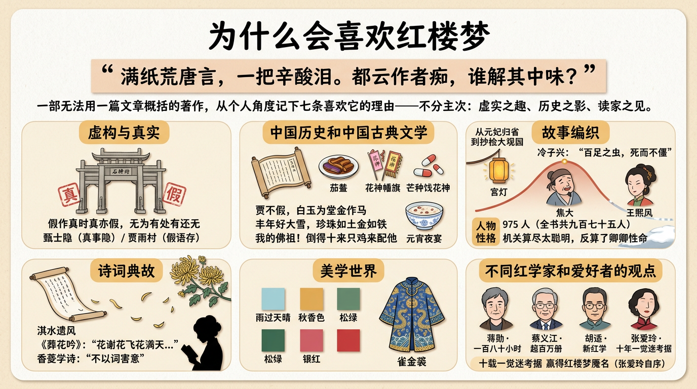

# 為什麼會喜歡紅樓夢

> 簡體版：[為什麼會喜歡紅樓夢](https://github.com/j3ffyang/history/blob/main/docs/260908-why-love-hlm-zh-hans.md)

說明 (disclaimer)：
- 這部著作無法用一篇文章概括
- 從個人角度，記錄一些凌亂的觀點，分享部分體會，不分主次

## 虛構與真實

- **假作真時真亦假**——書名真假，人物真假，開卷第一回就玩起這個把戲。作者自云曾歷過一番夢幻，“故將真事隱去，而借‘通靈’之說，撰此《石頭記》一書也，故曰‘甄士隱’云云”“又何妨用假語村言，敷演出一段故事來……故曰‘賈雨村’云云”——甄士隱，諧“真事隱”；賈雨村，諧“假語存”[¹]。到甄士隱夢裡那座太虛幻境的石牌坊，兩邊一副對聯直書：**“假作真時真亦假，無為有處有還無。”** 更有開篇絕句 **“滿紙荒唐言，一把辛酸淚。都云作者痴，誰解其中味？”**——荒唐只是表面，真味藏在荒唐之外。
- **脂批裡的“真”**——個人偏愛《脂硯齋重評石頭記》。現存早期抄本甲戌、己卯、庚辰，卷首都頂著這個名字：甲戌本有“至脂硯齋甲戌抄閱再評，仍用《石頭記》”之語，庚辰本每冊目錄還標著“脂硯齋凡四閱評過”（甲戌為乾隆十九年，1754）[²]。脂硯齋與曹雪芹同一時代，且關係極近：胡適考定其人“是曹雪芹很親的族人”“大概是雪芹的嫡堂弟兄或從堂弟兄”；脂批裡還有一句痛語：“壬午除夕，書未成，芹為淚盡而逝。”不管出自脂硯齋還是畸笏叟，都說明批者是眼睜睜看著這部書“未成”的見證人[³]。他/她在批語裡“確認”的家事、人物與本事，按推理應該最接近真實。

## 中國歷史和中國古典文學

- **清朝初期，形形色色**——一部書就是一幅清代社會的橫斷面。貴族這一頭，第四回登場的那張“護官符”寫盡煊赫：“賈不假，白玉為堂金作馬。阿房宮，三百里，住不下金陵一個史。東海缺少白玉床，龍王來請金陵王。豐年好大雪，珍珠如土金如鐵。”四句諺俗口碑，把賈、史、王、薛四大家族的排場數了個遍，也點出他們“一損皆損，一榮皆榮”[⁵]。百姓那一頭，又借第六回劉姥姥一進榮國府的慌張寒酸寫出柴米油鹽。上至皇妃省親，下至村嫗求告，形形色色的人與事，都攏進一個故事裡。
- **衣食住行、歲時風俗的細述**——衣食住行、中藥、宗教、建築、風俗、婚喪嫁娶，樣樣有實質的細節。飲食最見講究：第四十一回一道家常的茄鯗，鳳姐隨口就報出做法——茄子去皮去穰，切成碎釘子用雞油炸，再配雞脯、香菌、新筍、蘑菇、五香豆腐乾各色乾果子，雞湯煨乾，加香油、糟油封壇——劉姥姥聽得搖頭，“我的佛祖！倒得十來只雞來配他，怪道這個味兒”[⁶]。節令風俗也寫得一絲不苟：第二十七回寫芒種餞花神，“芒種一過，便是夏日了，眾花皆卸，花神退位，須要餞行”，大觀園裡的女孩兒“或用花瓣柳枝編成轎馬，或用綾錦紗羅疊成旄幢”，滿園“繡帶飄飄，花枝招展”[⁷]。至於宅邸園林的營造、僧尼道婆的往還、喜事喪事的禮數，書中處處留筆，細到讓人幾乎可以循著它復原那個時代。
- **《紅樓夢大辭典》是很耐讀的“旅行讀物”**——我讀的是文化藝術出版社1990年出版的《紅樓夢大辭典》（馮其庸、李希凡主編）[⁴]。在飛機旅行時，它是我的主要閱讀書籍。它按條目收錄小說中的人物、詩詞、風俗、器物、典故等各類細目，每一條都交代得十分詳實，不妨一條一條翻閱。
- **真是一部百科全書**——中藥配方、過節食物，這類細節俯拾即是。第七回寶釵那味“冷香丸”說得頭頭是道：春天白牡丹花蕊十二兩、夏天白荷花蕊十二兩、秋天白芙蓉蕊十二兩、冬天白梅花蕊十二兩，於次年春分這日曬乾研末，又取雨水、白露、霜降、小雪四節氣的雨露霜雪各十二錢調勻，丸成龍眼大的丸子，埋在花根底下，“若發了病時，拿出來吃一丸，用十二分黃柏煎湯送下”[⁸]。過節的食物也寫得實在：第五十四回元宵夜宴，席到深處賈母覺餓，鳳姐忙回“有預備的鴨子肉粥”，賈母要清淡些，便“也有棗兒熬的粳米粥”備著，最後是杏仁茶合了口味[⁹]。藥有配伍，食有時令，器用、衣飾、房舍、禮數一應俱全——說它是“百科全書”，並不誇張。

## 故事編織

- **敘事跌宕起伏，喜中寓悲**——全書由盛而衰的脈絡清清楚楚：第十七、十八回元妃歸省，大觀園燈綵輝煌，是全書光景最盛的頂點；可就在最尊榮的場面裡，元妃與賈母、王夫人“滿心裡皆有許多話，只是俱說不出，只管嗚咽對泣”，一句“當日既送我到那不得見人的去處”，道盡盛景底下的悲涼[¹⁰]。此後的榮國府由盛轉衰：第七十四回“惑奸讒抄檢大觀園”，第七十七回晴雯抱屈夭亡（“俏丫鬟抱屈夭風流”），秦可卿臨終託夢所說的“盛筵必散”（第十三回），在字裡行間一一應驗[¹¹]。
- **草蛇灰線，伏脈千里**——打下的伏筆，在未來回目裡再一一接上，這是最讓人上癮的地方。第二回冷子興演說榮國府，一句“百足之蟲，死而不僵”“如今的兒孫，竟一代不如一代了”，早已為賈府判了緩刑[¹²]；到第五回，太虛幻境的判詞與《紅樓夢曲》更把十二釵乃至全書人物的結局“劇透”了個徹底，收尾曲《飛鳥各投林》唱道“好一似食盡鳥投林，落了片白茫茫大地真乾淨”，彷彿是全書結局的一段大綱[¹³]。往後的回目，果然一筆一筆照著這預言落墨。

## 人物性格

- **人物眾多，性格迥異**——全書人物近千：上至皇妃誥命、王公貴族，下至丫鬟小廝、僧尼道婆、村嫗市儈，人人是人，各有各的聲口做派。據徐恭時統計，全書共九百七十五人，其中有姓名稱謂者七百三十二人[¹⁴]。
- **細緻的人物刻畫**——曹雪芹幾乎不開口評說人物，性格全從言行里長出來。寫焦大，幾乎只靠第七回一場醉罵：夜間被派去送秦鍾，借酒撒潑，從大總管賴二一路罵到主子，“爬灰的爬灰，養小叔子的養小叔子”，醉到連“紅刀子進去白刀子出來”這樣的狠話都說得顛倒。一句醉罵，既掀開寧府的遮羞布，也寫足了這個從死人堆裡背出太爺、自己肯喝馬溺活命的老僕的忠耿與落拓[¹⁵]。
- **沒有黑白，沒有臉譜化**——書中沒有絕對的善，也沒有絕對的惡。鳳姐一例最見分寸：她應賈珍之託進寧國府協理喪事，威重令行，日夜不暇，籌劃得十分整肅，合族上下無不稱歎（第十三回、第十四回）；轉身又在饅頭庵包攬詞訟，一句“你叫他拿三千兩銀子來，我就替他出這口氣”，貪贓弄權毫不含糊（第十五回）。而第五回的紅樓夢曲《聰明累》早已為她的精明寫下了判詞：“機關算盡太聰明，反算了卿卿性命”[¹⁶]。能幹而貪婪，精明而覆滅——這才是《紅樓夢》裡的人，不是戲臺上塗了臉譜的角色。

## 詩詞典故

- **眾多詩詞典故**——全書詩詞曲賦與典故俯拾即是，僅《詩經》就有多處化用。大觀園題對額時，瀟湘館擬題“淇水遺風”，典出《詩經·衛風·淇奧》；寶玉為稻香村題“新漲綠添浣葛處，好雲香護採芹人”，“浣葛”出於《周南·葛覃》，“采芹”出於《魯頌·泮水》[¹⁷]。
- **從作者的維度讀詩詞**——曹雪芹借詩寫人，詩即是人物。《葬花吟》是黛玉一生的哀音，“花謝花飛花滿天，紅消香斷有誰憐？”[¹⁸]；海棠詩社的菊花詩，黛玉的《詠菊》《問菊》《菊夢》三首被公評為前三，推為魁首[¹⁹]。
- **學詩的路徑**——香菱學詩一節，黛玉教她先讀王維五律一百首，再讀杜甫七律、李白七絕，說“第一立意要緊”“不以詞害意”[²⁰]。這既是作者的讀詩心得，也給今天的讀者指了一條學詩的路徑。

## 美學世界

美是抽象的，但《紅樓夢》的美可以具體去體會：

- **文字之美**——白描寥寥數筆，人物便呼之欲出。鳳姐出場未見其人先聞其聲：“我來遲了，不曾迎接遠客！”一句笑語寫盡她的張揚與得意[²¹]。
- **色彩之美**——器物紗羅，連顏色的名字都像詩。軟煙羅只有四樣顏色：雨過天晴、秋香色、松綠、銀紅，糊了窗屜遠遠看去，像一團煙霧[²²]。
- **衣著之美**——服飾的形制、面料、配色無不講究。寶玉那件雀金呢是俄羅斯國拿孔雀毛拈線織成，燒了個洞連織補匠都不認得，最後是病中的晴雯咬牙補好[²³]。
- **詩詞之美**——詩詞曲賦融入敘事，既是人物性情的流露，也是作者情思之所在。各類詩詞典故與讀法，詳見“詩詞典故”一節。

## 不同紅學家和愛好者的觀點

- **蔣勳，把《紅樓夢》講成與生命對接的書**——蔣勳（1947年生，生於西安，成長於臺北，臺灣畫家、作家與美學傳播者）的《蔣勳細說紅樓夢》，是他自己反覆閱讀《紅樓夢》三十多遍之後的系列講座錄音，從第一回一路講到第八十回，總共約一百八十個小時[²⁴]。他的講法幾乎不做繁瑣考據，而是從美學和情感出發，貼著文本講人物、講細節，講得很慢、很體貼。網上流傳林青霞的評價——聽蔣勳講《紅樓夢》像是“半顆安眠藥”。這三年裡，這套音訊我聽了兩遍。
- **蔡義江，把詩詞曲賦單獨講出來**——蔡義江（1934—2026，浙江寧波人，中國紅學研究者）的《紅樓夢詩詞曲賦評註》，1979年由北京出版社初版，累計印行超過百萬冊，被視為紅學普及的經典之作。這本書把小說中的詩詞、曲、賦、謎語、酒令、聯額逐一收齊，逐首評註；更難得的是，它前八十回以脂評本為底本，凡與程高排印本文字有異處都一一註明[²⁵]。想讀懂《紅樓夢》裡的詩，這是繞不開的一本。
- **胡適和張愛玲**——網路上的相關文章眾多，不再贅述，只記其大勢：胡適（1891—1962）的《紅樓夢考證》初稿完成於1921年春，隨即在上海亞東圖書館的排印本《紅樓夢》上刊出。文章力破流傳百年的索隱舊說，考定作者是曹雪芹，斷言“《紅樓夢》這部書是曹雪芹的自敘傳”，由此開闢了“新紅學”[²⁶]。張愛玲（1920—1995）則幾乎是另一極——她放下小說創作，用十年光陰做版本考據，寫成《紅樓夢魘》，1977年由臺北皇冠出版社初版，從早期抄本的文字差異裡推想曹雪芹的創作過程與原著樣貌；她在自序裡自嘲：“十年一覺迷考據，贏得紅樓夢魘名。”[²⁷]
- **喜馬拉雅上的播主**——此外，喜馬拉雅上還有不少講《紅樓夢》的播主，內容寬廣，研究有深度，或逐回細講，或專談人物、版本，拿來搭配通勤和睡前的零碎時間，別有一番收穫。
- **緩慢閱讀**——緩慢閱讀，和當今快速的生活工作節奏完全不同。有些內容，一年後再讀，觀點和理解又增添不同的角度。這本書值得這樣，慢慢讀。

## 引用來源

- 曹雪芹《紅樓夢》第一回——“故將真事隱去……撰此《石頭記》一書也，故曰‘甄士隱’云云”“用假語村言……故曰‘賈雨村’云云”、太虛幻境石牌坊對聯“假作真時真亦假，無為有處有還無”、絕句“滿紙荒唐言，一把辛酸淚。都云作者痴，誰解其中味？”，維基文庫/中國哲學書電子化計劃，訪問日期：2026-09-09
- 《脂硯齋重評石頭記》早期抄本——甲戌本（“至脂硯齋甲戌抄閱再評，仍用《石頭記》”）、己卯本、庚辰本（各冊目錄標“脂硯齋凡四閱評過”，庚辰為乾隆二十五年，1760），維基文庫，訪問日期：2026-09-09
- 中國社會科學院近代史研究所《胡適與甲戌本〈石頭記〉》——胡適考證脂硯齋“是曹雪芹很親的族人”“大概是雪芹的嫡堂弟兄或從堂弟兄”；並據批語“壬午除夕，書未成，芹為淚盡而逝”考定曹雪芹卒於壬午除夕，cssn.cn，訪問日期：2026-09-09
- 馮其庸、李希凡主編《紅樓夢大辭典》，文化藝術出版社，1990年1月
- 曹雪芹《紅樓夢》第四回——護官符（“賈不假，白玉為堂金作馬。阿房宮，三百里，住不下金陵一個史。東海缺少白玉床，龍王來請金陵王。豐年好大雪，珍珠如土金如鐵”；四家“一損皆損，一榮皆榮”）；第六回“劉姥姥一進榮國府”，維基文庫/中國哲學書電子化計劃，訪問日期：2026-09-09
- 曹雪芹《紅樓夢》第四十一回——茄鯗（“把才下來的茄子把皮簽了……用雞湯煨乾，將香油一收，外加糟油一拌，盛在瓷罐子裡封嚴”；劉姥姥“我的佛祖！倒得十來只雞來配他，怪道這個味兒”），維基文庫/中國哲學書電子化計劃，訪問日期：2026-09-09
- 曹雪芹《紅樓夢》第二十七回——芒種餞花神（“凡交芒種節的這日，都要設擺各色禮物，祭餞花神，言芒種一過，便是夏日了，眾花皆卸，花神退位，須要餞行”），維基文庫，訪問日期：2026-09-09
- 曹雪芹《紅樓夢》第七回——薛寶釵冷香丸配方（“要春天開的白牡丹花蕊十二兩……用十二分黃柏煎湯送下”；通行本此處或作“用一錢二分黃柏煎湯送下”），維基文庫，訪問日期：2026-09-09
- 曹雪芹《紅樓夢》第五十四回——元宵夜宴（“又上湯時，賈母說道：‘夜長，覺的有些餓了。’鳳姐兒忙回說：‘有預備的鴨子肉粥。’賈母道：‘我吃些清淡的罷。’鳳姐兒忙道：‘也有棗兒熬的粳米粥，預備太太們吃齋的。’”；回目“史太君破陳腐舊套　王熙鳳效戲彩斑衣”），維基文庫/中國哲學書電子化計劃，訪問日期：2026-09-09
- 曹雪芹《紅樓夢》第十七回、第十八回——元妃歸省（“滿心裡皆有許多話，只是俱說不出，只管嗚咽對泣”“當日既送我到那不得見人的去處”），脂本回目作“大觀園試才題對額　榮國府歸省慶元宵”，程甲本分作“皇恩重元妃省父母　天倫樂寶玉呈才藻”；第七十四回“惑奸讒抄檢大觀園”、第七十七回“俏丫鬟抱屈夭風流”——家道由盛轉衰，維基文庫/中國哲學書電子化計劃，訪問日期：2026-09-09
- 曹雪芹《紅樓夢》第十三回——秦可卿託夢“盛筵必散”，維基文庫，訪問日期：2026-09-09
- 曹雪芹《紅樓夢》第二回——冷子興演說榮國府（“百足之蟲，死而不僵”“如今的兒孫，竟一代不如一代了”），維基文庫，訪問日期：2026-09-09
- 曹雪芹《紅樓夢》第五回——十二釵判詞與《紅樓夢曲》（收尾·《飛鳥各投林》：“好一似食盡鳥投林，落了片白茫茫大地真乾淨”），維基文庫，訪問日期：2026-09-09
- 徐恭時《紅樓夢究竟寫了多少人物》，《上海師範學院學報》1982年第2期
- 曹雪芹《紅樓夢》第七回——“送宮花賈璉戲熙鳳　宴寧府寶玉會秦鍾”，焦大醉罵（“爬灰的爬灰，養小叔子的養小叔子”；“紅刀子進去白刀子出來”為脂本文字，通行本多作“白刀子進去，紅刀子出來”），維基文庫，訪問日期：2026-09-09
- 曹雪芹《紅樓夢》第五回（《紅樓夢曲·聰明累》）、第十三回（“秦可卿死封龍禁尉　王熙鳳協理寧國府”）、第十四回（“籌畫得十分的整肅”）、第十五回（“王鳳姐弄權鐵檻寺　秦鯨卿得趣饅頭庵”）——鳳姐之才幹與貪權（“機關算盡太聰明，反算了卿卿性命”），維基文庫/中國哲學書電子化計劃（脂本系統），訪問日期：2026-09-09
- 曹雪芹《紅樓夢》第十七回——大觀園題對額，“淇水遺風”、浣葛、采芹等典故（淇奧見《詩經·衛風》，浣葛見《周南·葛覃》，采芹見《魯頌·泮水》），維基文庫，訪問日期：2026-09-09
- 曹雪芹《紅樓夢》第二十七回——林黛玉《葬花吟》（“花謝花飛花滿天”為脂抄本文字，通行本多作“花謝花飛飛滿天”），維基文庫，訪問日期：2026-09-09
- 曹雪芹《紅樓夢》第三十八回——“林瀟湘魁奪菊花詩”，黛玉《詠菊》《問菊》《菊夢》被推為魁首，維基文庫，訪問日期：2026-09-09
- 曹雪芹《紅樓夢》第四十八回——“慕雅女雅集苦吟詩”，黛玉教香菱學詩（“不以詞害意”“第一立意要緊”），維基文庫，訪問日期：2026-09-09
- 曹雪芹《紅樓夢》第三回——王熙鳳出場（“我來遲了，不曾迎接遠客！”），維基文庫，訪問日期：2026-09-09
- 曹雪芹《紅樓夢》第四十回——軟煙羅四色（庚辰本作“雨過天晴”，通行本多作“雨過天青”），維基文庫，訪問日期：2026-09-09
- 曹雪芹《紅樓夢》第五十二回——“勇晴雯病補雀金裘”（通行本回目或作“病補孔雀裘”），維基文庫，訪問日期：2026-09-09
- 蔣勳（1947—，生於西安，成長於臺北，臺灣畫家、作家、美學傳播者）《蔣勳細說紅樓夢》（有聲書，第1—80回，約180小時，反覆閱讀《紅樓夢》三十多遍後的系列講座錄音），中國國際廣播音像出版社，2011年
- 蔡義江（1934—2026，浙江寧波人，中國紅學研究者）《紅樓夢詩詞曲賦評註》，北京出版社1979年——前八十回以脂評本為底本，凡與程、高系統排印本異文處一一註明
- 胡適（1891—1962）《紅樓夢考證》（改定稿），1921年——力破索隱舊說，考定著者為曹雪芹，“《紅樓夢》這部書是曹雪芹的自敘傳”，開闢新紅學/考證紅學，維基文庫，訪問日期：2026-09-09
- 張愛玲（1920—1995）《紅樓夢魘》，臺北皇冠出版社，1977年8月初版——自序“十年一覺迷考據，贏得紅樓夢魘名”；書名出自宋淇戲稱“Nightmare in the Red Chamber（紅樓夢魘）”
