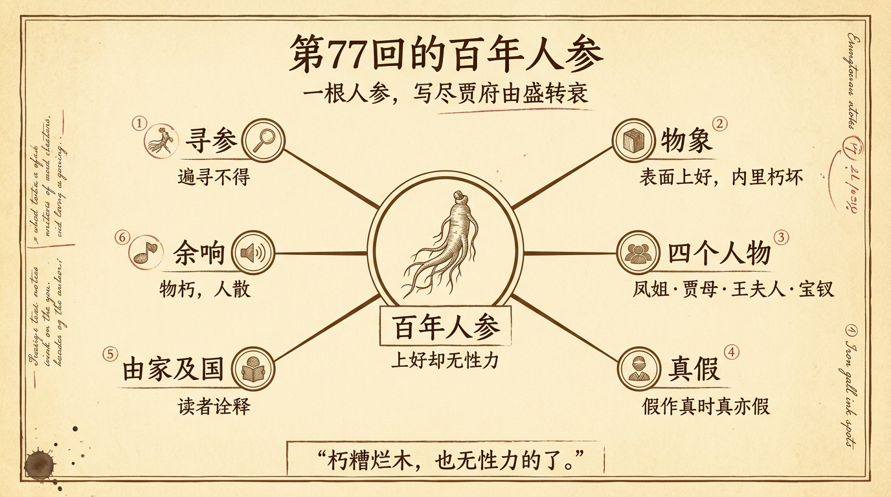

# 第77回的百年人參

> 簡體版：[第77回的百年人參](https://github.com/j3ffyang/history/blob/main/docs/260909-hlm-ch77-zh-hans.md)

《紅樓夢》第七十七回的回目是"俏丫鬟抱屈夭風流　美優伶斬情歸水月"——寫晴雯被逐、抱屈而亡，寫芳官、藕官、蕊官三人斬斷塵緣、出家為尼。這是一回充滿離散與死亡的書。可它偏偏用一件看似不相干的日常瑣事開頭：王夫人要為病中的王熙鳳配一料調經養榮丸，翻箱倒櫃，只差二兩上等人參。[¹]

一根藥引子，為什麼值得放在整回的開頭？因為它不是閒筆。它是全書寫"盛筵必散"最凝練的一個物象。

## 一、尋參：一場遍尋不得的尷尬

故事從王夫人的藥方開始。鳳姐病著，需要"上等人參二兩"配調經養榮丸。王夫人翻尋了半日，只在小匣裡找到幾枝"簪挺粗細"的細參，又翻出一大包參須碎末。她焦躁地說："用不著偏有，但用著了，再找不著。"彩雲說想是沒了，上次那邊的太太（邢夫人）來尋了些去；問鳳姐，鳳姐只有些"參膏蘆須"；問邢夫人，邢夫人說早已用完。最後只能親身去問賈母。賈母命鴛鴦取出"當日所餘的"，竟還有一大包，"皆有手指頭粗細的"。[¹]

到這裡，讀者大約以為問題解決了：到底老太太手裡還有好東西。可東西送出去，醫生的回話卻澆下一盆冷水——

> 但這一包人參固然是上好的，如今就連三十換也不能得這樣的了，但年代太陳了。這東西比別的大不同，憑是怎樣好的，只過一百年後，便自己就成了灰了。如今這個雖未成灰，然已成了朽糟爛木，也無性力的了。[¹]

一句話，把"最好"和"無用"疊在了一起。這是上等人參，好到市面上三十換也換不來；但它已經"年代太陳"，只剩一副空殼，"朽糟爛木，無性力的了"。

王夫人聽了，"低頭不語，半日"，才說只好去買二兩。她還有一句極要緊的吩咐：倘若老太太問起，只說用的是老太太的，不必多說。體面要維持，哪怕是在自家人面前。[¹]

接下來是薛寶釵出面。她點破市面上的人參"都沒好的"——縱有一枝全的，也要"截做兩三段，鑲嵌上蘆泡須枝，摻勻了好賣"；薛家開著鋪子，常和參行交易，可以託人從參行兌"未作的原枝好參"二兩。王夫人感嘆"賣油的娘子水梳頭"，自己家裡有好的，不知給了人多少，輪到自己用，反倒各處求人。寶釵答得從容："這東西雖然值錢，究竟不過是藥，原該濟眾散人才是。咱們比不得那沒見世面的人家，得了這個，就珍藏密斂的。"[¹]

這一段尋參的瑣細，**脂硯齋**看在眼裡。王夫人命人把辨不清的藥"各包記上名字"送去給醫生認時，庚辰本有一句雙行夾批：**"此等家常細事豈是揣摩得……"**——這樣的家常瑣碎，不是憑空揣摩得出來的（批語後半已殘缺）。一句"豈是揣摩得"，恰好點明：這一場尋參的窘迫，寫的是親歷的真事、真情，而非編造。[¹⁰]

## 二、物象：百年人參，就是賈府的祖業

把這段讀成一場單純的尋藥，就浪費了它。

"一大包手指頭粗細"的上等人參，是賈府表面的排場；"朽糟爛木，也無性力的了"，是它內裡的實況。東西還在，效力沒了；架子還在，氣數盡了。這不就是冷子興在第二回說的那句"百足之蟲，死而不僵"嗎——"如今的兒孫，竟一代不如一代了"。[²]

再往近處看，第七十二回已經把家計的窘迫寫盡：賈璉求鴛鴦偷運老太太查不著的金銀傢伙去當銀子；鳳姐為應付太監借銀，拿出兩個金項圈押了四百兩；林之孝勸賈璉"人口太重了"，該放幾家老家人出去、把姑娘們的月錢減一減。人參的"無性力"，正是這個背景下的一記註腳。[³]

而"瞞著賈母"這四個字，比尋不到參更涼。賈母是全府輩分最高的人，也是唯一還握有"當日所餘"的人。兒孫們要找最好的東西，得翻她的箱子；可找到了，又要瞞著她這參已經不能用了。舊時代的體面還在，只是已經要瞞著舊時代的人來維持。

## 三、人物：四個人，四種處境

這根人參像一面鏡子，照出四個人的處境。

**王熙鳳——那個被藥吊著的人。** 人參是給她配藥的。第七十二回已借平兒之口說出她的病：行經之後"瀝瀝淅淅的沒有止住"，鴛鴦聽了直說"這可不成了血山崩了"。[³] 她是全府最能幹、最要強的人，也是最早油盡燈枯的人。一根上好的人參是給她續命的，可連這"三十換也不能得"的參都已無性力——再好的藥，也救不回一個正在衰敗的家和一副正在崩壞的身體。

**賈母——舊時代的最後持有者。** 她的參是"當日所餘"，是昔日的餘溫。它"固然是上好的"，是全書裡品質最高的東西；可它"年代太陳"。賈母本人也是如此：她還在，那個講究、體面、豐足的時代就彷彿還在；可她已經老到只能拿出一包"未成灰"的舊物。賈母一死，這個家就再沒有可瞞、可依的人了。

**王夫人——維持者。** 她是尋參的人，也是掌家的人。她翻箱倒櫃、焦躁、嘆氣，最後決定去買，還要叮囑眾人瞞著老太太。她要維持的，不只是二兩藥，更是"這個家還拿得出上好人參"的體面。她越想撐住門面，越顯出這面已經撐不住。

**薛寶釵——外來者與新興的力量。** 最後真正解決問題的是寶釵。薛家是皇商，"領著內帑錢糧，採辦雜料"，有鋪子、有夥計、和參行有往來。[⁴] 她能拿到市面上"未作的原枝好參"，因為她站在商業的、外部的世界裡。賈府守著一包不能用的舊參，薛家卻能兌來新參——舊的貴族在退化，新的商業在上升。寶釵那句"原該濟眾散人才是"，歷來被讀作她的通達與大方；但若細品"咱們比不得那沒見世面的人家，得了這個，就珍藏密斂的"，也未必不是對賈府"珍藏密斂"的一記軟針。庚辰本在這裡恰好有一句雙行夾批，只有三個字：**"調侃語。"**——**脂硯齋**也聽出了這層調侃，沒有把寶釵這番話當作一本正經的說教。[¹⁰] 新參再好，也只是藥；它救得了病，換不回舊。

## 四、真假：市面上的假參，與全書的真假

寶釵說的另一件事，同樣值得留意：市面上的人參"截做兩三段，鑲嵌上蘆泡須枝，摻勻了好賣"——看著是整枝，其實是拼接；看著是真，其實是假。[¹]

《紅樓夢》第一回就寫下一副對聯："假作真時真亦假，無為有處有還無。"太虛幻境的牌坊上如此，人間市井的參行裡也如此。[⁵] 有意思的是，在這段故事裡，真與假的效力恰好錯位：賈府自己那包"真"參已經無性力，市面上的"假"參卻還能堂而皇之地賣。真者已朽，假者橫行——這正是全書由盛轉衰時的一種世相。

## 五、由家及國：一家的敗落，一個時代的隱喻

讀者讀到這裡，往往會不滿足於"一家一姓的興衰"，而想把這根人參讀得更大一些：從人物命運，到家族命運，再到國家命運。

這樣的讀法並非無根。原著自己卻先設了一道門：第一回借空空道人之口說，這書"無朝代年紀可考""地輿邦國，卻反失落無考"，作者又自云"將真事隱去"。[⁵] 曹雪芹並不明寫哪一個朝代。可正因為不明寫，後世的讀者才紛紛去猜它影射什麼。

一支是索隱派。蔡元培《石頭記索隱》（1917）開宗明義："《石頭記》者，清康熙朝政治小說也。作者持民族主義甚摯。書中本事，在吊明之亡，揭清之失，而尤於漢族名士仕清者，寓痛惜之意。"[⁶] 在這一路讀法裡，賈府的衰敗被看作明清易代、故國淪亡的隱喻。

另一支是自傳/考證派。胡適《紅樓夢考證》（1921）力破索隱舊說，考定作者為曹雪芹，斷言"《紅樓夢》這部書是曹雪芹的自敘傳"。[⁷] 在這一路讀法裡，賈府的興衰是曹家（曹寅一族）由盛而衰的投影。

兩派結論不同，方向卻一致：都把"一家之敗"讀成了"一個時代之變"。所謂家國同構——賈府就是那個時代的一個切片。而"百年人參"的"百年"，恰是一個耐人尋味的時間尺度：一百年，正是一個王朝由極盛走向衰朽的長度。人參"只過一百年後，便自己就成了灰"，未必是曹雪芹在寫某一朝某一代，但他把"百年"這個尺度放在一根藥上，讀者很難不想到比賈府更大的東西。

需要說明的是：這是**讀者的詮釋**，不是作者在第七十七回裡寫下的明示。把它當作事實去斷言"《紅樓夢》就是寫清朝滅亡"，越過了文本的邊界；把它當作一種有分量的讀法來體會，才是這根人參真正的餘味。

## 六、餘響：人參朽壞之後

人參的故事講完，本回才真正開始：**司棋**被逐出大觀園，**晴雯**被從炕上拖下來、攆回家中，抱屈而亡；**芳官**、**藕官**、**蕊官**三人，一個跟了水月庵的智通，兩個跟了地藏庵的圓心，斬情出家。**寶玉**在園中，先見**入畫**已去，又見司棋被帶走，只覺"如喪魂魄"；階下那株好好的海棠，無故死了半邊，他當作晴雯將亡的兆頭。[⁸]

蒙府本這一回的回前總批，把這種"物朽—人散"的筆法點得更透：**"司棋一事，前文著實寫來，此卻隨筆收去；晴雯一事，前文不過帶敘，此卻竭力發揮。前文借晴雯一襯，文不寂寞，此是借司棋一引，文愈曲折。"**一人輕帶，一人重寫，一物朽壞，一人離散，回目之下，全是"散"字。回末總批則盯著寶玉與晴雯的永訣：**"看晴雯與寶玉永絕一段，的是消魂文字……前文敘襲人奔喪時，寶玉夜來吃茶，先呼襲人，此又夜來吃茶，先呼晴雯。"**——連夜裡叫茶的一聲"晴雯"，都是前後照應的伏筆。[¹⁰]

物之朽壞，接著人之離散。一根無性力的舊參，就這樣成了整回離散的引子。往前看，是第一回"陋室空堂，當年笏滿床；衰草枯楊，曾為歌舞場"的《好了歌》注；往後看，是第五回《飛鳥各投林》那句"好一似食盡鳥投林，落了片白茫茫大地真乾淨"。[⁵][⁹] 中間這一包"未成灰"的人參，正好卡在"盛"與"散"之間——它是賈府最後的體面，也是它無力的證明。

從一根人參，讀到一個家，再讀到一個時代：這大概就是《紅樓夢》"草蛇灰線，伏脈千里"的寫法——它從不直說，只把最要緊的話，藏在一味藥裡。

## 引用來源

- 曹雪芹《紅樓夢》第七十七回——回目"俏丫鬟抱屈夭風流　美優伶斬情歸水月"；王夫人為鳳姐配調經養榮丸，尋上等人參二兩；賈母"當日所餘""一大包，皆有手指頭粗細的"；醫生回"固然是上好的……但年代太陳了……只過一百年後，便自己就成了灰了。如今這個雖未成灰，然已成了朽糟爛木，也無性力的了"；王夫人"低頭不語，半日"並囑"倘一時老太太問，你們只說用的是老太太的，不必多說"；薛寶釵論市面人參"截做兩三段，鑲嵌上蘆泡須枝，摻勻了好賣""原該濟眾散人才是""咱們比不得那沒見世面的人家，得了這個，就珍藏密斂的"；王夫人"賣油的娘子水梳頭"，維基文庫，訪問日期：2026-09-09
- 曹雪芹《紅樓夢》第二回——冷子興演說榮國府（"百足之蟲，死而不僵""如今的兒孫，竟一代不如一代了"），維基文庫，訪問日期：2026-09-09
- 曹雪芹《紅樓夢》第七十二回——鳳姐之病（平兒"只從上月行了經之後，這一個月竟瀝瀝淅淅的沒有止住"、鴛鴦"這可不成了血山崩了"）；賈璉求鴛鴦借當；鳳姐押金項圈；林之孝議裁減人口月錢，維基文庫，訪問日期：2026-09-09
- 曹雪芹《紅樓夢》第四回——薛家"本是書香繼世之家""雖是皇商……領著內帑錢糧，採辦雜料"，維基文庫，訪問日期：2026-09-09
- 曹雪芹《紅樓夢》第一回——"然朝代年紀，地輿邦國，卻反失落無考""第一件，無朝代年紀可考"；作者自云"將真事隱去"；太虛幻境牌坊對聯"假作真時真亦假，無為有處有還無"；《好了歌》注"陋室空堂，當年笏滿床；衰草枯楊，曾為歌舞場"，維基文庫，訪問日期：2026-09-09
- 蔡元培《石頭記索隱》，商務印書館，1917年——"《石頭記》者，清康熙朝政治小說也。作者持民族主義甚摯。書中本事，在吊明之亡，揭清之失，而尤於漢族名士仕清者，寓痛惜之意。"
- 胡適《紅樓夢考證》（改定稿），1921年——力破索隱舊說，考定著者為曹雪芹，斷言"《紅樓夢》這部書是曹雪芹的自敘傳"，開闢新紅學
- 曹雪芹《紅樓夢》第七十七回（後文）——司棋被逐、晴雯抱屈夭亡、芳官等出家；寶玉見海棠"無故死了半邊"以為兆應，維基文庫，訪問日期：2026-09-09
- 曹雪芹《紅樓夢》第五回——收尾·《飛鳥各投林》"好一似食盡鳥投林，落了片白茫茫大地真乾淨"，維基文庫，訪問日期：2026-09-09
- 《脂硯齋重評石頭記》第七十七回——庚辰本雙行夾批"此等家常細事豈是揣摩得……"（記於王夫人命醫生辨認藥材之後）、"調侃語"（記於薛寶釵論人參之後）；蒙府本回前總批"司棋一事，前文著實寫來，此卻隨筆收去；晴雯一事，前文不過帶敘，此卻竭力發揮……"、回末總批"看晴雯與寶玉永絕一段，的是消魂文字……前文敘襲人奔喪時，寶玉夜來吃茶，先呼襲人，此又夜來吃茶，先呼晴雯"，維基文庫《脂硯齋重評石頭記》，訪問日期：2026-09-09
