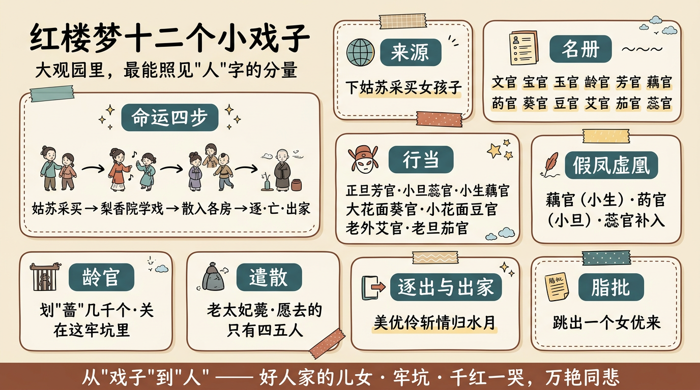

# 紅樓夢十二個小戲子

> 簡體版：[紅樓夢十二個小戲子](https://github.com/j3ffyang/history/blob/main/docs/260911-12-girl-actors-zh-hans.md)

大觀園裡，除了主子與丫鬟，還住著一群身份特殊的人：十二個從蘇州買來的女戲子。她們為元妃省親而買，學戲於梨香院，後來散入各房，最後或逐、或亡、或出家。在《紅樓夢》眾多人物裡，她們最容易被略過，卻也最能照見"人"字的分量。

## 一、來源：姑蘇採買，梨香院學戲

她們不是家生子，也不是陪房，而是"買來的"。第十六回，為預備元妃省親，賈薔被派去經辦戲班：

> 下姑蘇聘請教習，採買女孩子，置辦樂器行頭等事。[¹]

十二個女孩子就這樣從蘇州被買進賈府，安置在梨香院學戲。第五十八回遣散時，王夫人一句話點明瞭她們的來歷：

> 這學戲的倒比不得使喚的，他們也是好人家的兒女，因無能賣了做這事，裝醜弄鬼的幾年。[²]

"好人家的兒女"，卻"因無能賣了"——這一句，是她們全部命運的起點。

## 二、十二個女孩子：名與角色

書中並未在一處列出十二人的全名單。可考見者有：文官、寶官、玉官、齡官、芳官、藕官、菂（dì）官、葵官、豆官、艾官、茄官，以及菂官之後補入的蕊官——十二之數雖明，具體名單卻難復原。其中"菂"讀 dì，本義為蓮子；此名庚辰本作"菂官"，一作"藥官"。[⁸]

她們各有行當。第五十八回遣散時，明確交代了各人的角色與去向：

- 文官——賈母留下自使；
- 芳官——正旦，指與寶玉；
- 蕊官——小旦，送與寶釵；
- 藕官——小生，指與黛玉；
- 葵官——大花面，送與湘雲；
- 豆官——小花面，送與寶琴；
- 艾官——老外，送與探春；
- 茄官——老旦，尤氏討去。[²]

第三十六回又點出：十二人中，唱小旦的齡官唱得最好。[³]

## 三、女扮男裝與"假鳳虛凰"：藕官與菂官

戲臺上，她們常要女扮男裝。最動人的一段，是藕官與菂官。第五十八回回目即作"杏子陰假鳳泣虛凰"——通常解讀為："假鳳"是扮小生的藕官，"虛凰"是扮小旦的菂官。芳官向寶玉講出這段情由：

> 他竟是瘋傻的想頭，說他自己是小生，菂官是小旦，常做夫妻，雖說是假的，每日那些曲文排場，皆是真正溫存體貼之事，故此二人就瘋了，雖不做戲，尋常飲食起坐，兩個人竟是你恩我愛。菂官一死，他哭的死去活來，至今不忘，所以每節燒紙。[²]

藕官在杏樹下偷偷燒紙，祭的就是死去的菂官。寶玉撞見，替她遮掩，才引出這段隱情。後來補了蕊官，藕官待蕊官一般溫柔體貼。旁人問她是否"得新棄舊"，她答出一番痴理：

> 比如男子喪了妻，或有必當續絃者，也必要續絃為是。便只是不把死的丟過不提，便是情深意重了。若一味因死的不續，孤守一世，妨了大節，也不是理，死者反不安了。[²]

戲是假的，情是真的；臺上扮夫妻，臺下竟成生死之交。這正是"女扮男裝"在《紅樓夢》裡最深的一層：性別是扮出來的，情卻不是。

## 四、齡官：不肯唱、劃"薔"、情悟梨香院

十二人裡，齡官寫得最重。第三十回，寶玉在薔薇花架下看見一個女孩子蹲在花下，用金簪劃地，劃來劃去只一個字——

> 畫來畫去，還是個"薔"字。再看，還是個"薔"字……已經畫了有幾千個"薔"。[⁴]

"薔"是賈薔的"薔"。這一回的回目，庚辰本作"椿靈劃薔痴及局外"；此外尚有"齡官劃薔痴及局外""椿齡劃薔痴及局外"等異文，各本歸屬待考。[⁴]

第三十六回，寶玉慕名去梨香院找齡官唱《牡丹亭》的"嫋晴絲"，卻碰了一鼻子灰。齡官躺在枕上，"文風不動"，正色道："嗓子啞了。前兒娘娘傳進我們去，我還沒有唱呢。"——連元妃傳喚她都未必肯唱，何況寶玉。[³]

緊接著，賈薔花一兩八錢銀子買了只雀兒來哄她，齡官卻冷笑了：

> 你們家把好好的人弄了來，關在這牢坑裡學這個勞什子還不算，你這會子又弄個雀兒來，也偏生幹這個。你分明是弄了他來打趣形容我們，還問我好不好。[³]

這一句"關在這牢坑裡"，是戲子對自身處境最清醒的一次控訴。寶玉在旁邊看呆了，"這才領會了劃'薔'深意"，回去後對襲人長嘆：

> 從此後只是各人各得眼淚罷了……自此深悟人生情緣，各有分定。[³]

齡官的一"痴"，竟成了寶玉"情悟"的引子。

## 五、遣散：老太妃薨，各歸其主

第五十八回，一位老太妃薨逝，敕諭"凡有爵之家，一年內不得筵宴音樂"；其時"各官宦家，凡養優伶男女者，一概蠲免遣發"，賈府便議定遣發這十二個女孩子。[²]

王夫人主張給銀子讓她們各自回家：

> 如今有這機會，不如給他們幾兩銀子盤費，各自去罷……咱們如今損陰壞德，而且還小器。[²]

可問下來，"倒有一多半不願意回家的"：有的說父母"只以賣我們為事，這一去還被他賣了"；有的父母已亡，或被叔伯兄弟所賣；有的無人可投；有的"戀恩不捨"。願去的只有四五人。於是去者由乾娘領回，不願去者分散在園中使喚——就是上面那份"各歸其主"的名單。[²]

從這一刻起，"戲子"成了各房的丫頭。她們的戲，唱完了。

## 六、逐出與出家：晴雯、芳官、四兒；芳官、藕官、蕊官

第七十七回，王夫人親來怡紅院查人，一口氣逐出三人：**晴雯**被從炕上拖下來攆出，不久抱屈夭亡；**芳官**、**四兒**（蕙香）也被叫家人領出。這一回的回目下句，正是"美優伶斬情歸水月"。[⁵]

被逐之後，芳官與藕官、蕊官三人不肯就範，尋死覓活，只要剪了頭髮做尼姑。最後：

> 從此芳官跟了水月庵的智通，蕊官藕官二人跟了地藏庵的圓心，各自出家去了。[⁵]

晴雯死於逐出，芳官三人則斬斷塵緣。物朽人散之後，戲子們以最決絕的方式退出了這場盛筵。

## 七、脂批裡的她們

脂批（含蒙府本批語）對這群女孩子，態度頗為複雜。

第三十六回回前批（庚辰本、己卯本）直接點出"梨香院"的用意：

> **梨香院是明寫大家蓄戲不免姦淫之陋，可不慎哉，慎哉！**[⁶]

這是把"蓄養戲子"看作世家的一種"陋"，語氣嚴厲。同一回的蒙府本回前總批卻另是一種口吻：

> **造物何當作主張，任人稟受福修長。畫薔亦自非容易，解得臣忠子也良。**[⁶]

批的是"畫薔"——把齡官的一腔痴情，比作"臣忠子良"，讀出了其中的"忠"與"良"。

寫齡官拒絕寶玉唱曲時，蒙府本側批道：

> **非齡官不能如此做事，非寶玉不能如此忍。其文冷中濃具意蘊而。誠有"富貴不能移，威武不能屈"之意。**[⁶]

至於芳官，第五十八回寫她哭得狼狽、敞著褲腿，庚辰本雙行夾批讚道：

> **四字奇想，寫得紙上跳出一個女優來。**[⁶]

一句"跳出一個女優來"，是脂批對她們最生動的一次注目。

## 八、餘論：從"戲子"到"人"

戲子是"買來的"、供人"裝醜弄鬼"的營生。可在《紅樓夢》裡，曹雪芹偏讓她們一個個活成了"人"：藕官為亡者燒紙，齡官為處境冷笑，芳官被逐後寧肯出家也不肯"配人"。王夫人說她們是"好人家的兒女"，齡官說這園子是"牢坑"——兩句話之間，就是她們的一生。

她們從蘇州來，在梨香院學戲，散入大觀園，最後或死或散或入空門。讀《紅樓夢》，若只看見主子與丫鬟，便漏掉了這一群"美優伶"——而她們，恰恰是"千紅一哭，萬豔同悲"（第五回"千紅一窟""萬豔同杯"之諧音）裡，最早哭出聲的那幾個。[⁷]

## 引用來源

- 曹雪芹《紅樓夢》第十六回——回目"賈元春才選鳳藻宮　秦鯨卿夭逝黃泉路"；賈薔"下姑蘇聘請教習，採買女孩子，置辦樂器行頭等事"，維基文庫，訪問日期：2026-09-20
- 曹雪芹《紅樓夢》第五十八回——回目"杏子陰假鳳泣虛凰　茜紗窗真情揆痴理"；老太妃薨、蠲免遣發十二個女孩子；王夫人"他們也是好人家的兒女，因無能賣了做這事，裝醜弄鬼的幾年""不如給他們幾兩銀子盤費，各自去罷"（脂本作"盤纏"）；遣散後各歸其主（文官、芳官、蕊官、藕官、葵官、豆官、艾官、茄官）；藕官與菂官"常做夫妻……兩個人竟是你恩我愛"、燒紙、續絃之論，維基文庫，訪問日期：2026-09-20
- 曹雪芹《紅樓夢》第三十六回——回目"繡鴛鴦夢兆絳芸軒　識分定情悟梨香院"；齡官"嗓子啞了"拒唱；賈薔買雀兒；齡官"你們家把好好的人弄了來，關在這牢坑裡學這個勞什子"；寶玉"自此深悟人生情緣，各有分定"；寶官、玉官，維基文庫，訪問日期：2026-09-20
- 曹雪芹《紅樓夢》第三十回——回目"寶釵借扇機帶雙敲　齡官劃薔痴及局外"（維基文庫《紅樓夢》本；庚辰本作"椿靈劃薔痴及局外"，見維基文庫《脂硯齋重評石頭記（庚辰本）》目錄）；齡官劃"薔"數千遍；"文官等十二個女子都放了學"，訪問日期：2026-09-20
- 曹雪芹《紅樓夢》第七十七回——回目"俏丫鬟抱屈夭風流　美優伶斬情歸水月"；王夫人逐晴雯、芳官、四兒；"從此芳官跟了水月庵的智通，蕊官藕官二人跟了地藏庵的圓心，各自出家去了"，維基文庫，訪問日期：2026-09-20
- 《脂硯齋重評石頭記》——第三十六回回前批（庚辰本、己卯本）"梨香院是明寫大家蓄戲不免姦淫之陋，可不慎哉，慎哉！"、蒙府本回前總批"造物何當作主張，任人稟受福修長。畫薔亦自非容易，解得臣忠子也良。"、蒙府本側批"非齡官不能如此做事，非寶玉不能如此忍……"；第五十八回庚辰本雙行夾批"四字奇想，寫得紙上跳出一個女優來。"，維基文庫《脂硯齋重評石頭記》，訪問日期：2026-09-20
- 曹雪芹《紅樓夢》第五回——茶名"千紅一窟"、酒名"萬豔同杯"（諧音"千紅一哭，萬豔同悲"），維基文庫，訪問日期：2026-09-20
- 菂官——"菂"讀 dì，本義為蓮子（《新華字典》、漢典"菂"條）；庚辰本作"菂官"（《脂硯齋重評石頭記》第五十八回，維基文庫）；一作"藥官"（維基百科"菂官"條），訪問日期：2026-09-25
