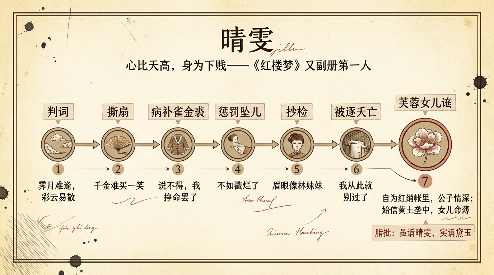

# 晴雯

> 簡體版：[晴雯](https://github.com/j3ffyang/history/blob/main/docs/260912-qingwen-zh-hans.md)

《紅樓夢》裡第一個出現在判詞中的人物，是晴雯。第五回，賈寶玉夢入太虛幻境，翻開金陵十二釵又副冊，看到的頭一首判詞，寫的就是她——那時她還沒在書中正式登場，命運卻已經寫定。

## 一、判詞與出身：霽（jì）月難逢，彩雲易散

又副冊的第一首判詞是：

> 霽月難逢，彩雲易散。心比天高，身為下賤。風流靈巧招人怨，壽夭多因毀謗生，多情公子空牽念。[¹]

"心比天高，身為下賤"八個字，"壽夭多因毀謗生"七個字——晴雯的一生，幾乎就是這兩句判詞的註腳。

她的出身，要等到第七十七回被逐之後，才由敘述者補出：她本是賴大家用銀子買來的丫頭，被買來時才十歲，"尚未留頭"，因為常跟賴嬤（mó）嬤進來，賈母見她生得伶俐標緻，十分喜愛，賴嬤嬤便把她孝敬了賈母；後來賈母又把她給了寶玉。[⁶] 所以脂批說她"前文不過帶敘"，真正為她"寫傳"，是到被逐、將死之時。[⁹] 她不知道自己的家鄉父母，"只知有個姑舅哥哥"。

## 二、撕扇子作千金一笑

晴雯的性格，最見鋒芒的一場戲在第三十一回。寶玉因她失手跌折了扇子，說了兩句重話，晴雯當場頂了回去：

> 二爺近來氣大的很，行動就給臉子瞧。前兒連襲人都打了，今兒又來尋我們的不是。要踢要打憑爺去。就是跌了扇子，也是平常的事。……[²]

到了晚上，寶玉吃酒回來，兩人和好。寶玉說，東西"原不過是借人所用"，扇子原是扇的，"你要撕著玩也可以使得，只是不可生氣時拿他出氣"。晴雯便真的把扇子接過來，"嗤的一聲，撕了兩半，接著嗤嗤又聽幾聲"。寶玉在旁笑著說"響的好，再撕響些！"，連麝（shè）月的扇子也奪過來給她撕。晴雯"倚在床上"說"我也乏了，明兒再撕罷"，寶玉笑道：

> 古人云，"千金難買一笑"，幾把扇子能值幾何！[²]

這一回的回目，就叫"撕扇子作千金一笑"。任性、嬌縱、要強，都在這幾把被撕碎的扇子裡。

## 三、胡庸醫看病與病補雀金裘

晴雯的病，起於第五十一回一晚的貪玩。她夜裡穿著小襖出去嚇麝月，吹了風，次日便"鼻塞聲重"。寶玉怕驚動王夫人，只悄悄從後門請了大夫——請來的卻是胡庸醫。晴雯從暖閣的幔帳裡伸出手去，那大夫看見：

> 這隻手上有兩根指甲，足有三寸長，尚有金鳳花染的通紅的痕跡。[³]

那大夫錯當她是府裡的小姐。藥方上開了枳實、麻黃，寶玉一看就急了："該死，該死，他拿著女孩兒們也象我們一樣的治，如何使得！……這枳實，麻黃如何禁得。" 他把這類峻烈之藥稱作"狼虎藥"（正文作"狼虎藥"，回目作"虎狼藥"，用字略異），另請了王太醫。這一節的回目下句，正是"胡庸醫亂用虎狼藥"。[³]

緊接著的第五十二回，是她最"勇"的一筆。寶玉得了一件賈母給的"雀金呢"褂子——"這是俄羅斯國拿孔雀毛拈了線織的"——不曾想頭一日後襟就燒了指頂大的一個洞。外頭織補匠、裁縫、繡匠都不認得這料子，沒人敢攬。病中的晴雯忍不住翻身，說：

> 這是孔雀金線織的，如今咱們也拿孔雀金線就象界線似的界密了，只怕還可混得過去。……說不得，我掙命罷了。[⁴]

她"挽了一挽頭髮，披了衣裳，只覺頭重身輕，滿眼金星亂迸"，卻"恨命咬牙捱著"，補兩針，又看看，織補兩針，又端詳端詳，"補不上三五針，伏在枕上歇一會"，直補到自鳴鐘敲過四下。補完，她說：

> 補雖補了，到底不象，我也再不能了！[⁴]

這一回的回目，就是"勇晴雯病補雀金裘"。

## 四、懲罰墜兒

同在第五十二回，晴雯還發了另一場火。平兒的手鐲"蝦鬚鐲"被小丫頭墜兒偷了，平兒怕晴雯"是塊爆炭"、"或打或罵"嚷出來，只悄悄告訴了麝月。晴雯聽說，"果然氣的蛾眉倒蹙，鳳眼圓睜"，立刻把墜兒叫來，"冷不防欠身一把將他的手抓住，向枕邊取了一丈青，向他手上亂戳"，罵道：

> 要這爪子作什麼？拈不得針，拿不動線，只會偷嘴吃。眼皮子又淺，爪子又輕，打嘴現世的，不如戳爛了！[⁴]

隨後做主把墜兒攆了出去。這件事，把她的"爆炭"脾性與"要強"寫得淋漓盡致——也埋下了日後為人所忌的根。

## 五、抄檢大觀園：眉眼像黛玉

第七十三回，傻大姐在山石處拾到一個"繡春囊"；第七十四回，王夫人震怒，王善保家的又趁機進讒，攛掇抄檢大觀園（"丟了一件要緊的東西"只是抄檢時對外的說辭）。抄到怡紅院，到了晴雯的箱子：

> 襲人等方欲代晴雯開時，只見晴雯挽著頭髮闖進來，豁一聲將箱子掀開，兩手捉著底子，朝天往地下盡情一倒，將所有之物盡都倒出。[⁵]

一場頂撞，硬氣到底。而更值得注意的，是王夫人此前對她的印象。王夫人說，上次進園逛去，看見"一個水蛇腰，削肩膀，眉眼又有些象你林妹妹的，正在那裡罵小丫頭"。[⁵]

"眉眼又有些象你林妹妹"——這一句在全書裡極重。晴雯與黛玉，不但眉眼相似，命運也相似：同樣心高、同樣遭讒、同樣早夭。甲戌本第八回雙行夾批已說"餘謂晴有林風，襲乃釵副，真真不假"；後世讀《紅樓夢》者由此生發出"晴為黛影、襲為釵副"的讀法。[⁹]

## 六、被逐與夭亡

第七十七回，王夫人親來怡紅院查人，把病中的晴雯"現從炕上拉了下來"，"蓬頭垢面，兩個女人才架起來去了"，還吩咐只許把貼身衣服撂出去。[⁶] 寶玉在後面哭道"我究竟不知晴雯犯了何等滔天大罪"，又疑心身邊有人走漏了私語。這一節，襲人作了解釋，寶玉那句反問——"怎麼人人的不是太太都知道，單不挑出你和麝月秋紋來？"——向來是讀者爭論的口子。[⁶]

當晚，寶玉私下去看晴雯。她躺在"蘆蓆土炕"上，渴了半日，叫半個人也叫不著；寶玉用"黑沙吊子"給她倒了一碗"絳紅"的粗茶，她"如得了甘露一般，一氣都灌下去了"。她說了最不甘心的一段話：

> 我雖生的比別人略好些，並沒有私情密意勾引你怎樣，如何一口死咬定了我是個狐狸精！我太不服。今日既已擔了虛名，而且臨死，不是我說一句後悔的話，早知如此，我當日也另有個道理。[⁶]

說罷，她"伸手取了剪刀，將左手上兩根蔥管一般的指甲齊根鉸下"（"鉸"讀 jiǎo），又把貼身的舊紅綾襖脫下，與寶玉換穿，說"這個你收了，以後就如見我一般"。這正是她鉸下指甲、與寶玉互換內衣的出處。而燈姑娘——那個一貫被人看輕的嫂子——聽牆角之後的判斷卻是：

> 誰知你兩個竟還是各不相擾。可知天下委屈事也不少。[⁶]

當夜，寶玉夢見晴雯從外頭走來，笑道："你們好生過罷，我從此就別過了。"[⁶] 醒來便哭道"晴雯死了"。她去世時，據誄（lěi）文所記，年僅十六。

## 七、芙蓉女兒誄

第七十八回的《芙蓉女兒誄》，是《紅樓夢》專為丫鬟而寫的一篇長祭文。這一回的回目是"痴公子杜撰芙蓉誄"——一字"痴"，一字"杜撰"，寶玉的身份與態度都在裡面。

**芙蓉花神。** 晴雯死時，有個小丫頭轉述她臨終的話：不是說死，是"如今天上少了一位花神，玉皇敕命我去司主"，她被差去"專管這芙蓉花的"。寶玉聽了，"不但不為怪，亦且去悲而生喜"，指著芙蓉笑道：

> 此花也須得這樣一個人去司掌。我就料定他那樣的人必有一番事業做的。[⁷]

**前序後歌，遠師楚人。** 寶玉決意"另開生面"，不拘世俗祭禮，連文體也要"自放手眼"。他自述其法，要上追《大言》《招魂》《離騷》《九辯》《枯樹》《問難》《秋水》《大人先生傳》一路，或單句，或短聯，或實典，或譬喻，"隨意所之，信筆而去，喜則以文為戲，悲則以言志痛"。他"用晴雯素日所喜之冰鮫縠一幅楷字寫成，名曰《芙蓉女兒誄》，前序後歌"（冰鮫縠："鮫"讀 jiāo，"縠"讀 hú，一種縐紗；維基文庫《紅樓夢》此句"縠"作"穀"，本文從脂本及誄序作"縠"），於月下掛在芙蓉枝上，泣涕而念。[⁷]

**誄文裡的晴雯。** 序文開端套用祭文常式，卻寫得極鄭重：

> 維太平不易之元，蓉桂競芳之月，無可奈何之日，怡紅院濁玉，謹以群花之蕊、冰鮫之縠、沁芳之泉、楓露之茗……致祭於白帝宮中撫司秋豔芙蓉女兒之前。[⁷]

寫她的品貌，連用四喻：

> 其為質則金玉不足喻其貴，其為性則冰雪不足喻其潔，其為神則星日不足喻其精，其為貌則花月不足喻其色。[⁷]

寫她的被害，是"花原自怯，豈奈狂飆，柳本多愁，何禁驟雨"；是"高標見嫉，閨幃恨比長沙，直烈遭危，巾幗慘於羽野"——以含冤受屈的古人為比，語氣已遠超一個丫鬟的分量。[⁷] 結尾一聯，更是全篇的頂點（"綃"讀 xiāo，"壟"讀 lǒng）：

> 自為紅綃帳裡，公子情深，始信黃土壟中，女兒命薄！[⁷]

後一段"歌而招之"，鋪陳素女、宓妃、弄玉、嵩嶽之妃、驪山之姥諸神相迎，彷彿真在招一個仙去之魂，末了收在六個字：

> 嗚呼哀哉！尚饗！[⁷]

**"竟是為誰之讖"：黛玉改字。** 誄文念罷，第七十九回里，花影中走出來的是林黛玉。她先說"好新奇的祭文！"，又指出"紅綃帳裡"未免熟濫，提議改用他們窗上現成的"霞影紗"，改成"茜紗窗下，公子多情"（"茜"讀 qiàn）。寶玉一改再改，最後定為：

> 茜紗窗下，我本無緣，黃土壟中，卿何薄命。[⁸]

黛玉聽了，當場"忡然變色"（"忡"讀 chōng），"心中雖有無限的狐疑亂擬，外面卻不肯露出"，只連忙含笑點頭稱妙。[⁸]

**脂批怎麼讀這篇誄。** 正因這一改，脂硯齋留下了極關鍵的一條批語。第七十九回庚辰本雙行夾批說：

> 如此我亦為妥極。但試問當面用"爾""我"字樣究竟不知是為誰之讖，一笑一嘆。一篇誄文總因此二句而有，又當知雖誄晴雯而又實誄黛玉也。奇幻至此！若云必因晴雯誄，則呆之至矣。[⁹]

同回另一條庚辰雙行夾批更直白："慧心人可為一哭。觀此句便知誄文實不為晴雯而作也。"[⁹] 蒙府本回末總批也點出，作誄之後"黛玉飄然而至，增一番感慨"。[⁹]

需要說明的是：這是脂批與後世紅學的**讀法**，不是曹雪芹在正文裡明說的意思。寶玉改句、黛玉變色的白描是事實，脂批"實誄黛玉"是解釋——兩者層次不同。本文所引《紅樓夢》正文均據維基文庫，脂批抄本的用字、回目與他本互有異文，涉及處已隨文標明版本——如維基文庫《脂硯齋重評石頭記》此條批語錄作"雖晴雯"（無"誄"字），與本文所引讀法有一字之異；凡脂批與"晴為黛影""實誄黛玉"一類讀法，均屬脂硯齋及後世紅學家的詮釋，而非作者的明確陳述。

## 八、脂批裡的晴雯

脂硯齋對晴雯，是偏愛而痛惜的。最集中一批批語在第七十七回。寫她被逐時，庚辰本雙行夾批連下數條：

> 只此一句便是晴雯正傳。可知晴雯為聰明風流所害也。一篇為晴雯寫傳，是哭晴雯也。非哭晴雯，乃哭風流也。[⁹]

又有"總哭晴雯"、"不獨為晴雯一哭，且為寶玉一哭亦可"、"餘亦不知，蓋此等冤實非晴雯一人也"等語。[⁹] 寫她與寶玉永絕，蒙府本回末總批說這是"消魂文字"，並留意到全書的一處呼應：前文襲人奔喪時寶玉夜裡吃茶先呼襲人，此處又夜來吃茶先呼晴雯。[⁹]

第七十八回的脂批，則指出這一回文章的主次。蒙府本回前總批說：

> 文有賓主，不可誤。此文以《芙蓉誄》為主，以《姽嫿詞》為賓……[⁹]

也就是說，同回那篇寫林四娘、恆王的《姽嫿（guǐ huà）詞》，在脂批看來只是陪襯，《芙蓉女兒誄》才是這一回真正的主體。

## 九、餘論：心比天高，身為下賤

晴雯的故事，始於第五回一首判詞，終於第七十八回一篇誄文。判詞裡的每一句，幾乎都在她身上應驗了。

《芙蓉女兒誄》之所以動人，不只因為辭采。寶玉以楚辭的腔調（遠師《離騷》《九辯》）來寫這篇祭文，又把晴雯比作遭讒受屈的古人——這就為一個丫鬟的死亡，爭了一份在書裡、在禮法之外才有的體面。脂批又借這一改，把這份哀悼悄悄指向全書更大的悲劇：晴雯之死，是黛玉之死的先聲。

讀晴雯，讀的是一個人如何在"下賤"的身份裡，始終不肯把自己活低。

## 引用來源

- 曹雪芹《紅樓夢》第五回——回目（庚辰本）"遊幻境指迷十二釵　飲仙醪曲演紅樓夢"；金陵十二釵又副冊晴雯判詞"霽月難逢，彩雲易散。心比天高，身為下賤。風流靈巧招人怨，壽夭多因毀謗生，多情公子空牽念"，維基文庫，訪問日期：2026-09-26
- 曹雪芹《紅樓夢》第三十一回——回目"撕扇子作千金一笑　因麒麟伏白首雙星"；晴雯跌扇、頂撞、撕扇；"千金難買一笑，幾把扇子能值幾何"，維基文庫，訪問日期：2026-09-26
- 曹雪芹《紅樓夢》第五十一回——回目"薛小妹新編懷古詩　胡庸醫亂用虎狼藥"；晴雯夜出受寒致病；從幔中伸手，"兩根指甲，足有三寸長，尚有金鳳花染的通紅的痕跡"；胡庸醫誤用枳實、麻黃，寶玉斥為"狼虎藥"，維基文庫，訪問日期：2026-09-26
- 曹雪芹《紅樓夢》第五十二回——回目"俏平兒情掩蝦鬚鐲　勇晴雯病補雀金裘"；平兒議蝦鬚鐲、墜兒偷鐲；晴雯用一丈青戳墜兒並被攆出；雀金呢燒洞、"說不得，我掙命罷了"、病補雀金裘、"補雖補了，到底不象"，維基文庫，訪問日期：2026-09-26
- 曹雪芹《紅樓夢》第七十三、七十四回——第七十三回回目"痴丫頭誤拾繡春囊　懦小姐不問累金鳳"，傻大姐拾繡春囊；第七十四回回目"惑奸讒抄檢大觀園　矢孤介杜絕寧國府"（庚辰本"抄檢"作"抄揀"），王善保家的進讒，王夫人"水蛇腰，削肩膀，眉眼又有些象你林妹妹"，晴雯倒箱，維基文庫，訪問日期：2026-09-26
- 曹雪芹《紅樓夢》第七十七回——回目"俏丫鬟抱屈夭風流　美優伶斬情歸水月"；晴雯被從炕上拉下攆出；寶玉私探、鉸指甲、互換內衣、"早知如此，我當日也另有個道理"；燈姑娘"各不相擾"；寶玉夢"你們好生過罷，我從此就別過了"；晴雯身世（賴大家買來、孝敬賈母、轉與寶玉），維基文庫，訪問日期：2026-09-26
- 曹雪芹《紅樓夢》第七十八回——回目"老學士閒徵姽嫿詞　痴公子杜撰芙蓉誄"；晴雯司芙蓉花神；寶玉撰《芙蓉女兒誄》，序、歌全文；"遠師楚人之《大言》、《招魂》、《離騷》、《九辯》……"；"其為質則金玉不足喻其貴……"；"高標見嫉，閨幃恨比長沙"；"自為紅綃帳裡，公子情深，始信黃土壟中，女兒命薄"，維基文庫，訪問日期：2026-09-26
- 曹雪芹《紅樓夢》第七十九回——回目"薛文龍悔娶河東獅　賈迎春誤嫁中山狼"（程乙本作"薛文起"）；黛玉評誄、改"紅綃帳裡"為"茜紗窗下"；寶玉定為"茜紗窗下，我本無緣，黃土壟中，卿何薄命"；黛玉"忡然變色"，維基文庫，訪問日期：2026-09-26
- 《脂硯齋重評石頭記》——第八回甲戌本雙行夾批"餘謂晴有林風，襲乃釵副，真真不假"；第七十七回庚辰本雙行夾批"只此一句便是晴雯正傳……非哭晴雯，乃哭風流也""總哭晴雯""不獨為晴雯一哭，且為寶玉一哭亦可""餘亦不知，蓋此等冤實非晴雯一人也"；第七十七回蒙府本回前、回末總批；第七十八回蒙府本回前總批"此文以《芙蓉誄》為主，以《姽嫿詞》為賓"；第七十九回庚辰本雙行夾批"雖誄晴雯而又實誄黛玉也""觀此句便知誄文實不為晴雯而作也"、蒙府本回末總批，維基文庫《脂硯齋重評石頭記》，訪問日期：2026-09-26
