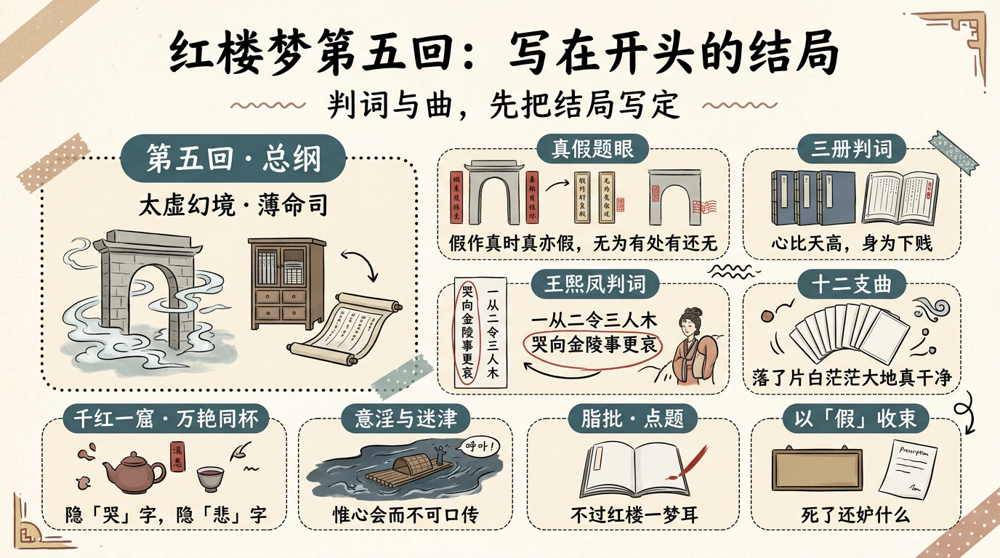

# 紅樓夢第五回：寫在開頭的結局

> 簡體版：[紅樓夢第五回：寫在開頭的結局](https://github.com/j3ffyang/history/blob/main/docs/260919-hlm-ch5-zh-hans.md)

《紅樓夢》最奇特的一點，是它把結局寫在了開頭。現存曹雪芹原著（脂評抄本）為八十回；通行的百二十回本另有後四十回（作者問題詳見第六節）。而真正的"總綱"，是第五回——賈寶玉夢遊太虛幻境，在"薄命司"裡翻看金陵十二釵的冊子，又聽了新制的《紅樓夢》十二支曲。判詞與曲把書中主要女子的命運幾乎一一預先寫定。[¹] 本文作者也傾向一種讀法（個人之見）：只讀八十回，把後四十回當作參照，而不當作曹雪芹的原定結局。

這一回的回目（庚辰本）是"遊幻境指迷十二釵　飲仙醪曲演紅樓夢"。蔣勳甚至說，它才是全書真正的開頭（詳見第八節）。[⁶] 先讀懂第五回，才談得上讀懂《紅樓夢》。

## 一、太虛幻境：假作真時真亦假

寶玉在秦可卿房中睡去，夢裡隨她到了一處，"朱欄白石，綠樹清溪，真是人跡稀逢，飛塵不到"。迎面一位仙姑，自稱是"放春山遣香洞太虛幻境警幻仙姑"。再往前，見一座石牌坊，上書"太虛幻境"四字，兩邊一副對聯：

> 假作真時真亦假，無為有處有還無。[¹]

這副對聯是全書的題眼之一。它說：把假的當成真的，真的也就成了假的；把無當作有，有也就成了無。全書"真"（甄士隱）與"假"（賈雨村）的架構、"真事隱去、假語村言"的寫法，都可從這裡讀起。

不過要說明：這副對聯並非第五回獨有。早在第一回，甄士隱午夢中所見的太虛幻境牌坊上，就掛著同一副對子。[⁷] 脂批因此特意點出，第五回的這一夢，是"與首回中甄士隱夢景一照"。[³]

## 二、三冊判詞：把結局先寫一遍

"薄命司"裡有一排大櫥：封條上寫著"金陵十二釵正冊"，下面兩櫥是"副冊"和"又副冊"。寶玉先開"又副冊"，看到的頭一首判詞，就是晴雯：

> 霽月難逢，彩雲易散。心比天高，身為下賤。風流靈巧招人怨，壽夭多因毀謗生，多情公子空牽念。[¹]

第二首是襲人："枉自溫柔和順，空云似桂如蘭。堪羨優伶有福，誰知公子無緣。" 副冊裡是香菱："根並荷花一莖香，平生遭際實堪傷。自從兩地生孤木，致使香魂返故鄉。"[¹]

正冊中，第一首是黛玉與寶釵合寫的："可嘆停機德，誰憐詠絮才。玉帶林中掛，金簪雪裡埋。" 之後依次是元春、探春、湘雲、妙玉、迎春、惜春、鳳姐、巧姐、李紈、秦可卿。[¹] 其中鳳姐的一首，尤其像讖語：

> 凡鳥偏從末世來，都知愛慕此生才。一從二令三人木，哭向金陵事更哀。[¹]

"一從二令三人木"一句，歷來被解作她先"從"、後"令"、終被"休"（"人木"合為"休"）的下場。判詞不是抒情，而是預告；它不描寫當下，而是提前把每個人的終點釘在了冊子上。

## 三、《紅樓夢》十二支曲

看罷冊子，警幻命舞女演出新制的《紅樓夢》十二支。開篇是《引子》：

> 開闢鴻蒙，誰為情種？都只為風月情濃；趁著這奈何天，傷懷日，寂寥時，試遣愚衷，因此上演出這悲金悼玉的《紅樓夢》。[¹]

接著是《終身誤》（"都道是金玉良緣，俺只念木石前盟……縱然是齊眉舉案，到底意難平"）、《枉凝眉》（"一個是閬苑仙葩，一個是美玉無瑕……一個是水中月，一個是鏡中花"）、《恨無常》《分骨肉》《樂中悲》《世難容》《喜冤家》《虛花悟》《聰明累》《留餘慶》《晚韶華》《好事終》，最後一支是收尾《飛鳥各投林》：

> 為官的、家業凋零，富貴的、金銀散盡，有恩的、死裡逃生，無情的、分明報應……好一似食盡鳥投林，落了片白茫茫大地真乾淨。[¹]

一首首曲，等於把全書的落幕先唱了一遍。席間，警幻還請寶玉喝了兩種東西：茶名"千紅一窟"，酒名"萬豔同杯"。[¹] 脂批即點出"千紅一窟"隱"哭"字、"萬豔同杯"隱"悲"字[³]；後世更把它讀成"千紅一哭，萬豔同悲"——這正是判詞與曲的總主題。（"千紅一哭，萬豔同悲"這一四字對句屬後世讀法。）

## 四、警幻的"意淫"與告誡

警幻對寶玉說了一句驚人之語：他是"天下古今第一淫人"。寶玉惶恐辯解，警幻卻另有解釋：世人好淫，不過是"悅容貌，喜歌舞"的"皮膚淫濫"；而寶玉"天分中生成一段痴情"，是"意淫"——"惟心會而不可口傳，可神通而不可語達"。[¹] 隨後她把乳名"兼美"、字可卿的妹妹許配寶玉，又告誡他："今後萬萬解釋，改悟前情，留意於孔孟之間，委身於經濟之道。"[¹]

夢的盡頭是"迷津"：荊榛遍地，黑溪阻路，只有"木居士掌舵，灰侍者撐篙"的一隻木筏可渡。寶玉被夜叉海鬼拖下水，失聲喊"可卿救我"，夢醒。[¹] 這既是情節，也是隱喻：紅塵如一迷津，能渡人者似乎唯有"木"與"灰"——不過此處已進入讀者的詮釋了。

## 五、脂批裡的第五回

脂批（含蒙府本批語）對第五回極重視。蒙府本回前總批說：

> 萬種豪華原是幻，何嘗造孽，何是風流？曲終人散有誰留，為甚營求？只愛蠅頭！一番遭遇幾多愁，點水根由，泉湧難酬！[³]

甲戌本則有一條側批點出這一回的"題"：

> 點題。蓋作者自云所歷不過紅樓一夢耳。[³]

另有甲戌側批強調它與首回的呼應："與首回中甄士隱夢景一照。"[³] 也就是說，在脂批看來，第五回不是一個孤立的奇幻章節，而是全書"真—假—夢"結構的中樞：它既是第一次給出結局，也是第一次把"真假"命題立起來。

## 六、判詞、曲與"後四十回"作者問題

曹雪芹原著《紅樓夢》為八十回，後四十回一般認為是高鶚、程偉元整理續成；新紅學創始人胡適等人更認為後四十回是續作，證據之一是張問陶詩注："傳奇《紅樓夢》八十回以後，俱蘭墅所補。"[⁵] 不過也有主流意見指出，此處"補"更可能指在曹雪芹原稿基礎上增補，而非全部由高鶚新寫。[⁵]

無論取哪一說，第五回的判詞與曲都提供了一個"對照尺"：判詞與曲寫在八十回之內，預告的是曹雪芹筆下人物的結局；後四十回（一般認為非曹雪芹原筆）走向往往不同。僅舉一例：鳳姐的判詞"一從二令三人木"暗示她終被休棄（"被休"之解見第二節），而後四十回裡她卻並未被休，只是病死（第一百十四回"王熙鳳歷幻返金陵"）。同一個鳳姐，前八十回與後四十回給出了兩套並不相同的結局。[⁸]

但也必須說清層次：判詞與曲預示的是"故事的走向"，它本身並不是判斷作者歸屬的直接證據；作者問題要靠脂批、版本與文獻來論證。最有力的一條材料，反倒說明這部書"未完成"——甲戌本第一回眉批寫道：

> 能解者方有辛酸之淚，哭成此書。壬午除夕，書未成，芹為淚盡而逝。[⁴]

曹雪芹在"書未成"時就去世了，現存脂本只到八十回。第五回的判詞與曲，某種程度上成了後人追索"曹雪芹原意"的一把鑰匙。需要強調的是："後四十回非曹雪芹所著"是紅學的作者問題，並不是第五回明文"暗示"出來的——這裡不把兩者混為一談。

## 七、第八十回王一貼：以"假"收束

脂本《紅樓夢》的最後一回是第八十回。這一回結尾，寫寶玉在天齊廟遇到一個賣膏藥的道士"王一貼"。他的膏藥號稱"一貼百病皆除"，其實只是場面話。寶玉問有沒有治"妒婦"的方子，王一貼便胡謅了一味"療妒湯"：

> 用極好的秋梨一個，二錢冰糖，一錢陳皮，水三碗，梨熟為度。[²]

他又說，這湯吃到一百歲，"人橫豎是要死的，死了還妒什麼！"——一句玩笑話，把"藥"的意義徹底解構。現存脂本八十回，就這樣以一張假藥的假方收束。

這與第五回"假作真時真亦假"形成呼應：全書以"假"起（假語村言、太虛幻境），也以"假"（無藥力的藥方）收在現存文本的末回。[²] 需要說明，這層"呼應"是讀者的讀法，不是曹雪芹明寫的；但它與第五回的對聯、與全書的"真假"主題，確實一脈相承。

## 八、蔣勳的讀法（詮釋）

蔣勳在《蔣勳細說紅樓夢》裡，把第五回稱為全書的"總綱"和"真正的開頭"。他認為小說的結局幾乎全部藏在第五回，通過判詞與曲提前洩露；他特別強調其中的"青春"視角，以及警幻所代表的"人生是一場空幻"的警示。[⁶]

這是一種現代的、偏文學與人生體悟的讀法，不屬於考證，也不以"對錯"論高下。作為讀者的一種詮釋，它提醒我們：第五回不僅是一份命運清單，也是一首關於青春的輓歌。

## 關於解讀層次

本文所引《紅樓夢》正文均據維基文庫；脂批的用字、回目與他本互有異文，涉及處已隨文標明版本。凡"呼應""讖語""諧音""警幻即警告""後四十回非曹著"等，均屬脂批、紅學家或本文讀者的詮釋；文本事實（判詞、曲、對聯、藥方原文）與解讀意見，文中已儘量分開。後四十回作者問題以胡適等新紅學的考證為代表，本文只作概述，不作定論；蔣勳的觀點屬現代流行讀法，亦非考證結論。

## 餘論

《紅樓夢》讓讀者一開局就看見結局：冊子上的判詞、席間的十二支曲、牌坊上的"假作真時真亦假"，把人物的命運與全書的總命題一併寫下。曹雪芹沒有把謎底留到最後——他把它放在開頭，然後讓所有人揣著謎底，一步一步走向那"白茫茫大地真乾淨"。

## 引用來源

- 曹雪芹《紅樓夢》第五回——回目（庚辰本）"遊幻境指迷十二釵　飲仙醪曲演紅樓夢"；太虛幻境牌坊對聯"假作真時真亦假，無為有處有還無"；薄命司對聯"春恨秋悲皆自惹，花容月貌為誰妍"；三冊判詞（晴雯、襲人、香菱、黛玉寶釵、鳳姐等）；《紅樓夢》十二支曲及收尾《飛鳥各投林》；"千紅一窟""萬豔同杯"；警幻"意淫"之論、兼美可卿、迷津，維基文庫，訪問日期：2026-09-26
- 曹雪芹《紅樓夢》第八十回——王道士（王一貼）胡謅"療妒湯"（"用極好的秋梨一個，二錢冰糖，一錢陳皮，水三碗，梨熟為度"），維基文庫，訪問日期：2026-09-26
- 《脂硯齋重評石頭記》第五回——蒙府本回前總批"萬種豪華原是幻……"、甲戌本側批"點題。蓋作者自云所歷不過紅樓一夢耳"、甲戌本側批"與首回中甄士隱夢景一照"、甲戌本側批"千紅一窟"隱"哭"字與"萬豔同杯"隱"悲"字，維基文庫《脂硯齋重評石頭記》，訪問日期：2026-09-26
- 《脂硯齋重評石頭記》第一回——甲戌本眉批"壬午除夕，書未成，芹為淚盡而逝"，維基文庫《脂硯齋重評石頭記》，訪問日期：2026-09-26
- 張問陶《船山詩草》卷十六《贈高蘭墅（鶚）同年》——詩題自注"傳奇《紅樓夢》八十回以後，俱蘭墅所補"（中華詩詞網、搜韻錄入）；後四十回作者問題另見維基百科"高鶚"條：程偉元、高鶚共同整理，胡適等新紅學據張問陶詩注認為後四十回為續作，亦有意見認為"補"指在原稿上增補，訪問日期：2026-09-26
- 蔣勳《蔣勳細說紅樓夢》——第五回為全書"總綱"/"真正的開頭"、結局盡在第五回、警幻即"警告人生是空幻"等讀法（現代流行詮釋），訪問日期：2026-09-26
- 曹雪芹《紅樓夢》第一回——甄士隱夢中太虛幻境牌坊對聯"假作真時真亦假，無為有處有還無"（與第五回同一副），維基文庫，訪問日期：2026-09-26
- 曹雪芹《紅樓夢》第一百十四回（程高本後四十回）——回目"王熙鳳歷幻返金陵　甄應嘉蒙恩還玉闕"，鳳姐病死（與第五回判詞"一從二令三人木"所暗示的"被休"結局不同），維基文庫，訪問日期：2026-09-26
