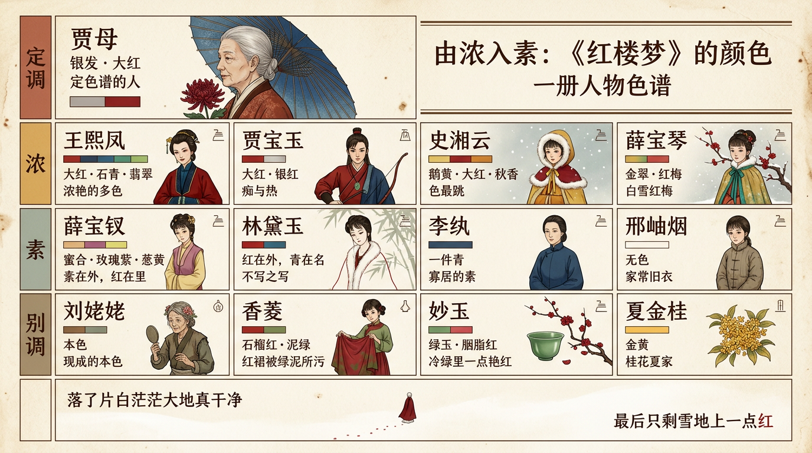

# 由濃入素：《紅樓夢》的顏色

> 簡體版：[由濃入素：《紅樓夢》的顏色](https://github.com/j3ffyang/history/blob/main/docs/261007-hlm-color-zh-hans.md)

## 引子：軟煙羅四色

第四十回，賈母帶著劉姥姥逛大觀園。走到瀟湘館，見窗上的紗舊了，她說了一句：這綠紗配著院裡的翠竹，"反不配"。鳳姐忙說自己見過銀紅的蟬翼紗，賈母說她把名色認錯了，才道出一匹幾乎沒人認得的"軟煙羅"——一種極輕軟的羅，與紗同屬紗羅類而織法不同，舊時用來糊窗、做帳[¹⁴]：

> 那個軟煙羅只有四樣顏色：一樣雨過天晴，一樣秋香色，一樣松綠的，一樣就是銀紅的……那銀紅的又叫作"霞影紗"。[⁴]

（"天晴"一作"天青"：庚辰本作"晴"，程甲本、程乙本作"青"；"雨過天青"相傳是柴窯的色名。一字之差，正是說天氣與說顏色的分界。）

一匹舊羅，能數出四種顏色，還能一一叫出名字——這份講究，是賈府的規矩，也是老太太的本事。同一回里，蘅蕪苑"雪洞一般"，她說年輕姑娘住著"也忌諱"；又要拿銀紅的霞影紗替黛玉糊窗。誰該豔、誰該素、誰的窗子該換一匹什麼顏色的料子，她心裡都有一本賬。[⁴] 全書裡，賈母最像一位**色彩的裁判**：她不必穿得最豔，卻定得下誰該豔、誰該素。

曹雪芹寫人，也常走同一條路：不給人物貼標籤，先給她一身顏色。紅歸了寶玉，濃豔歸了鳳姐，素淨歸了寶釵，獨黛玉的顏色最難說清；而最會看顏色的老太太，自己鬢上倒簪著一朵大紅。於是看《紅樓夢》裡各人穿什麼、用什麼色，也就看出了一個人的性情，和一個家族的規矩。（下文點某人"是什麼顏色"，多屬讀法，未必是作者明說；賈母這位"裁判"，也是讀出來的。）

## 一、王熙鳳：濃豔的多色

林黛玉初進榮國府，見過賈母與三春之後，最搶眼的一個便是王熙鳳。那一段出場，幾乎是全書顏色最密的一筆：

> 頭上戴著金絲八寶攢珠髻，綰著朝陽五鳳挂珠釵，項上戴著赤金盤螭瓔珞圈，裙邊系著豆綠宮絛，雙衡比目玫瑰佩，身上穿著縷金百蝶穿花大紅洋緞窄褙襖，外罩五彩刻絲石青銀鼠褂，下著翡翠撒花洋縐裙。[¹]

這裡一身配色，值得一件件數：大紅（正紅）、石青（近乎黑的深藍，清代官服以藍、石青為主色）[¹⁹]、翡翠（翠綠）、豆綠（淺綠），再加上赤金與玫瑰——"玫瑰"一說指玫瑰色玉，一說本是美玉、火齊珠之名，未必是顏色[¹⁸]。衣料也不尋常：刻絲即緙絲（一種"通經斷緯"的高級織法）；"洋緞""洋縐"是帶"洋"字的舶來或仿舶來織物，"洋緞"各本或作"萍緞""雲緞"，洋縐的確切所指今已難考[¹⁶]；撒花是散點式的花紋。濃色相撞而不亂，是要壓得住場面的人才穿得起。

到第六回劉姥姥頭一次登門，鳳姐家常坐在炕上，仍是"桃紅撒花襖，石青刻絲灰鼠披風，大紅洋縐銀鼠皮裙"，連屋裡的軟簾、氈條也一律是紅——只有那床坐褥，是金心綠的閃緞。[²] 後來第四十回，她還特意拉出自己身上一件"大紅綿紗襖子襟兒"，要跟賈母的軟煙羅比一比高下。[⁴]

顏色在這裡不只是裝點，更像她權力的外衣——"濃、豔、多"三字，與"潑皮破落戶兒""鳳辣子"的做派恰是一路。

## 二、薛寶釵：半新不舊的暖調

第八回，寶玉繞遠路去梨香院探養病的寶釵。掀簾進去，先看見的是她那一身：

> 頭上挽著漆黑油光的䰖兒，蜜合色棉襖，玫瑰紫二色金銀鼠比肩褂，蔥黃綾棉裙，一色半新不舊，看去不覺奢華。[³]

蜜合色（淺黃白，溫潤如蜜蠟）、玫瑰紫（紫紅）、蔥黃（綠得近於黃）——都是暖色，卻都壓著亮度；比肩褂即半臂，半袖外衣，袖長及肘、身長及腰[¹⁷]；再添一句"半新不舊"，安分守拙的性情就落在衣裳上了。耐人尋味的是，這樣素淨的外面之下，解開來，裡面卻是"大紅襖"，襯著她那把黃金燦爛的瓔珞金鎖。[³] 這層外素內豔，正合她那"從胎裡帶來的一股熱毒"：病要冷香丸壓著，顏色也要壓著。[¹²] 連她那張臉也是"唇不點而紅，眉不畫而翠"，天生的顏色，不借脂粉。[³]

到第四十回，她的屋子更素：蘅蕪苑"雪洞一般，一色玩器全無"，床上只吊一頂青紗帳幔，賈母看了直搖頭，說年輕姑娘屋裡這樣素淨，"也忌諱"。[⁴] 到第四十九回大雪，眾人都是一色大紅猩猩氈與羽毛緞斗篷，她與李紈是兩處例外：李紈穿一件青哆羅呢對襟褂子，她穿一件"蓮青斗紋錦上添花洋線番羓絲的鶴氅"——蓮青就是青蓮色，即紫；鶴氅是寬大的外罩。[⁶][¹⁷] 暖的時候暖，冷的時候冷，都比旁人淡一層。

## 三、賈寶玉：紅

寶玉的顏色，是一個字：紅。第三回，寶玉在黛玉眼中登場，是這樣一身：

> 頭上戴著束髮嵌寶紫金冠，齊眉勒著二龍搶珠金抹額，穿一件二色金百蝶穿花大紅箭袖，束著五彩絲攢花結長穗宮絛，外罩石青起花八團倭緞排穗褂，登著青緞粉底小朝靴。[¹]

箭袖是袖口收窄、便於騎射的式樣，排穗褂是下襬綴著排穗的外褂；一身裡最搶眼的，是那一件大紅箭袖。他出去見了母親一趟，再回來，已經換過家常衣裳：

> 身上穿著銀紅撒花半舊大襖，仍舊帶著項圈，寶玉，寄名鎖，護身符等物，下面半露松花撒花綾褲腿，錦邊彈墨襪，厚底大紅鞋。[¹]

銀紅是有光澤的淺紅，松花是松樹花粉那樣的黃綠；連那條總編的大辮，也用"紅絲結束"。從大紅的禮服到"半舊"的居家襖，紅仍是主調。到第八回，他去看養病的寶釵，又換了"秋香色立蟒白狐腋箭袖"（秋香色，黃中帶綠的秋色），繫著五色蝴蝶鸞絛；回來還興沖沖給房裡的門斗寫了三個字——"絳雲軒"。[³] 絳，就是深紅（回目作"絳芸軒"，正文作"絳雲軒"，各本用字不一）。怡紅院、怡紅公子、絳雲軒，他的居處與別號，都落在"紅"上。紅是痴，也是他一生脫不掉的熱。

## 四、林黛玉：不寫之寫

可輪到林黛玉，曹雪芹的筆忽然省了起來。第三回她初到賈府，作者寫她，只寫眉眼與神氣：

> 兩灣似蹙非蹙罥煙眉，一雙似泣非泣含露目。態生兩靨之愁，嬌襲一身之病。淚光點點，嬌喘微微。閒靜時如姣花照水，行動處似弱柳扶風。[¹]

這一回通篇沒有一句寫她自己穿什麼。寶玉的衣服寫了又換、換了又寫，黛玉卻只剩一副眉眼，彷彿她的容貌就是她的全部衣飾。這或許首先是視角：她看別人，看不見自己。但視線的省略，也正好空出了她的顏色——這一份"不寫"，本身就是一種顏色。初登場的人裡，她是留白的那一個。

當然，說黛玉全無衣飾描寫，也不確。第八回雪中，她外面罩一件"大紅羽緞對衿褂子"（對襟的羽緞外褂；羽緞是羊毛織品或絲毛交織，並非鳥羽[¹⁶]）；[³] 第四十九回大雪，她又換上"掐金挖雲紅香羊皮小靴，罩了一件大紅羽紗面白狐狸裡的鶴氅，束一條青金閃綠雙環四合如意絛，頭上罩了雪帽"。[⁶] 她不是沒有衣裳，只是寫得少——而寫到的幾件衣裳，偏偏都是大紅；唯一的異色，是那條"青金閃綠"的腰帶：青金是黑，閃綠是夾綠，黑裡透一點綠[¹⁷]。

於是她身上的"青"，其實不在衣裳上，而在名字與環境裡：名"黛玉"，黛是青黑色，畫眉的墨——寶玉說"西方有石名黛，可代畫眉之墨"[¹]；瀟湘館又"兩邊翠竹夾路"，連賈母都嫌她窗上的綠紗配竹"反不配"，要換一匹銀紅的霞影紗。[⁴] 寶釵是素在外、紅在裡；黛玉是紅在外、白狐在裡。兩人都用了紅，只是一個藏，一個露。可名字與住處，偏偏又是青的——比之釵之"素"、鳳之"豔"，黛玉的顏色並不整齊，倒更像她這個人：熱在裡，冷在外，說不清。

## 五、賈母：銀髮與大紅簪花

賈母是那個定色譜的人。她一出場，顏色就定了。黛玉初見，是：

> 只見兩個人攙著一位鬢髮如銀的老母迎上來。[¹]

銀髮，是她一生的底色。可到第四十回賞菊，她偏要往這銀白上添一點紅：

> 賈母便揀了一朵大紅的簪于鬢上。[⁴]

銀髮配大紅，"老而豔"，是福壽雙全的顏色。在場的人裡，認得出"軟煙羅"、分得清誰素誰豔的，也只有她。她進一趟大觀園，等於巡視一遍全家的顏色：說寶釵房裡"這樣素淨，也忌諱"，說黛玉窗紗綠得"反不配"，要拿銀紅的霞影紗替黛玉糊窗，當場就發落。[⁴] 第五十回大雪，她"圍了大斗篷，帶著灰鼠暖兜，坐著小竹轎，打著青綢油傘"，[⁷] 一行人雪中而來，老太太的排場，也還是一身顏色。

## 六、史湘雲：鵝黃與大紅

大觀園裡色最"跳"的，是史湘雲。第四十九回大雪，她來得遲，一身穿得又暖又花。外面是賈母給的一件"貂鼠腦袋面子大毛黑灰鼠裡子裡外發燒大褂子"，頭上是：

> 帶著一頂挖雲鵝黃片金里大紅猩猩氈昭君套，又圍著大貂鼠風領。[⁶]

湘雲一面笑說"你們瞧瞧我裡頭打扮的"，一面脫了褂子，露出裡面一身：

> 只見他里頭穿著一件半新的靠色三鑲領袖秋香色盤金五色繡龍窄褙小袖掩衿銀鼠短襖，里面短短的一件水紅裝緞狐肷褶子，腰里緊緊束著一條蝴蝶結子長穗五色宮絛。[⁶]

鵝黃是嫩黃；猩猩氈舊說以猩猩血染成，實為紅色哆羅呢一類的毛織品，並非今日的氈[¹⁶]；昭君套是一種無頂的皮帽套，圍在額前取暖，相傳仿昭君出塞的裝束[¹⁵]；秋香色是黃中帶綠，水紅是淺紅，宮絛是絲帶。鵝黃、大紅、秋香、水紅，一股腦堆在一人身上，黛玉先笑她"孫行者來了"，眾人又笑她"偏只愛打扮成個小子的樣兒，原比他打扮女兒更俏麗"。[⁶] 第六十二回她喝醉了，在山石後的石凳上睡去：

> 果見湘雲臥于山石僻處一個石凳子上，業經香夢沉酣，四面芍藥花飛了一身，滿頭臉衣襟上皆是紅香散亂。[⁸]

一身跳色的人，末了收進一片亂紅裡，正像她這個人，熱鬧到底。

## 七、薛寶琴：白雪紅梅

新來的薛寶琴，是另一種亮法。第四十九回她初到，先聲奪人：

> 只見寶琴來了，披著一領斗篷，金翠輝煌，不知何物。[⁶]

香菱猜是孔雀毛，湘雲點破，是"野鴨子頭上的毛"織的——是為"鳧靨裘"，用野鴨面頰的毛織成的一種貴重斗篷，是老太太給她的。到第五十回，大雪初晴：

> 忽見寶琴披著鳧靨裘站在山坡上遙等，身後一個丫鬟抱著一瓶紅梅。[⁷]

賈母遠遠看見，問像什麼，眾人答"就象老太太屋裡掛的仇十洲畫的《雙豔圖》"（仇十洲即明代畫家仇英）；賈母搖頭笑道："那畫的那裡有這件衣裳？人也不能這樣好！"[⁷] 人、衣、雪、梅，在這一刻合成一幅畫。寶琴是全書少有的、由外而來的亮色，來得正合時候。同回三人以"紅梅花"三字分韻作詩，寶琴得"花"字——"疏是枝條豔是花，春妝兒女競奢華"，[⁷] 像是替自己作了註腳。

## 八、李紈與邢岫煙：青與無色

第四十九回那場雪，是全書顏色最整齊的一次點名：

> 只見眾姊妹都在那邊，都是一色大紅猩猩氈與羽毛緞斗篷，獨李紈穿一件青哆羅呢對襟褂子，薛寶釵穿一件蓮青斗紋錦上添花洋線番羓絲的鶴氅；邢岫煙仍是家常舊衣，并無避雪之衣。[⁶]

滿園大紅裡，李紈一件青哆羅呢對襟褂子——"青"在這裡指黑色，哆羅呢是歐洲傳入的寬幅毛呢[¹⁶]——一身寡居的素[¹⁷]；寶釵的蓮青是紫，只比她豔一層；邢岫煙卻只一件家常舊衣，連避雪的外衣都沒有——那是貧寒的無色。從大紅到蓮青到青，再到沒有顏色，四級臺階，一句話寫完。

邢岫煙的無色沒有維持太久。第五十一回，平兒到底拿了一件"大紅羽紗"給她，說："十來件大紅衣裳，映著大雪好不齊整。就只他穿著那件舊氈斗篷，越發顯的拱肩縮背，好不可憐見的。"[¹³] 大觀園的顏色制度，到底還是靠一件施捨的紅衣裳，把她收了進去。

## 九、劉姥姥：本色

前面這些人，顏色都是自己身上長出來的；只有劉姥姥，顏色是別人給她點上去的。第四十回進了大觀園，鳳姐先拿她打趣：

> 鳳姐便拉過劉姥姥，笑道："讓我打扮你。"說著，將一盤子花橫三豎四的插了一頭。[⁴]

她也不惱，笑說自己"年輕時也風流，愛個花兒粉兒的"。[⁴] 行酒令時，鴛鴦報過牌色，說"中間'三四'綠配紅"，她對"大火燒了毛毛蟲"；鴛鴦又說"右邊'幺四'真好看"，她對"一個蘿蔔一頭蒜"。眾人笑道"這是有的，還說你的本色"，她自己也笑："我們莊家人，不過是現成的本色，眾位別笑。"[⁴]

"本色"在這裡是雙關：牌面上配的是綠與紅，她答的是莊稼人的日子。大觀園裡人人都在配色，只有她不必染——她的顏色是現成的，也是別人染不上的。土色不是她塗上去的，是她帶來的。到第四十一回，她醉了，誤闖進怡紅院，把牆上畫裡的女孩認作活人，又對著穿衣鏡裡的自己發怔，末了"扎手舞腳"睡倒在寶玉床上，滿屋酒屁臭氣。[⁵] 同一回還有一段小插曲：她在櫳翠庵吃茶用過的那隻名貴成窯杯（明代成化官窯的瓷杯），妙玉嫌髒，想撂在外頭不要了；倒是寶玉討了來，說"白撂了豈不可惜？依我說，不如就給那貧婆子罷，他賣了也可以度日"。[⁵] 大觀園的濃紅豔紫，被一個鄉下老太太一頭撞進來，撞成了一面鏡子。

## 十、三處別調

還有三個人的顏色，值得一記。香菱一生都夾在紅與綠之間。第六十二回，她的新裙子"石榴紅綾"被泥水汙了：

> 寶玉方低頭一瞧，便噯呀了一聲，說："怎麼就拖在泥里了？可惜這石榴紅綾最不經染。"[⁸]

石榴紅，是石榴花般的紅。這條裙子的料子還是寶琴帶來的，頭一回上身，就拖進了泥裡。寶玉忙張羅著拿襲人一條一模一樣的裙子給她換上，她低頭一看，"那裙上猶滴滴點點流下綠水來"——那不是清波，是泥水。紅裙被綠泥所汙，才是她一生的底色。[⁸] 她名字裡那個"菱"，到第七十九回又化作寶玉眼中紫菱洲"池內的翠荇香菱"，只是那時已"搖搖落落"，不復"逞妍鬥色"的鮮綠。[⁹]

妙玉在櫳翠庵，用"自己常日吃茶的那隻綠玉斗"（玉製的小茶器）給寶玉斟茶——杯是冷的，人卻是熱的。那茶更講究：

> 這是五年前我在玄墓蟠香寺住著，收的梅花上的雪，共得了那一鬼臉青的花瓮一瓮，總舍不得吃，埋在地下，今年夏天才開了。[⁵]

"鬼臉青"，舊註多釋為一種青藍斑駁的窯釉，不是單純的暗青[²⁰]。她門前偏偏"十數株紅梅如胭脂一般"，映著雪色，[⁶] 冷綠裡透出一點豔紅。夏金桂姓夏，家裡"單有幾十頃地獨種桂花"，人稱"桂花夏家"；她不許人口中帶出"金桂"二字，硬把桂花改稱"嫦娥花"，"又寓自己身分如此"。[⁹] 讀起來，金黃桂花是她的顏色，也是她的性氣。至於薛蟠本人——至少在這幾回裡，書裡沒給他一個顏色。

## 餘論：白茫茫

顏色寫到最後，是兩場雪。第五回《飛鳥各投林》收尾一句：

> 好一似食盡鳥投林，落了片白茫茫大地真乾淨。[¹⁰]

這是曲文裡的預言，還不是眼前的景。到了第一百二十回，賈政在毗陵驛的船頭，才真看見那場雪：

> 抬頭忽見船頭上微微的雪影裡面一個人，光著頭，赤著腳，身上披著一領大紅猩猩氈的斗篷，向賈政倒身下拜。[¹¹]

從第五十一回平兒口中"十來件大紅衣裳，映著大雪好不齊整"，到曲文裡的白茫茫，再到末迴雪影裡那一領大紅斗篷——那件斗篷，與第四十九回滿園姊妹一色的那種大紅猩猩氈，是同一種料子。紅沒有消失，只是被剝到一個人身上；他光著頭，赤著腳，連鞋也沒有了。所謂"由濃入素"，不是顏色自己變淡，是穿衣的人一個一個散去，最後只剩雪地上一點紅。

這當然是讀法，不是作者寫下的結論；第一百二十回出於程本，是否曹雪芹原筆，學界也還有爭議。但把這幾處放在一起看，那點紅確實比許多判詞都更像一個收束。當年在雪地裡打著青綢油傘、鬢上簪一朵大紅菊花的老太太，已經不在了；她一走，那本顏色的賬也就散了。

## 引用來源

### 原典

- [¹] 曹雪芹《紅樓夢》第三回，維基文庫：<https://zh.wikisource.org/wiki/%E7%B4%85%E6%A8%93%E5%A4%A2/%E7%AC%AC003%E5%9B%9E>（回目"金陵城起復賈雨村　榮國府收養林黛玉"；王熙鳳出場服飾；寶玉出場、換裝與"紅絲結束"（"倭緞"，脂本作"倭鍛"）；黛玉眉眼、名字與贈字"顰顰"、"西方有石名黛，可代畫眉之墨"。訪問日期：2026-10-21）
- [²] 曹雪芹《紅樓夢》第六回，維基文庫：<https://zh.wikisource.org/wiki/%E7%B4%85%E6%A8%93%E5%A4%A2/%E7%AC%AC006%E5%9B%9E>（回目"賈寶玉初試雲雨情　劉姥姥一進榮國府"；鳳姐家常服飾與屋內陳設；劉姥姥出場。訪問日期：2026-10-21）
- [³] 曹雪芹《紅樓夢》第八回，維基文庫：<https://zh.wikisource.org/wiki/%E7%B4%85%E6%A8%93%E5%A4%A2/%E7%AC%AC008%E5%9B%9E>（回目"薛寶釵小恙梨香院　賈寶玉大醉絳芸軒"；寶釵服飾、"半新不舊"與金鎖；寶玉秋香色箭袖、"絳雲軒"三字（回目作"絳芸軒"）；黛玉雪中"大紅羽緞對衿褂子"。訪問日期：2026-10-21）
- [⁴] 曹雪芹《紅樓夢》第四十回，維基文庫：<https://zh.wikisource.org/wiki/%E7%B4%85%E6%A8%93%E5%A4%A2/%E7%AC%AC040%E5%9B%9E>（回目"史太君兩宴大觀園　金鴛鴦三宣牙牌令"；賈母揀大紅菊花簪鬢；軟煙羅四色與霞影紗（"雨過天晴"，庚辰本作"晴"，程甲本、程乙本作"青"）；寶釵屋"雪洞一般"，賈母說"房裡這樣素淨，也忌諱"，又說黛玉窗紗"反不配"；劉姥姥被插花、行令"本色"。訪問日期：2026-10-21）
- [⁵] 曹雪芹《紅樓夢》第四十一回，維基文庫：<https://zh.wikisource.org/wiki/%E7%B4%85%E6%A8%93%E5%A4%A2/%E7%AC%AC041%E5%9B%9E>（回目"賈寶玉品茶櫳翠庵　劉姥姥醉臥怡紅院"；妙玉綠玉斗、"梅花上的雪""鬼臉青的花甕"；劉姥姥誤入怡紅院、對鏡、醉臥；成窯杯轉贈。訪問日期：2026-10-21）
- [⁶] 曹雪芹《紅樓夢》第四十九回，維基文庫：<https://zh.wikisource.org/wiki/%E7%B4%85%E6%A8%93%E5%A4%A2/%E7%AC%AC049%E5%9B%9E>（回目"琉璃世界白雪紅梅　脂粉香娃割腥啖羶"；群像一句；湘雲貂鼠大褂、昭君套與內裝；寶琴鳧靨裘；櫳翠庵紅梅如胭脂。訪問日期：2026-10-21）
- [⁷] 曹雪芹《紅樓夢》第五十回，維基文庫：<https://zh.wikisource.org/wiki/%E7%B4%85%E6%A8%93%E5%A4%A2/%E7%AC%AC050%E5%9B%9E>（回目"蘆雪廣爭聯即景詩　暖香塢創制春燈謎"；賈母雪中"青綢油傘"；寶琴披鳧靨裘立雪、丫鬟抱紅梅、仇十洲《雙豔圖》；寶琴詠紅梅得"花"字。訪問日期：2026-10-21）
- [⁸] 曹雪芹《紅樓夢》第六十二回，維基文庫：<https://zh.wikisource.org/wiki/%E7%B4%85%E6%A8%93%E5%A4%A2/%E7%AC%AC062%E5%9B%9E>（回目"憨湘雲醉眠芍藥裀　呆香菱情解石榴裙"；湘雲醉眠"紅香散亂"；香菱石榴紅綾裙汙、流下綠水。訪問日期：2026-10-21）
- [⁹] 曹雪芹《紅樓夢》第七十九回，維基文庫：<https://zh.wikisource.org/wiki/%E7%B4%85%E6%A8%93%E5%A4%A2/%E7%AC%AC079%E5%9B%9E>（回目"薛文龍悔娶河東獅　賈迎春誤嫁中山狼"；"桂花夏家"、將桂花改稱"嫦娥花"；"池內的翠荇香菱"。訪問日期：2026-10-21）
- [¹⁰] 曹雪芹《紅樓夢》第五回，維基文庫：<https://zh.wikisource.org/wiki/%E7%B4%85%E6%A8%93%E5%A4%A2/%E7%AC%AC005%E5%9B%9E>（《飛鳥各投林》"好一似食盡鳥投林，落了片白茫茫大地真乾淨"。訪問日期：2026-10-21）
- [¹¹] 曹雪芹《紅樓夢》第一百二十回，維基文庫《紅樓夢（程乙本）》：<https://zh.wikisource.org/wiki/%E7%B4%85%E6%A8%93%E5%A4%A2%EF%BC%88%E7%A8%8B%E4%B9%99%E6%9C%AC%EF%BC%89/%E7%AC%AC%E4%B8%80%E7%99%BE%E5%8D%81%E4%B8%80%E5%9B%9E_%E8%87%B3%E7%AC%AC%E4%B8%80%E7%99%BE%E4%BA%8C%E5%8D%81%E5%9B%9E>（賈政毗陵驛船頭所見"大紅猩猩氈的斗篷"；維基文庫程乙本錄文作"大紅猩猩氈的篷"，通行排印本多作"斗篷"。訪問日期：2026-10-21）
- [¹²] 曹雪芹《紅樓夢》第七回，維基文庫：<https://zh.wikisource.org/wiki/%E7%B4%85%E6%A8%93%E5%A4%A2/%E7%AC%AC007%E5%9B%9E>（寶釵自述"從胎裡帶來的一股熱毒"與冷香丸。訪問日期：2026-10-21）
- [¹³] 曹雪芹《紅樓夢》第五十一回，維基文庫：<https://zh.wikisource.org/wiki/%E7%B4%85%E6%A8%93%E5%A4%A2/%E7%AC%AC051%E5%9B%9E>（平兒將"大紅羽紗"送給邢岫煙，"十來件大紅衣裳，映著大雪好不齊整。就只他穿著那件舊氈斗篷，越發顯的拱肩縮背"。訪問日期：2026-10-21）

### 參考

- [¹⁴] 周錫保《中國古代服飾史》，中國戲劇出版社，1984年（紗、羅的織法與名物區分）。
- [¹⁵] 陳詔《紅樓夢小考》，上海古籍出版社，1985年（"昭君套"為無頂皮帽套、暖額）。
- [¹⁶] 徐波《〈紅樓夢〉中的各色西洋紡織品》，《中華讀書報》2024年7月3日：<https://epaper.gmw.cn/zhdsb/html/2024-07/03/nw.D110000zhdsb_20240703_2-15.htm>（洋緞、洋縐、哆羅呢、猩猩氈、羽紗羽緞、番羓絲的考釋）。
- [¹⁷] 王彬《雪洞中的青紗帳幔》，《光明日報》2012年3月22日：<https://epaper.gmw.cn/gmrb/html/2012-03/22/nw.D110000gmrb_20120322_1-12.htm>（比肩褂即半臂；蜜合、蔥黃、蓮青；李紈"青"指黑色；"青金"為黑、"閃綠"為夾綠）。
- [¹⁸] 張德斌《鳳姐的"玫瑰珮"》，《北京晚報》2024年2月5日：<https://xinwen.bjd.com.cn/content/s65c0cdf6e4b07f5c39289e10.html>（"玫瑰"為美玉、火齊珠之名的一說，與"玫瑰色玉"說並列）。
- [¹⁹] 故宮博物院《清代宮廷服飾制度及其文化內涵》："服為藍及石青色"：<https://www.dpm.org.cn/classify_detail/262014.html>。
- [²⁰] 馮其庸、李希凡主編《紅樓夢大辭典》，文化藝術出版社，1990年（增訂版由商務印書館2015年出版；"鬼臉青"為青藍斑駁的釉色）。

> 版本說明：原典引文據維基文庫《紅樓夢》（脂本系統）與《紅樓夢（程乙本）》，僅作繁簡轉寫及標點、異體字（如著/著）的統一；底本異文與補字見注。維基文庫校本尚有校訂未備之處，正式發表前建議再核人民文學出版社1982年（2008年第3版）《紅樓夢》校注本。
