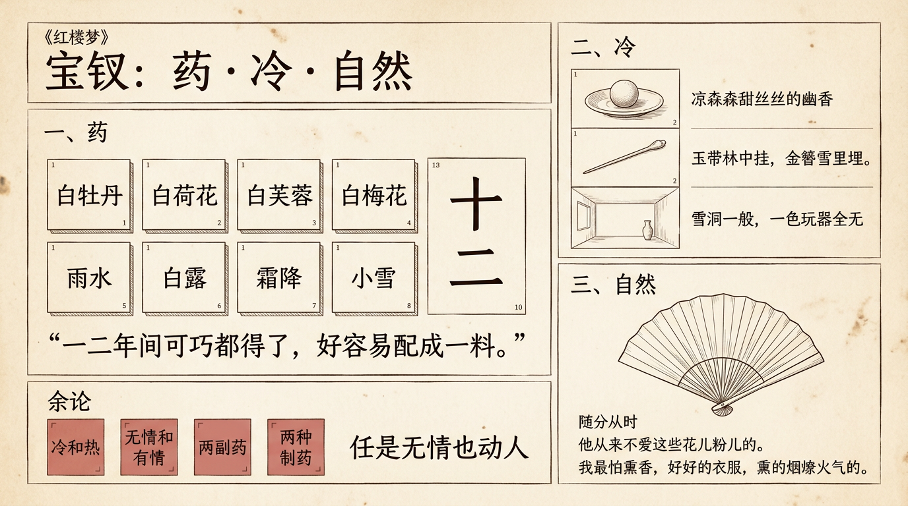

# 寶釵：藥·冷·自然

> 簡體版：[寶釵：藥·冷·自然](https://github.com/j3ffyang/history/blob/main/docs/261011-baochai-zh-hans.md)

第七回，寶釵跟周瑞家的說起自己的病。

> 後來還虧了一個禿頭和尚，說專治無名之症，因請他看了。他說我這是從胎裡帶來的一股熱毒，幸而先天壯，還不相干，若吃尋常藥，是不中用的。（第七回）

> 脂批（甲戌本側批）：凡心偶熾，是以孽火齊攻。（第七回）

和尚給了一個方子，叫冷香丸。方子不難懂，難的是湊齊。

> 要春天開的白牡丹花蕊十二兩，夏天開的白荷花蕊十二兩，秋天的白芙蓉蕊十二兩，冬天的白梅花蕊十二兩。將這四樣花蕊，於次年春分這日曬乾，和在藥末子一處，一齊研好。又要雨水這日的雨水十二錢──周瑞家的忙道："噯喲！這麼說來，這就得三年的工夫。倘或雨水這日竟不下雨，這卻怎處呢？"寶釵笑道："所以說那裡有這樣可巧的雨，便沒雨也只好再等罷了。"白露這日的露水十二錢，霜降這日的霜十二錢，小雪這日的雪十二錢。把這四樣水調勻，和了藥，再加十二錢蜂蜜，十二錢白糖，丸了龍眼大的丸子，盛在舊磁壇內，埋在花根底下。若發了病時，拿出來吃一丸，用十二分黃柏煎湯送下。（第七回）

> 脂批（甲戌本側批）：凡用"十二"字樣，皆照應十二釵。（第七回）

> 脂批（甲戌本雙行夾批）：卿不知從那裡弄來，余則深知是從放春山採來，以灌愁海水和成，煩廣寒玉兔搗碎，在太虛幻境空靈殿上炮製配合者也。（第七回）

寶釵說，"一二年間可巧都得了，好容易配成一料"。這個"可巧"很要緊。四季的花，四個節氣的水，缺一樣都配不齊，要等天時正好湊在一起。

## 一、藥

這味藥是自然的，不是爐子裡煉出來的。花是季節開的花，水是節氣落下的水。它不能買，只能等。

所以冷香丸像一種時間的記號。它記著一年四季，也記著一個人要過多少日子，才能把這一料湊齊。

## 二、冷

冷香丸是用來壓熱毒的。熱是天生帶來的，所以要用冷的東西去壓。

第八回，寶玉到梨香院去看寶釵。他聞到一陣香氣。

> 寶玉此時與寶釵就近，只聞一陣陣涼森森甜絲絲的幽香……寶釵想了一想，笑道："是了，是我早起吃了丸藥的香氣。"（第八回）

> 脂批（甲戌本側批）：點"冷香丸"。（第八回）

第五回的判詞也有一句冷的。畫上是一堆雪，雪下埋著一股金簪。

> 只見頭一頁上便畫著兩株枯木，木上懸著一圍玉帶，又有一堆雪，雪下一股金簪。……可嘆停機德，堪憐詠絮才。玉帶林中掛，金簪雪裡埋。（第五回，甲戌本）

> 脂批（甲戌本夾批）：此句薛。（第五回，繫於"可嘆停機德"句下）

> 脂批（甲戌本夾批）：此句林。（第五回，繫於"堪憐詠絮才"句下。程甲本"堪憐"作"誰憐"。）

這首詞是釵黛合寫：兩株枯木、玉帶是黛玉，一堆雪、金簪是寶釵。

她的住處也是冷的。第四十回，賈母進蘅蕪苑：

> 及進了房屋，雪洞一般，一色玩器全無，案上只有一個土定瓶中供著數枝菊花，並兩部書，茶奩茶杯而已。床上只吊著青紗帳幔，衾褥也十分樸素。（第四十回）

賈母看了搖頭，說年輕姑娘屋裡這樣素淨，"也不要很離了格兒"。

## 三、自然

寶釵做事，隨分從時。

> 寶釵行為豁達，隨分從時，不比黛玉孤高自許，目無下塵，故比黛玉大得下人之心。（第五回）

她也不愛那些花兒粉兒。第七回，薛姨媽對王夫人說：

> 姨娘不知道，寶丫頭古怪著呢，他從來不愛這些花兒粉兒的。（第七回）

> 脂批（甲戌本眉批）：余閱送花一回，薛姨媽云"寶丫頭不喜這些花兒粉兒的"，則謂是寶釵正傳……（第七回。此批繫於黛玉"我就知道，別人不挑剩下的也不給我"句後，評的是整個送花一回。脂本作"不喜"，與正文"不愛"異文。）

她連薰香也不喜歡。第八回，寶玉問她燻的是什麼香：

> 寶釵笑道："我最怕薰香，好好的衣服，燻的煙燎火氣的。"（第八回）

這裡的自然，有兩層意思。一層是她吃的藥，取的是天時。一層是她過日子的樣子，順著時候走。

## 餘論

下面這些是我的讀法，不是書裡的原話。

**冷和熱。** 用冷去壓熱，這像是禮法對天性的收束。寶釵的冷，有多少是天生的，有多少是後來學來的，書裡沒有說死。

**無情和有情。** 第六十三回，寶釵抽到的花簽上畫著牡丹，題著"豔冠群芳"四字，籤詩是"任是無情也動人"。

> 只見簽上畫著一支牡丹，題著"豔冠群芳"四字，下面又有鐫的小字一句唐詩，道是：任是無情也動人。（第六十三回）

曹雪芹寫寶釵，是不是恰恰在這份無情裡藏著深情？可以參看《紅樓夢》引子裡的"懷金悼玉"。

> 演出這懷金悼玉的"紅樓夢"。（第五回，引子，甲戌本）

> 脂批（甲戌本眉批）：懷金悼玉，大有深意。（第五回。程甲本"懷金"作"悲金"。）

**兩副藥。** 寶釵的藥，是一年四季湊出來的冷香丸。黛玉的藥，是人參養榮丸。兩副藥的背後是同一個和尚：第三回對黛玉說話的是癩頭和尚；第七回給寶釵方子的，寶釵先說"禿頭和尚"，說藥名時又稱"癩頭和尚"。

> 如今還是吃人參養榮丸。（第三回）

> 脂批（甲戌本側批）：人生自當自養榮衛。（第三回）

一個藥要等天時；一個藥從會吃飲食時便吃，到今日未斷。兩副藥，兩種活法。（這一層是讀者的解讀。）

**兩種製藥。** 寶釵的冷香丸，是取法自然的藥。第六十三回，賈敬吃丹砂，最後死了。

> ……如今雖死，肚中堅硬似鐵，面皮嘴唇燒的紫絳皺裂。便向媳婦回說："系玄教中吞金服砂，燒脹而歿。"（第六十三回）

> 眾道士慌的回說："原是老爺秘法新制的丹砂吃壞事……"（第六十三回）

一個是順著天時，一個是跟天時反著來。（這一層是讀者的解讀。）

## 引用來源

正文引文據維基文庫《紅樓夢》（120 回匯校本，該頁說明前八十回以庚辰本為底本，後四十回以程甲本為底本），唯第五回判詞"堪憐詠絮才"與引子"懷金悼玉"從甲戌本；脂批據維基文庫《脂硯齋重評石頭記》（庚辰、己卯、甲戌匯校本，批語按該頁標註的"甲戌側批""甲戌眉批""甲戌雙行夾批"引用）。這兩處異文與程甲本原書對校。訪問日期均為 2026-10-28。

- 曹雪芹《紅樓夢》第三回，維基文庫：<https://zh.wikisource.org/wiki/%E7%B4%85%E6%A8%93%E5%A4%A2/%E7%AC%AC003%E5%9B%9E>
- 曹雪芹《紅樓夢》第五回，維基文庫：<https://zh.wikisource.org/wiki/%E7%B4%85%E6%A8%93%E5%A4%A2/%E7%AC%AC005%E5%9B%9E>
- 曹雪芹《紅樓夢》第七回，維基文庫：<https://zh.wikisource.org/wiki/%E7%B4%85%E6%A8%93%E5%A4%A2/%E7%AC%AC007%E5%9B%9E>
- 曹雪芹《紅樓夢》第八回，維基文庫：<https://zh.wikisource.org/wiki/%E7%B4%85%E6%A8%93%E5%A4%A2/%E7%AC%AC008%E5%9B%9E>
- 曹雪芹《紅樓夢》第四十回，維基文庫：<https://zh.wikisource.org/wiki/%E7%B4%85%E6%A8%93%E5%A4%A2/%E7%AC%AC040%E5%9B%9E>
- 曹雪芹《紅樓夢》第六十三回，維基文庫：<https://zh.wikisource.org/wiki/%E7%B4%85%E6%A8%93%E5%A4%A2/%E7%AC%AC063%E5%9B%9E>
- 脂硯齋評《脂硯齋重評石頭記》（匯校本；第三、七、八回批語標甲戌，第五回批語標"甲"〔甲戌本〕），維基文庫：第三回 <https://zh.wikisource.org/wiki/%E8%84%82%E7%A1%AF%E9%BD%8B%E9%87%8D%E8%A9%95%E7%9F%B3%E9%A0%AD%E8%A8%98/%E7%AC%AC%E4%B8%89%E5%9B%9E>；第五回 <https://zh.wikisource.org/wiki/%E8%84%82%E7%A1%AF%E9%BD%8B%E9%87%8D%E8%A9%95%E7%9F%B3%E9%A0%AD%E8%A8%98/%E7%AC%AC%E4%BA%94%E5%9B%9E>；第七回 <https://zh.wikisource.org/wiki/%E8%84%82%E7%A1%AF%E9%BD%8B%E9%87%8D%E8%A9%95%E7%9F%B3%E9%A0%AD%E8%A8%98/%E7%AC%AC%E4%B8%83%E5%9B%9E>；第八回 <https://zh.wikisource.org/wiki/%E8%84%82%E7%A1%AF%E9%BD%8B%E9%87%8D%E8%A9%95%E7%9F%B3%E9%A0%AD%E8%A8%98/%E7%AC%AC%E5%85%AB%E5%9B%9E>
- 曹雪芹《紅樓夢》（程甲本，清乾隆五十六年萃文書屋排印本，維基文庫影印轉錄）第五回：<https://zh.wikisource.org/wiki/%E7%B4%85%E6%A8%93%E5%A4%A2%EF%BC%88%E7%A8%8B%E7%94%B2%E6%9C%AC%EF%BC%89/%E4%BA%94>
