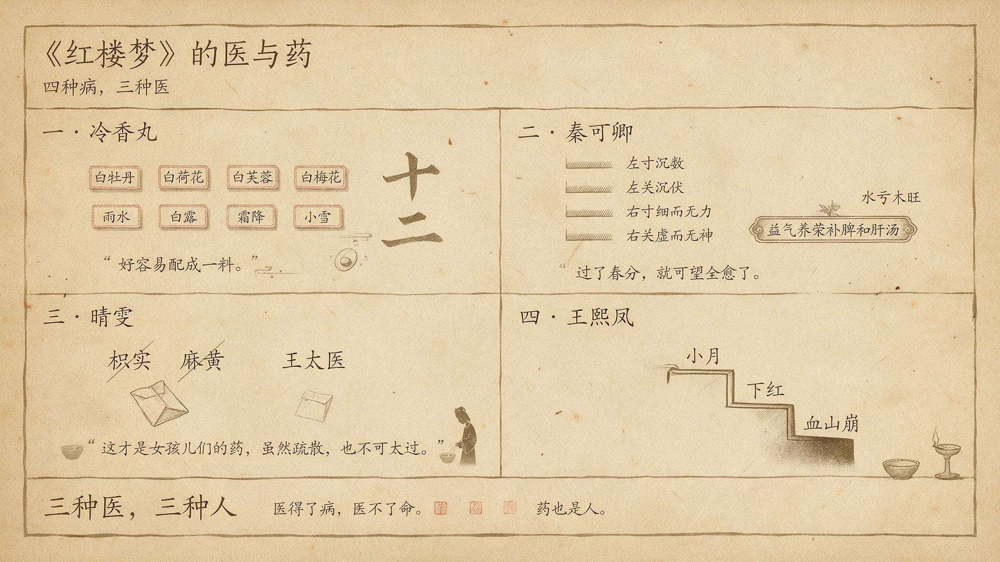

# 《紅樓夢》的醫與藥

> 簡體版：[《紅樓夢》的醫與藥](https://github.com/j3ffyang/history/blob/main/docs/261014-hlm-medical-zh-hans.md)

《紅樓夢》裡生老病死是家常。藥與醫，是書裡暗暗鋪開的另一條線。從一味要湊天時的冷香丸，到一次最精密的診脈，再到一個少年替女孩兒擋下的狼虎藥，這條線一直在走。

## 一、寶釵的冷香丸：要湊天時的藥

第七回，寶釵跟周瑞家的說起自己的病。癩頭和尚說她"從胎裡帶來的一股熱毒"，給了一個海上方，叫冷香丸。

> 要春天開的白牡丹花蕊十二兩，夏天開的白荷花蕊十二兩，秋天的白芙蓉蕊十二兩，冬天的白梅花蕊十二兩。將這四樣花蕊，於次年春分這日曬乾，和在藥末子一處，一齊研好。又要雨水這日的雨水十二錢──白露這日的露水十二錢，霜降這日的霜十二錢，小雪這日的雪十二錢。把這四樣水調勻，和了藥，再加十二錢蜂蜜，十二錢白糖，丸了龍眼大的丸子，盛在舊磁壇內，埋在花根底下。若發了病時，拿出來吃一丸，用十二分黃柏煎湯送下。（第七回）

方子不難懂，難的是湊齊。寶釵說，"一二年間可巧都得了，好容易配成一料"。這個"可巧"很要緊。四季的花，四個節氣的水，缺一樣都配不齊，要等天時正好湊在一起。

這味藥是自然的，不是爐子裡煉出來的。它不能買，只能等。所以冷香丸像一種時間的記號，記著一年四季，也記著一個人要過多少日子，才能把這一料湊齊。

## 二、秦可卿的病：最精密的一次診斷

第十回，尤氏跟別人說起秦可卿的病。

> 他這些日子不知怎麼著，經期有兩個多月沒來。叫大夫瞧了，又說並不是喜。（第十回）

尤氏又說，請來的大夫都是"聽著人的口氣兒"，人怎麼說，他也添幾句文話兒說一遍。直到張友士來了，才有人真的看出問題。

> 這病就是打這個秉性上頭思慮出來的。（第十回）

張友士診完脈，說的是：

> 看得尊夫人這脈息：左寸沉數，左關沉伏，右寸細而無力，右關虛而無神。其左寸沉數者，乃心氣虛而生火，左關沉伏者，乃肝家氣滯血虧。右寸細而無力者，乃肺經氣分太虛，右關虛而無神者，乃脾土被肝木克制。（第十回）

他斷為"水虧木旺"，又說"這病尚有三分治得"。他開的方子是益氣養榮補脾和肝湯。

> 益氣養榮補脾和肝湯：人參二錢、白朮二錢、土炒雲苓三錢、熟地四錢、歸身二錢、酒洗白芍二錢、炒川芎錢半、黃苓三錢、香附米二錢、製醋柴胡八分、懷山藥二錢、炒真阿膠二錢、蛤粉炒延胡索錢半、酒炒炙甘草八分，引用建蓮子七粒去心、紅棗二枚。（第十回）

張友士還留了一句判語：

> 今年一冬是不相干的。總是過了春分，就可望全愈了。（第十回）

診斷很準，命卻不準。"過了春分"的話，和秦可卿之後的結局，讀起來是一個反諷。

### 方裡有什麼（讀者分析）

張友士的方子，書裡只列了藥和分量，沒有寫每味藥在方裡做什麼。下面的歸類是讀者的歸納，不是正文的說法。歸類也不是逐條對照藥典，只是把藥按作用粗略分組：

| 歸類 | 藥 | 對應脈案所見 |
|---|---|---|
| 補氣健脾 | 人參2錢、白朮2錢、土炒雲苓3錢、懷山藥2錢、炙甘草8分 | 肺氣太虛、脾土被肝木克制 |
| 養血 | 熟地4錢、歸身2錢、酒洗白芍2錢、炒真阿膠2錢 | 肝家血虧 |
| 行氣疏肝 | 製醋柴胡8分、香附米2錢、炒川芎1錢半、蛤粉炒延胡索1錢半 | 肝家氣滯 |
| 清熱 | 黃苓3錢 | 心氣虛而生火 |
| 調和引導 | 炙甘草、建蓮子7粒、紅棗2枚 | 調和 |

從這張表可以看出幾點。第一，方子的每一組藥，都能在脈案裡找到對應的病。第二，補藥佔的分量最多，熟地用了4錢，是一味藥裡分量最重的。第三，書裡寫明了炮製方法，如土炒、酒洗、醋製、酒炒，但每種炮製對藥性有什麼影響，書裡沒有說。

這些藥和脈案的對應，是讀者歸納出來的。書裡沒有說每味藥是君、臣、佐、使，這裡也只作參考。君臣佐使是中醫方劑學的組方概念，見人民日報海外版的介紹，也見南京中醫藥大學學報的研究。

## 三、晴雯的藥：誰替女兒家擋下狼虎藥

第五十一回，回目是"胡庸醫亂用虎狼藥"。晴雯夜裡受寒，請來一個生大夫。大夫的方子上有紫蘇、桔梗、防風、荊芥，後面又有枳實、麻黃。寶玉看了，急了：

> 該死，該死，他拿著女孩兒們也象我們一樣的治，如何使得！憑他有什麼內滯，這枳實，麻黃如何禁得。（第五十一回）

後來另請王太醫來看。王太醫的方子裡果然沒有枳實、麻黃，藥的分量也比先前輕了些。寶玉喜道：

> 這才是女孩兒們的藥，雖然疏散，也不可太過。（第五十一回）

寶玉又說，自己小時候病了，大夫也說他"禁不起麻黃，石膏，枳實等狼虎藥"，把女兒家比作"才開的白海棠"。他還說：

> 藥氣比一切的花香果子香都雅。（第五十一回）

正文寫的是"狼虎藥"，回目寫的是"虎狼藥"，兩處並存，引用時要分清。

## 四、王熙鳳的病：醫不了的強人

王熙鳳是全書最能幹的人，她的病卻一直拖著。第五十五回，她小產了：

> 剛將年事忙過，鳳姐兒便小月了，在家一月，不能理事，天天兩三個太醫用藥。（第五十五回）

她自恃強壯，還是要管事。一個月之後，又添了下紅的症。

> 一月之後，復添了下紅之症。他雖不肯說出來，眾人看他面目黃瘦，便知失於調養。（第五十五回）

第七十二回，平兒跟鴛鴦說起鳳姐的病，話裡說她懶懶的已經有一個月了，又說鳳姐不肯請大夫。鴛鴦一聽，說"依你這話，這可不成了血山崩了"。這是丫鬟之間的私話，不是大夫的診斷。

> 他這懶懶的也不止今日了，這有一月之前便是這樣。（第七十二回）

## 餘論：三種醫，三種人

下面這些是我的讀法，不是書裡的原話。

**三種醫生。** 癩頭和尚的冷香丸，是象徵。張友士的脈案，是寫實，精密到每一句脈象。胡大夫的一方狼虎藥，是反諷：他治的是"人"，卻照著男人的方子來治女兒家。

**醫得了病，醫不了命。** 冷香丸能壓住熱毒，卻壓不住命運。張友士斷得準脈，卻斷不準生死。

**藥也是人。** 寶玉替女孩兒擋下狼虎藥的那一節，把"醫"寫成了體貼。

**王熙鳳的病。** 她是全書最能幹的人，卻敗在病上。小產，下紅，一拖幾個月，書裡寫的是她不肯停下來。

寶釵的冷香丸和本文的其他幾例，也可以和《寶釵：藥·冷·自然》對照著讀。

## 引用來源

- 曹雪芹《紅樓夢》第七回，維基文庫：<https://zh.wikisource.org/wiki/%E7%B4%85%E6%A8%93%E5%A4%A2/%E7%AC%AC007%E5%9B%9E>
- 曹雪芹《紅樓夢》第十回，維基文庫：<https://zh.wikisource.org/wiki/%E7%B4%85%E6%A8%93%E5%A4%A2/%E7%AC%AC010%E5%9B%9E>
- 曹雪芹《紅樓夢》第五十一回，維基文庫：<https://zh.wikisource.org/wiki/%E7%B4%85%E6%A8%93%E5%A4%A2/%E7%AC%AC051%E5%9B%9E>
- 曹雪芹《紅樓夢》第五十五回，維基文庫：<https://zh.wikisource.org/wiki/%E7%B4%85%E6%A8%93%E5%A4%A2/%E7%AC%AC055%E5%9B%9E>
- 曹雪芹《紅樓夢》第七十二回，維基文庫：<https://zh.wikisource.org/wiki/%E7%B4%85%E6%A8%93%E5%A4%A2/%E7%AC%AC072%E5%9B%9E>
- 《君臣佐使》相關介紹，人民日報海外版，2016年4月8日：<http://paper.people.com.cn/rmrbhwb/html/2016-04/08/content_1668619.htm>
- 李飛《方劑君臣佐使中的君藥辨析》，南京中醫藥大學學報，2021：<https://xb.njucm.edu.cn/article/doi/10.14148/j.issn.1672-0482.2021.0481>
