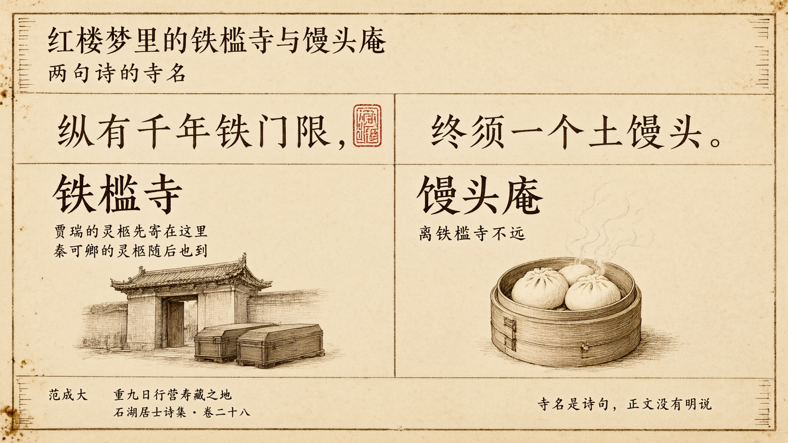

# 紅樓夢裡的鐵檻寺與饅頭庵：兩句詩的寺名

> 簡體版：[紅樓夢裡的鐵檻寺與饅頭庵：兩句詩的寺名](https://github.com/j3ffyang/history/blob/main/docs/261020-hlm-tiekan-mantou-zh-hans.md)

## 一、賈瑞的靈柩

讀者通常覺得賈瑞令人討厭，死時也很齷齪。他死後，靈柩寄在了鐵檻寺。

> 當下，代儒料理喪事，各處去報喪。三日起經，七日發引，寄靈於鐵檻寺，日後帶回原籍。（第十二回）

> 脂批（庚辰本，雙行夾批，第十二回）：所謂"鐵門限"事業。先安一開路道之人，以備秦氏仙柩有方也。

脂批把賈瑞的寄靈，和秦氏的靈柩連在了一起。鐵檻寺，先為秦氏"開路"。這是脂批的說法，正文沒有直接寫。

鐵檻寺原是寧榮二公當日修造的，以備京中老了人口，在此便宜寄放靈柩。第十五回說得很清楚：

> 原來這鐵檻寺原是寧榮二公當日修造，現今還是有香火地畝布施，以備京中老了人口，在此便宜寄放。其中陰陽兩宅俱已預備妥貼，好為送靈人口寄居。（第十五回）

## 二、秦可卿也到了鐵檻寺

書裡寫秦可卿"生的裊娜纖巧，行事又溫柔和平"，是"重孫媳中第一個得意之人"（第五回）。她死後的葬禮龐大隆重，靈柩也到了鐵檻寺。第十四回，賈珍先去看寄靈的地方：

> 那賈珍因見發引日近。親自坐車，帶了陰陽司吏，往鐵檻寺來踏看寄靈所在。（第十四回）
>
> 一面又派人先往鐵檻寺，連夜另外修飾停靈之處，並廚茶等項接靈人口坐落。（第十四回）

第十五回，送殯的隊伍出城，直奔鐵檻寺：

> 且說寧府送殯，一路熱鬧非常。……然後出城，竟奔鐵檻寺大路行來。（第十五回）

## 三、詩詞來源

第十五回，王熙鳳安排住處的地方，是饅頭庵。正文說：

> 原來這饅頭庵就是水月庵，因他廟裡做的饅頭好，就起了這個渾號，離鐵檻寺不遠。（第十五回）

甲戌本在這一句下有一條雙行夾批：

> 脂批（甲戌本，雙行夾批，第十五回）：前人詩云："縱有千年鐵門限，終須一個土饅頭。"是此意。故"不遠"二字有文章。

這樣，兩個寺名就都對上了：鐵檻寺的"鐵檻"，即批語所謂"鐵門限"；饅頭庵的"饅頭"，即"土饅頭"。兩句詩，正好做了兩座寺的名字。這是批語點出的讀法，正文沒有明說。

脂批說的"前人"，沒有寫出名字。我們查到這兩句詩的原作者是宋代范成大。范成大號石湖居士，《石湖居士詩集》卷二十八收有《重九日行營壽藏之地》，詩中這兩句是：

> 家山隨處可行楸，荷鍤攜壺似醉劉。縱有千年鐵門限，終須一個土饅頭。三輪世界猶灰劫，四大形骸強首丘。螻蟻烏鳶何厚薄，臨風拊掌菊花秋。（《石湖居士詩集》卷二十八）

《紅樓夢》正文裡，妙玉也常引這兩句。第六十三回，是邢岫煙向寶玉轉述她的話：

> 他常說："古人自漢晉五代唐宋以來皆無好詩，只有兩句好，說道：'縱有千年鐵門檻，終須一個土饅頭。'所以他自稱'檻外之人'。"（第六十三回）

這兩句在書裡出現兩次：一次是第十五回的脂批，一次是第六十三回的正文（邢岫煙轉述妙玉的話）。第六十三回作"門檻"，脂批與詩集作"門限"，用字不同；本文都照原文引用，不改字。

## 引用來源

- 曹雪芹《紅樓夢》第五回，維基文庫：<https://zh.wikisource.org/wiki/%E7%B4%85%E6%A8%93%E5%A4%A2/%E7%AC%AC005%E5%9B%9E>
- 曹雪芹《紅樓夢》第十二回，維基文庫：<https://zh.wikisource.org/wiki/%E7%B4%85%E6%A8%93%E5%A4%A2/%E7%AC%AC012%E5%9B%9E>
- 曹雪芹《紅樓夢》第十四回，維基文庫：<https://zh.wikisource.org/wiki/%E7%B4%85%E6%A8%93%E5%A4%A2/%E7%AC%AC014%E5%9B%9E>
- 曹雪芹《紅樓夢》第十五回，維基文庫：<https://zh.wikisource.org/wiki/%E7%B4%85%E6%A8%93%E5%A4%A2/%E7%AC%AC015%E5%9B%9E>
- 曹雪芹《紅樓夢》第六十三回，維基文庫：<https://zh.wikisource.org/wiki/%E7%B4%85%E6%A8%93%E5%A4%A2/%E7%AC%AC063%E5%9B%9E>
- 脂硯齋評《脂硯齋重評石頭記》第十二回（庚辰本），維基文庫：<https://zh.wikisource.org/wiki/%E8%84%82%E7%A1%AF%E9%BD%8B%E9%87%8D%E8%A9%95%E7%9F%B3%E9%A0%AD%E8%A8%98/%E7%AC%AC%E5%8D%81%E4%BA%8C%E5%9B%9E>
- 脂硯齋評《脂硯齋重評石頭記》第十五回（甲戌本），維基文庫：<https://zh.wikisource.org/wiki/%E8%84%82%E7%A1%AF%E9%BD%8B%E9%87%8D%E8%A9%95%E7%9F%B3%E9%A0%AD%E8%A8%98/%E7%AC%AC%E5%8D%81%E4%BA%94%E5%9B%9E>
- 范成大《石湖居士詩集》卷二十八（四部叢刊本），維基文庫：<https://zh.wikisource.org/wiki/%E7%9F%B3%E6%B9%96%E5%B1%85%E5%A3%AB%E8%A9%A9%E9%9B%86_%28%E5%9B%9B%E9%83%A8%E5%8F%A2%E5%88%8A%E6%9C%AC%29/%E5%8D%B7%E7%AC%AC%E4%BA%8C%E5%8D%81%E5%85%AB>

> 版本說明：引文據維基文庫轉錄的《紅樓夢》（脂本系統、程乙本）與《脂硯齋重評石頭記》脂批，只作繁簡轉寫，異體字隨文統一（如"箇"作"個"、"刦"作"劫"）；脂批的版本歸屬依維基文庫頁面標註，未核影印本。底本另有異文者，隨文注出。

本文是聽蔣勳《蔣勳細說紅樓夢》之後的感想記錄。
